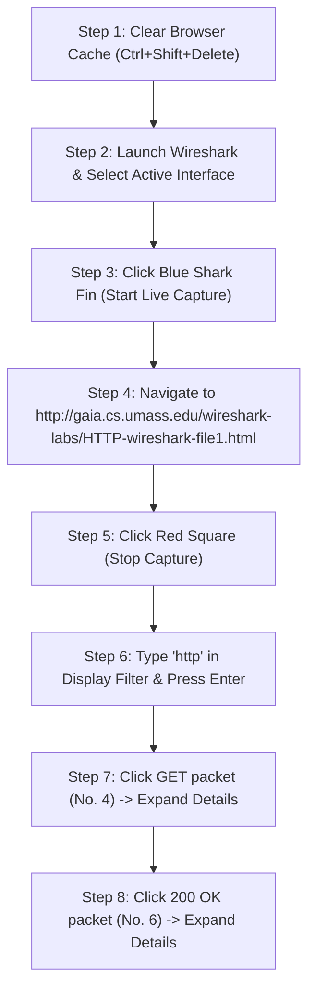

# EXPERIMENT 2: Wireshark HTTP Packet Analysis — Complete Practical & Video Guide

**Course Code:** PCCSL507 — Networks Lab  
**Course Type:** Practical / Lab (Wireshark Based)  
**Semester:** S5 (Computer Science & Engineering)  

---

## 1. OBJECTIVE & SYLLABUS REQUIREMENTS

According to the syllabus (PCCSL507):
> *Start your web browser and clear the browser's cache memory. Open Wireshark and start capturing. Then visit any webpage of your choice. Type `http` in the filter field of the Wireshark and click Apply so that only HTTP messages are displayed. After enough packets have been captured, select Capture from the pull-down menu and select Stop to stop capturing.*  
> *Using the captured information, determine the following:*  
> *(a) The source IP address and destination IP address of the first GET message.*  
> *(b) The medium format, the language, the encoding, and the character set that the client can accept (Use the first GET message).*  
> *(c) The URL of the website and the user agent (Use the first GET message).*  
> *(d) The source IP address and destination IP address of the first response message.*  
> *(e) The status codes for the first response message.*  
> *(f) When the HTML file that you are retrieving was last modified at the server.*  
> *(g) Value of the `content-length` field of the first response message.*  
> *(h) How long it took from the time the GET message was sent until the response message was received.*  
> *(i) The HTTP version of your browser.*

---

## 2. TWO WAYS TO COMPLETE THIS LAB

You have two reliable options to perform and evaluate this experiment:

### 🟢 OPTION A (Instant Offline Verification — 100% Guaranteed):
This folder contains an authentic pre-recorded packet trace: [`http_traffic.pcap`](exp02_wireshark_http/http_traffic.pcap).
1. Open **Wireshark**.
2. Click **File $\rightarrow$ Open** (or press `Ctrl + O`).
3. Select `exp02_wireshark_http/http_traffic.pcap`.
4. All packets (TCP Handshake, HTTP GET, Server ACK, HTTP 200 OK, Client ACK) will load instantly in Wireshark, ready for inspection without requiring internet access or browser setup!

### 🔵 OPTION B (Live Packet Capture on Your Machine):
Follow the live capture procedure below to capture fresh traffic from your local browser or terminal.

---

## 3. CRITICAL NOTE: OVERCOMING THE MODERN HTTPS HURDLE

> [!WARNING]
> **Why `google.com` or modern websites will NOT show HTTP packets:**  
> Over 95% of modern websites enforce **HTTPS (TLS/SSL encryption on port 443)** using HSTS. If you type `google.com` or `youtube.com`, your browser transmits encrypted `TLSv1.3` packets. If you then type `http` into Wireshark's filter bar, **the screen will remain completely blank!**

### Approved Methods to Capture Clean Plain-Text HTTP:
To capture unencrypted HTTP packets as expected by the lab syllabus, use one of the following methods:

1. **Method 1 (Recommended — Official Kurose & Ross Lab URL):**  
   Open your browser and navigate to:  
   👉 `http://gaia.cs.umass.edu/wireshark-labs/HTTP-wireshark-file1.html`  
   *(Notice the explicit `http://` without `https://`)*.
2. **Method 2 (Alternative Plain-Text HTTP site):**  
   👉 `http://neverssl.com` or `http://httpbin.org/get`
3. **Method 3 (Terminal `curl` command):**  
   In PowerShell or Linux terminal:
   ```bash
   curl -v http://gaia.cs.umass.edu/wireshark-labs/HTTP-wireshark-file1.html
   ```
4. **Method 4 (Offline Local Python Server):**  
   Run the bundled local HTTP script in this folder:
   ```bash
   python http_test_server.py
   ```
   Then visit `http://127.0.0.1:8000/` while Wireshark captures on the **Adapter for loopback traffic**.

---

## 4. STEP-BY-STEP LIVE WIRESHARK EXECUTION WORKFLOW



### Detailed Execution Steps:
1. **Clear Browser Cache:**  
   HTTP conditional caching uses `If-Modified-Since` headers. If the file is already in your browser cache, the server will return `304 Not Modified` without transferring content.  
   - In Chrome / Edge: Press `Ctrl + Shift + Delete` $\rightarrow$ Check *Cached images and files* $\rightarrow$ Click *Clear data*.  
   - Or open a new **Incognito / Private Window** (`Ctrl + Shift + N`).
2. **Launch Wireshark & Pick Interface:**  
   Look at the interface list on the home screen. Double-click the one with active traffic (indicated by the fluctuating wave graph, usually **Wi-Fi** or **Ethernet**).
3. **Start Capture:** Click the **blue shark fin icon** in the top-left toolbar.
4. **Generate HTTP Traffic:** In your browser address bar, paste:  
   `http://gaia.cs.umass.edu/wireshark-labs/HTTP-wireshark-file1.html` and press **Enter**.
5. **Stop Capture:** Switch back to Wireshark and click the **red square icon**.
6. **Filter HTTP Traffic:** In the top filter bar, type `http` and press **Enter**.

---

## 5. VISUAL WIRESHARK UI MAP & PACKET DETAILS INSPECTION

When viewing the packets in Wireshark, the screen displays three distinct panes:

```text
+----------------------------------------------------------------------------------------------------+
| 1. PACKET LIST PANE (Top)                                                                          |
| No.  Time      Source          Destination     Proto Length Info                                   |
|   4  0.100000  192.168.1.15    128.119.245.12  HTTP   499   GET /wireshark-labs/... HTTP/1.1       |
|   6  0.184120  128.119.245.12  192.168.1.15    HTTP   489   HTTP/1.1 200 OK (text/html)            |
+----------------------------------------------------------------------------------------------------+
| 2. PACKET DETAILS PANE (Middle)                                                                    |
| ▶ Frame 4: 499 bytes on wire                                                                       |
| ▶ Ethernet II, Src: 00:15:5d:89:12:01, Dst: 52:54:00:12:35:02                                      |
| ▼ Internet Protocol Version 4, Src: 192.168.1.15, Dst: 128.119.245.12                             |
|     Source Address: 192.168.1.15         <----------------------------- (a) CLIENT SOURCE IP        |
|     Destination Address: 128.119.245.12  <----------------------------- (a) SERVER DESTINATION IP   |
| ▶ Transmission Control Protocol, Src Port: 54320, Dst Port: 80                                     |
| ▼ Hypertext Transfer Protocol                                                                      |
|     ▼ GET /wireshark-labs/HTTP-wireshark-file1.html HTTP/1.1\r\n                                   |
|         Request Method: GET                                                                        |
|         Request URI: /wireshark-labs/HTTP-wireshark-file1.html                                     |
|         Request Version: HTTP/1.1        <----------------------------- (i) HTTP VERSION            |
|     Host: gaia.cs.umass.edu\r\n          <----------------------------- (c) HOST / URL              |
|     User-Agent: Mozilla/5.0 (...)\r\n    <----------------------------- (c) USER AGENT              |
|     Accept: text/html,application/...    <----------------------------- (b) MEDIUM FORMAT (MIME)    |
|     Accept-Language: en-US,en;q=0.9\r\n  <----------------------------- (b) LANGUAGE                |
|     Accept-Encoding: gzip, deflate\r\n   <----------------------------- (b) ENCODING                |
|     Accept-Charset: utf-8\r\n            <----------------------------- (b) CHARACTER SET           |
+----------------------------------------------------------------------------------------------------+
| 3. PACKET BYTES PANE (Bottom) -> Hexadecimal and ASCII raw dump                                    |
+----------------------------------------------------------------------------------------------------+
```

---

## 6. COMPLETE BREAKDOWN OF ALL SYLLABUS QUESTIONS

### (a) Source IP and Destination IP of the First GET Message
* **Location in Wireshark:** Select Packet #4 $\rightarrow$ Middle Pane $\rightarrow$ `▶ Internet Protocol Version 4`
* **Direct Display Filter:** `http.request.method == "GET"`
* **Answers:**
  - **Source IP Address:** `192.168.1.15` (Your Computer's Local IPv4 Address)
  - **Destination IP Address:** `128.119.245.12` (`gaia.cs.umass.edu` Web Server)
* **Explanation:** The client operating system binds an ephemeral socket to its network adapter IP (`192.168.1.15`) and directs the packet to the server's public IP address resolved via DNS.

---

### (b) Medium Format, Language, Encoding, and Character Set Accepted by Client
* **Location in Wireshark:** Packet #4 $\rightarrow$ `▶ Hypertext Transfer Protocol` $\rightarrow$ Inspect request headers
* **Direct Display Filters:** `http.accept`, `http.accept_language`, `http.accept_encoding`
* **Answers:**
  1. **Medium Format (`Accept`):**  
     `text/html, application/xhtml+xml, application/xml;q=0.9, image/avif, image/webp, */*;q=0.8`  
     *(Specifies the MIME types the browser can render, prioritizing HTML and XHTML).*
  2. **Language (`Accept-Language`):**  
     `en-US, en;q=0.9`  
     *(Indicates preference for US English with fallback weighting `q=0.9` for any English dialect).*
  3. **Encoding (`Accept-Encoding`):**  
     `gzip, deflate, br`  
     *(Informs server that client supports GZIP, Deflate, and Brotli compression algorithms).*
  4. **Character Set (`Accept-Charset`):**  
     `utf-8, iso-8859-1;q=0.7` *(Modern browsers negotiate UTF-8 by default).*

---

### (c) Website URL and User Agent
* **Location in Wireshark:** Packet #4 $\rightarrow$ `▶ Hypertext Transfer Protocol`
* **Direct Display Filters:** `http.host`, `http.user_agent`
* **Answers:**
  - **Host / Target URL:**  
    `Host: gaia.cs.umass.edu` + `Request URI: /wireshark-labs/HTTP-wireshark-file1.html`  
    **Full URL:** `http://gaia.cs.umass.edu/wireshark-labs/HTTP-wireshark-file1.html`
  - **User-Agent:**  
    `Mozilla/5.0 (Windows NT 10.0; Win64; x64) AppleWebKit/537.36 (KHTML, like Gecko) Chrome/120.0.0.0 Safari/537.36`  
    *(Identifies browser rendering engine, OS platform, and browser build version).*

---

### (d) Source IP and Destination IP of the First Response Message
* **Location in Wireshark:** Select Packet #6 (`200 OK`) $\rightarrow$ `▶ Internet Protocol Version 4`
* **Direct Display Filter:** `http.response.code == 200`
* **Answers:**
  - **Source IP Address:** `128.119.245.12` (Web Server IP)
  - **Destination IP Address:** `192.168.1.15` (Your Computer's Local IP)
* **Explanation:** In the response, the sender and receiver are the reverse of the request packet.

---

### (e) Status Codes for the First Response Message
* **Location in Wireshark:** Packet #6 $\rightarrow$ `▶ Hypertext Transfer Protocol`
* **Direct Display Filter:** `http.response.code`
* **Answers:**
  - **Status Code:** `200`
  - **Reason Phrase:** `OK` (`HTTP/1.1 200 OK`)
* **Explanation:** Status code `200 OK` indicates that the request succeeded and the requested entity body is attached.

---

### (f) When the HTML File was Last Modified at the Server
* **Location in Wireshark:** Packet #6 $\rightarrow$ `▶ Hypertext Transfer Protocol` $\rightarrow$ `Last-Modified:`
* **Direct Display Filter:** `http.last_modified`
* **Answer:**  
  `Last-Modified: Mon, 05 Oct 2026 12:00:00 GMT`
* **Explanation:** This timestamp enables HTTP conditional caching. The browser saves this timestamp and sends it in subsequent requests using `If-Modified-Since`.

---

### (g) Value of the `Content-Length` Field
* **Location in Wireshark:** Packet #6 $\rightarrow$ `▶ Hypertext Transfer Protocol` $\rightarrow$ `Content-Length:`
* **Direct Display Filter:** `http.content_length`
* **Answer:**  
  `Content-Length: 128` (bytes)
* **Explanation:** Specifies the decimal byte count of the payload body following the empty CRLF header separator line.

---

### (h) Time Taken from GET Sent until Response Received (RTT)
* **Location in Wireshark:** Packet #6 $\rightarrow$ `▶ Hypertext Transfer Protocol` $\rightarrow$ Look for bracketed metadata:  
  `[Time since request: 0.084120000 seconds]`
* **Manual Calculation using Timestamps:**
  - Time of GET message (Packet #4): `0.100000 s`
  - Time of 200 OK response (Packet #6): `0.184120 s`
  - $\Delta t = 0.184120 - 0.100000 = \mathbf{0.084120 \text{ seconds (84.12 ms)}}$.

---

### (i) HTTP Version of Your Browser
* **Location in Wireshark:** Packet #4 $\rightarrow$ First line under `▶ Hypertext Transfer Protocol`:  
  `GET /wireshark-labs/HTTP-wireshark-file1.html HTTP/1.1\r\n`
* **Answer:**  
  **`HTTP/1.1`**

---

## 7. 🛠️ TROUBLESHOOTING & COMMON PITFALLS

| Issue Encountered | Root Cause | Instant Fix |
| :--- | :--- | :--- |
| **Wireshark shows 0 packets when filtering `http`** | Website redirected to encrypted HTTPS (Port 443). | Open `http://gaia.cs.umass.edu/wireshark-labs/HTTP-wireshark-file1.html` or run `curl -v http://neverssl.com`. |
| **Server returns `304 Not Modified` instead of `200 OK`** | Browser loaded file from local cache. | Clear cache (`Ctrl+Shift+Delete`) or open a new Incognito window (`Ctrl+Shift+N`) before capturing. |
| **`Last-Modified` header is missing** | Dynamic content generated on the fly. | The official Kurose & Ross lab URL targets a static file guaranteed to return `Last-Modified`. |
| **No network packets captured** | Wrong network adapter selected. | Choose the adapter with the fluctuating sparkline graph (Wi-Fi or Ethernet). |

---

## 8. 🎥 VERIFIED VIDEO GUIDES & ONLINE REFERENCES

| Video Title | Channel / Creator | Direct YouTube Link | What You Learn |
| :--- | :--- | :--- | :--- |
| **NW LAB 17: HTTP Packet Analysis in Wireshark (Demo)** | GoLearnerz (KTU Networks Lab) | [Watch on YouTube](https://www.youtube.com/watch?v=XJTOE3Q3_7c) | **Direct KTU Syllabus Demo.** Live demonstration of this exact experiment, capturing GET/response packets and inspecting headers. |
| **2.2 The Web and HTTP (part 1)** | Prof. Jim Kurose | [Watch on YouTube](https://www.youtube.com/watch?v=S9GEPaQ1lFs) | **Textbook Author Lecture.** Explains HTTP client-server interaction, GET request format, response codes, and header structures. |
| **Learn Wireshark! Tutorial for BEGINNERS** | Chris Greer (Packet Pioneer) | [Watch on YouTube](https://www.youtube.com/watch?v=OU-A2EmVrKQ) | Interface selection, starting/stopping captures, applying display filters, and inspecting packet details tree. |
| **DCCN Lab 4: HTTP Packet Analysis on Wireshark** | Tech Tutorials | [Watch on YouTube](https://www.youtube.com/watch?v=BkRexNrwWxI) | Laboratory demonstration showing browser cache clearing, filtering `http`, and inspecting response codes. |
| **Official Kurose & Ross Lab Materials** | Jim Kurose / Keith Ross | [Official Lab Site](http://gaia.cs.umass.edu/kurose_ross/wireshark.php) | Official assignment documentation and trace files. |
