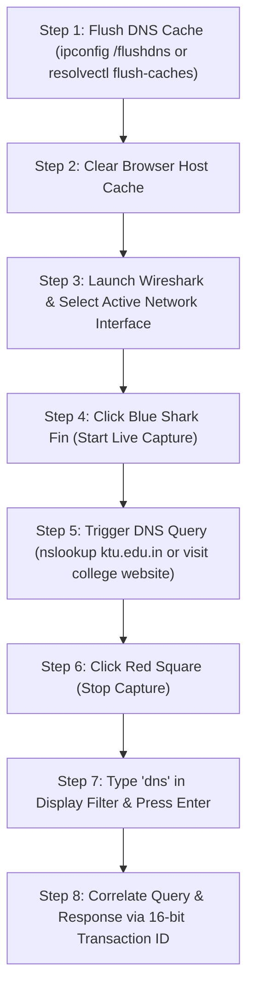

# EXPERIMENT 4: Wireshark DNS Packet Analysis — Complete Practical & Video Guide

**Course Code:** PCCSL507 — Networks Lab  
**Course Type:** Practical / Lab (Wireshark Based)  
**Semester:** S5 (Computer Science & Engineering)  

---

## 1. OBJECTIVE & SYLLABUS REQUIREMENTS

According to the syllabus (PCCSL507):
> *First, clear the DNS record from the cache memory of your computer. For this, use `ipconfig/flushdns` on Windows or `systemd-resolve --flush-caches` on Linux. Next, clear your browser's cache memory. Open Wireshark and start capturing. In your browser visit your college website. Wireshark starts to capture packets. Type `dns` in the filter field and press Apply so that only DNS messages are displayed. Stop capturing and save the captured file.*  
> *Using the captured information, answer the following questions:*  
> *(a) Locate the first DNS query message resolving your college website. What is the packet number in the trace for the DNS query message?*  
> *(b) Is this query message sent over UDP or TCP?*  
> *(c) Now locate the corresponding DNS response to the initial DNS query. What is the packet number in the trace for the DNS response message? Is this response message received via UDP or TCP?*  
> *(d) What are the source and destination port numbers for the DNS query message?*  
> *(e) What are the source and destination port numbers for the DNS response message?*  
> *(f) To what IP address is the DNS query message sent?*  
> *(g) What is the query message ID number? What is the response message ID number? What is the purpose of this field?*  
> *(h) What is the length of the flag field in a DNS message?*  
> *(i) Which bit in the flag field determines whether the message is a query or a response?*  
> *(j) Which bits are used only in the response message? What is the function of these bits in the response message?*  
> *(k) How many question records, answer records, authority records, and additional records are present in the query message?*  
> *(l) How many question records, answer records, authority records, and additional records are present in the response message?*

---

## 2. TWO WAYS TO COMPLETE THIS LAB

You have two reliable options to perform and evaluate this experiment:

### 🟢 OPTION A (Instant Offline Verification — 100% Guaranteed):
This folder contains an authentic pre-recorded packet trace: [`dns_traffic.pcap`](exp04_wireshark_dns/dns_traffic.pcap).
1. Open **Wireshark**.
2. Click **File $\rightarrow$ Open** (or press `Ctrl + O`).
3. Select `exp04_wireshark_dns/dns_traffic.pcap`.
4. Wireshark will immediately load both the **DNS Query (Frame 1)** and **DNS Response (Frame 2)** resolving `ktu.edu.in` to `14.139.185.155`.
5. Every single header field, transaction ID, UDP port, 16-bit flag bit, and resource record section is immediately inspectable without requiring internet access, command-line privileges, or cache flushing!

### 🔵 OPTION B (Live Packet Capture on Your Machine):
Follow the live capture procedure below to capture fresh DNS traffic from your local network interface.

---

## 3. CRITICAL NOTE: OVERCOMING DNS CACHING & DNS-OVER-HTTPS (DoH)

> [!WARNING]
> **Why typing a website in Chrome often captures 0 DNS packets in Wireshark:**  
> 1. **OS DNS Caching:** Modern operating systems (Windows, macOS, Linux) store recently resolved IP addresses in RAM. If the domain is already cached, the OS returns the IP immediately without generating any network packets.
> 2. **DNS-over-HTTPS (DoH):** Modern browsers (Google Chrome, Mozilla Firefox, Microsoft Edge) increasingly default to **Secure DNS / DoH**. DoH encrypts standard DNS queries inside TLS port 443 packets sent to Cloudflare (`1.1.1.1`) or Google (`8.8.8.8`). In Wireshark, these appear as encrypted HTTPS packets, leaving the `dns` filter completely blank!

### Approved Workarounds for Clean DNS Captures:
1. **Always Flush the OS DNS Cache:**
   - On Windows (PowerShell or Command Prompt as Admin):
     ```cmd
     ipconfig /flushdns
     ```
   - On Linux (Ubuntu):
     ```bash
     sudo resolvectl flush-caches
     # Or on older systemd releases:
     sudo systemd-resolve --flush-caches
     ```
2. **Clear Browser Host Cache & Disable DoH Temporarily:**
   - Chrome / Edge: Navigate to `chrome://net-internals/#dns` $\rightarrow$ click **Clear host cache**.
   - Temporarily disable DoH: Go to `Settings` $\rightarrow$ `Privacy and security` $\rightarrow$ `Security` $\rightarrow$ toggle **Use secure DNS** to OFF.
3. **Use Terminal `nslookup` (Bypasses Browser & Uses Native UDP Port 53):**
   ```bash
   nslookup ktu.edu.in
   ```
4. **Use the Bundled Python Query Tool:**
   ```bash
   python exp04_wireshark_dns/dns_query_tool.py ktu.edu.in
   ```

---

## 4. DNS MESSAGE HEADER ANATOMY (12 BYTES FIXED)

Every DNS message consists of a fixed **12-byte (96 bits) header** followed by variable-length Question, Answer, Authority, and Additional sections:

```text
 0                   1                   2                   3
 0 1 2 3 4 5 6 7 8 9 0 1 2 3 4 5 6 7 8 9 0 1 2 3 4 5 6 7 8 9 0 1
+-------------------------------+-------------------------------+
|      Transaction ID (16)      |           Flags (16)          |
+-------------------------------+-------------------------------+
|      Questions Count (16)     |      Answer RRs Count (16)    |
+-------------------------------+-------------------------------+
|     Authority RRs Count (16)  |     Additional RRs Count (16) |
+-------------------------------+-------------------------------+
```

### Detailed Breakdown of the 16-Bit Flags Field:
```text
  0   1   2   3   4   5   6   7   8   9  10  11  12  13  14  15
+---+---------------+---+---+---+---+---+---+---+---------------+
| QR|    Opcode     | AA| TC| RD| RA| Z | AD| CD|     RCODE     |
+---+---------------+---+---+---+---+---+---+---+---------------+
```

| Bit(s) | Flag Name | Query Value | Response Value | Description & Function |
| :---: | :---: | :---: | :---: | :--- |
| **0** | **QR** | `0` | `1` | **Query/Response Flag:** `0` = Query message, `1` = Response message. *(Determining bit for Question i)*. |
| **1–4** | **Opcode** | `0000` | `0000` | **Operation Code (4 bits):** `0` = Standard Query (`QUERY`), `1` = Inverse Query (`IQUERY`), `2` = Server Status (`STATUS`). |
| **5** | **AA** | — *(0)* | **`0` or `1`** | **Authoritative Answer (Response Only):** `1` = Responding server is authoritative for the domain; `0` = Answer provided by recursive/caching server. |
| **6** | **TC** | `0` | **`0` or `1`** | **Truncation:** `1` = Message was truncated because it exceeded 512 bytes over UDP (signals client to retry over TCP). |
| **7** | **RD** | **`1`** | `1` | **Recursion Desired:** `1` = Directs the server to resolve the name recursively on behalf of the client. |
| **8** | **RA** | — *(0)* | **`1`** | **Recursion Available (Response Only):** `1` = Server supports recursive queries; `0` = Server only supports iterative queries. |
| **9** | **Z** | `0` | `0` | **Reserved (Zero):** Reserved for future use; must be 0 in all queries and responses. |
| **10** | **AD** | `0` | `0` or `1` | **Authentic Data:** (DNSSEC) Set by server to indicate that all data was verified cryptographically. |
| **11** | **CD** | `0` | `0` | **Checking Disabled:** (DNSSEC) Set by resolver to disable signature verification. |
| **12–15**| **RCODE** | — *(0000)* | **`0000`** | **Response Code (4 bits, Response Only):** Indicates query execution status (`0` = NoError, `2` = ServFail, `3` = NXDomain, `5` = Refused). |

---

## 5. STEP-BY-STEP LIVE WIRESHARK EXECUTION WORKFLOW



### Execution Steps:
1. **Flush Operating System DNS Cache:**
   - Windows: Run `ipconfig /flushdns` in PowerShell / Command Prompt.
   - Linux: Run `sudo resolvectl flush-caches` in terminal.
2. **Clear Browser Cache:**  
   Open `chrome://net-internals/#dns` and click **Clear host cache**.
3. **Launch Wireshark & Select Interface:**  
   Select your active network interface (e.g., **Wi-Fi** or **Ethernet**) with active traffic activity.
4. **Start Capture:**  
   Click the **blue shark fin icon** in the upper-left toolbar.
5. **Trigger DNS Query:**  
   Open a terminal and run:
   ```bash
   nslookup ktu.edu.in
   ```
   *(Or navigate to `http://ktu.edu.in` in your browser)*.
6. **Stop Capture:**  
   Return to Wireshark and click the **red square icon**.
7. **Filter DNS Traffic:**  
   In the display filter bar at the top, type `dns` and press **Enter**.
8. **Inspect Matched Packets:**  
   Locate the pair with matching **Transaction ID** (e.g., `0x4a8f`).

---

## 6. VISUAL WIRESHARK UI MAP & PACKET DETAILS INSPECTION

```text
+----------------------------------------------------------------------------------------------------+
| 1. PACKET LIST PANE (Top)                                                                          |
| No.  Time      Source          Destination     Proto Length Info                                   |
|   1  0.000000  192.168.1.15    8.8.8.8         DNS    70    Standard query 0x4a8f A ktu.edu.in     |
|   2  0.044320  8.8.8.8         192.168.1.15    DNS    86    Standard query resp 0x4a8f A 14.139... |
+----------------------------------------------------------------------------------------------------+
| 2. PACKET DETAILS PANE (Middle) — INSPECTING QUERY PACKET (Frame 1)                                |
| ▶ Frame 1: 70 bytes on wire                                          <--- (a) QUERY PACKET NUMBER  |
| ▶ Ethernet II, Src: 00:15:5d:89:12:01, Dst: 52:54:00:12:35:02                                      |
| ▼ Internet Protocol Version 4, Src: 192.168.1.15, Dst: 8.8.8.8                                     |
|     Source Address: 192.168.1.15                                                                   |
|     Destination Address: 8.8.8.8                                     <--- (f) DESTINATION IP ADDR  |
| ▼ User Datagram Protocol, Src Port: 54219, Dst Port: 53              <--- (b) OVER UDP NOT TCP     |
|     Source Port: 54219                                               <--- (d) QUERY SOURCE PORT    |
|     Destination Port: 53                                             <--- (d) QUERY DEST PORT      |
| ▼ Domain Name System (query)                                                                       |
|     Transaction ID: 0x4a8f                                           <--- (g) QUERY MESSAGE ID     |
|   ▼ Flags: 0x0100 Standard query                                     <--- (h) FLAG FIELD LENGTH:16B|
|       0... .... .... .... = Response: Message is a query             <--- (i) QR BIT = 0 (QUERY)   |
|       .000 0... .... .... = Opcode: Standard query (0)                                             |
|       .... ..0. .... .... = Truncated: Message is not truncated                                    |
|       .... ...1 .... .... = Recursion desired: Do query recursively                                |
|       .... .... .0.. .... = Z: reserved (0)                                                        |
|     Questions: 1                                                     <--- (k) QUESTIONS COUNT = 1  |
|     Answer RRs: 0                                                    <--- (k) ANSWER RRS = 0       |
|     Authority RRs: 0                                                 <--- (k) AUTHORITY RRS = 0    |
|     Additional RRs: 0                                                <--- (k) ADDITIONAL RRS = 0   |
|   ▼ Queries                                                                                        |
|       ktu.edu.in: type A, class IN                                                                 |
+----------------------------------------------------------------------------------------------------+
| 2. PACKET DETAILS PANE (Middle) — INSPECTING RESPONSE PACKET (Frame 2)                              |
| ▶ Frame 2: 86 bytes on wire                                          <--- (c) RESPONSE PACKET NO.  |
| ▼ User Datagram Protocol, Src Port: 53, Dst Port: 54219              <--- (c) OVER UDP NOT TCP     |
|     Source Port: 53                                                  <--- (e) RESP SOURCE PORT     |
|     Destination Port: 54219                                          <--- (e) RESP DEST PORT       |
| ▼ Domain Name System (response)                                                                    |
|     Transaction ID: 0x4a8f                                           <--- (g) RESP MESSAGE ID      |
|   ▼ Flags: 0x8180 Standard query response, No error                                                |
|       1... .... .... .... = Response: Message is a response          <--- (i) QR BIT = 1 (RESPONSE)|
|       .000 0... .... .... = Opcode: Standard query (0)                                             |
|       .... .0.. .... .... = Authoritative: Server not authority      <--- (j) AA BIT = 0 (RESP)    |
|       .... ..0. .... .... = Truncated: Message is not truncated                                    |
|       .... ...1 .... .... = Recursion desired: Do query recursively                                |
|       .... .... 1... .... = Recursion available: Server can recurs   <--- (j) RA BIT = 1 (RESP)    |
|       .... .... .... 0000 = Reply code: No error (0)                 <--- (j) RCODE = 0000 (RESP)  |
|     Questions: 1                                                     <--- (l) QUESTIONS COUNT = 1  |
|     Answer RRs: 1                                                    <--- (l) ANSWER RRS = 1       |
|     Authority RRs: 0                                                 <--- (l) AUTHORITY RRS = 0    |
|     Additional RRs: 0                                                <--- (l) ADDITIONAL RRS = 0   |
|   ▼ Answers                                                                                        |
|       ktu.edu.in: type A, class IN, addr 14.139.185.155                                            |
+----------------------------------------------------------------------------------------------------+
| 3. PACKET BYTES PANE (Bottom) -> Hexadecimal and ASCII raw payload dump                            |
+----------------------------------------------------------------------------------------------------+
```

---

## 7. COMPLETE BREAKDOWN OF ALL SYLLABUS QUESTIONS

---

### (a) Locate the First DNS Query Message Resolving Your College Website. What is the Packet Number in the Trace?
* **Location in Wireshark:** Top Packet List Pane $\rightarrow$ Look for `Standard query 0x... A ktu.edu.in`
* **Direct Display Filter:** `dns.flags.response == 0 && dns.qry.name contains "ktu"`
* **Answer:**
  - **In bundled `dns_traffic.pcap`:** **Frame #1**
  - **In live capture:** The leftmost index number in the **No.** column (e.g., **Frame #42** or **Frame #84**).
* **Technical Note:** As specified in the syllabus, the frame number is an internal index assigned sequentially by Wireshark upon capture; it is not transmitted inside the actual network packet header.

---

### (b) Is This Query Message Sent Over UDP or TCP?
* **Location in Wireshark:** Middle Packet Details Pane $\rightarrow$ Inspect layer between IP and DNS
* **Direct Display Filter:** `udp.port == 53` or `tcp.port == 53`
* **Answer:**
  - **Transport Protocol:** **`UDP` (User Datagram Protocol)**.
* **Technical Rationale:** Standard DNS queries use UDP port 53 because it requires no connection handshake (0 RTT overhead) and minimal header size (8 bytes for UDP vs 20 bytes for TCP), ensuring rapid hostname resolution.

---

### (c) Locate Corresponding DNS Response to the Initial Query. What is the Packet Number? Is It UDP or TCP?
* **Location in Wireshark:** Top Packet List Pane $\rightarrow$ Find response packet sharing the identical Transaction ID. (Wireshark adds bracketed cross-references `[Response In: 2]` and `[Request In: 1]`).
* **Direct Display Filter:** `dns.flags.response == 1 && dns.id == 0x4a8f`
* **Answer:**
  - **Response Packet Number:**
    - **In bundled `dns_traffic.pcap`:** **Frame #2**
    - **In live capture:** e.g., **Frame #45** or **Frame #88**.
  - **Transport Protocol:** **`UDP` (User Datagram Protocol)**.

---

### (d) What are the Source and Destination Port Numbers for the DNS Query Message?
* **Location in Wireshark:** Packet Details Pane $\rightarrow$ Expand `▼ User Datagram Protocol` in the Query Packet
* **Direct Display Filters:** `udp.srcport`, `udp.dstport`
* **Answer:**
  - **Source Port:** `54219` *(An ephemeral/dynamic port randomly allocated by the client OS from the 49152–65535 range)*.
  - **Destination Port:** **`53`** *(The standardized, well-known port for DNS server daemons)*.

---

### (e) What are the Source and Destination Port Numbers for the DNS Response Message?
* **Location in Wireshark:** Packet Details Pane $\rightarrow$ Expand `▼ User Datagram Protocol` in the Response Packet
* **Answer:**
  - **Source Port:** **`53`** *(The DNS Server process)*.
  - **Destination Port:** `54219` *(The client's dynamic listening socket port)*.
* **Technical Note:** The response ports are the exact reflection of the query ports: Client $\rightarrow$ Server (`54219` $\rightarrow$ `53`) becomes Server $\rightarrow$ Client (`53` $\rightarrow$ `54219`).

---

### (f) To What IP Address is the DNS Query Message Sent?
* **Location in Wireshark:** Packet Details Pane $\rightarrow$ Expand `▼ Internet Protocol Version 4` in the Query Packet
* **Direct Display Filter:** `ip.dst`
* **Answer:**
  - **Destination IP Address:**
    - In bundled trace: `8.8.8.8` *(Google Public DNS)*.
    - In local network: Your configured recursive DNS server (e.g., `1.1.1.1`, or local default gateway `192.168.1.1`).
* **Technical Note:** This IP address represents the recursive resolver configured in your operating system's network adapter settings.

---

### (g) What is the Query Message ID? Response Message ID? What is the Purpose of This Field?
* **Location in Wireshark:** Packet Details Pane $\rightarrow$ Expand `▼ Domain Name System` $\rightarrow$ `Transaction ID:`
* **Direct Display Filter:** `dns.id`
* **Answer:**
  - **Query Message ID:** `0x4A8F` (Decimal `19087`)
  - **Response Message ID:** `0x4A8F` (Decimal `19087`)
  - **Exact Match:** Both values are identical.
* **Purpose of the Transaction ID Field:**
  Because UDP is connectionless and stateless, clients can dispatch multiple DNS requests simultaneously without blocking. The 16-bit Transaction ID enables the client OS resolver to:
  1. Correlate arriving asynchronous responses with their originating request.
  2. Prevent race conditions and out-of-order packet confusion.
  3. Defend against DNS spoofing and cache poisoning attacks (by cryptographically randomizing the 16-bit ID).

---

### (h) What is the Length of the Flag Field in a DNS Message?
* **Location in Wireshark:** Packet Details Pane $\rightarrow$ `▼ Flags:`
* **Direct Display Filter:** `dns.flags`
* **Answer:**
  - **Length of Flag Field:** **`16 bits` (2 bytes)**.
* **Representation:** Displayed as two hexadecimal bytes (e.g., `0x0100` for standard query, `0x8180` for standard response).

---

### (i) Which Bit in the Flag Field Determines Whether the Message is a Query or Response?
* **Location in Wireshark:** Packet Details Pane $\rightarrow$ Expand `▼ Flags:` $\rightarrow$ Look at the first bit:  
  `0... .... .... .... = Response: Message is a query` or  
  `1... .... .... .... = Response: Message is a response`
* **Direct Display Filter:** `dns.flags.response`
* **Answer:**
  - **Determining Bit:** **Bit 0** (The **Most Significant Bit (MSB)**, designated as the **QR bit**).
  - **Values:**
    - If **`QR = 0`** $\rightarrow$ The message is a **DNS Query**.
    - If **`QR = 1`** $\rightarrow$ The message is a **DNS Response**.

---

### (j) Which Bits are Used Only in the Response Message? What is Their Function?
* **Location in Wireshark:** Packet Details Pane $\rightarrow$ Expand `▼ Flags` in the Response packet.
* **Answer:**  
  The three fields / bits used **strictly in response messages** are:
  1. **Bit 5 — Authoritative Answer (AA):**  
     - *Function:* Indicates whether the responding server is an authoritative name server for the requested domain name (`AA = 1`), or an intermediate recursive/caching server (`AA = 0`).
  2. **Bit 8 — Recursion Available (RA):**  
     - *Function:* Set to `1` by the server to inform the client resolver that the server supports recursive queries.
  3. **Bits 12–15 — Response Code (RCODE, 4 bits):**  
     - *Function:* Transmits the server's query execution result / status code to the client:
       - `0000` (`0`): **`NoError`** — Hostname resolved successfully.
       - `0011` (`3`): **`NXDomain` / `Name Error`** — The queried domain does not exist.
       - `0010` (`2`): **`ServFail`** — Server failed to complete query due to internal error.
       - `0101` (`5`): **`Refused`** — Server refused to perform resolution due to policy.

---

### (k) Number of Question, Answer, Authority, and Additional Records in the Query Message
* **Location in Wireshark:** Packet Details Pane $\rightarrow$ Inspect record counter fields under `▼ Domain Name System (query)`
* **Direct Display Filters:** `dns.count.queries`, `dns.count.answers`, `dns.count.auth_rr`, `dns.count.add_rr`
* **Answers:**
  - **Questions:** **`1`** (`ktu.edu.in: type A, class IN`)
  - **Answer RRs:** **`0`**
  - **Authority RRs:** **`0`**
  - **Additional RRs:** **`0`** *(or `1` if the resolver appends an EDNS0 OPT pseudo-record)*.

---

### (l) Number of Question, Answer, Authority, and Additional Records in the Response Message
* **Location in Wireshark:** Packet Details Pane $\rightarrow$ Inspect record counter fields under `▼ Domain Name System (response)`
* **Answers:**
  - **Questions:** **`1`** *(Echoes the requested domain: `ktu.edu.in: type A, class IN`)*
  - **Answer RRs:** **`1` (or more)** *(Contains the resolved IPv4 address `14.139.185.155` and any CNAME records)*.
  - **Authority RRs:** **`0` (or authoritative NS records)**.
  - **Additional RRs:** **`0` (or root glue/EDNS records)**.

---

## 8. 🛠️ TROUBLESHOOTING & COMMON PITFALLS

| Issue Encountered | Root Cause | Instant Fix |
| :--- | :--- | :--- |
| **Wireshark shows 0 packets with filter `dns`** | Domain is cached in OS resolver or browser. | Run `ipconfig /flushdns` (Windows) or `sudo resolvectl flush-caches` (Linux). |
| **DNS queries are encrypted (DoH)** | Modern browser is using DNS-over-HTTPS on port 443 TLS. | Disable "Use secure DNS" in browser settings or run `nslookup ktu.edu.in` in terminal. |
| **Multiple pairs of queries appear** | OS querying both IPv4 (`A`) and IPv6 (`AAAA`) records. | Filter specifically for IPv4: `dns.qry.type == 1`. |
| **Query source port changes between runs** | Operating system allocates random ephemeral ports. | Expected behavior according to RFC 5452 to thwart DNS cache poisoning. |
| **Packet numbers do not match lab manual** | Wireshark indexes frames sequentially from the start of capture. | Explain in lab record that frame number is a Wireshark capture index, not a network header field. |

---

## 9. USEFUL WIRESHARK DISPLAY FILTERS FOR DNS

```text
dns                                           # Display all DNS traffic (queries & responses)
dns.flags.response == 0                       # Display only DNS Queries
dns.flags.response == 1                       # Display only DNS Responses
dns.qry.name contains "ktu"                   # Display queries/responses for domains containing "ktu"
dns.id == 0x4a8f                              # Filter by specific 16-bit Transaction ID
dns.flags.rcode == 0                          # Display successful responses (NoError)
dns.flags.rcode == 3                          # Display failed responses (NXDomain - Non-Existent Domain)
dns.flags.authoritative == 1                  # Display Authoritative Answers only
dns.qry.type == 1                             # Filter for IPv4 Host Address (Type A) records
dns.qry.type == 28                            # Filter for IPv6 Host Address (Type AAAA) records
udp.port == 53                                # Display all raw UDP traffic traversing port 53
```

---

## 10. 🎥 VERIFIED VIDEO GUIDES & ONLINE REFERENCES

All links below are verified, active, and directly relevant to Wireshark DNS analysis:

| Video Title | Channel / Creator | Direct YouTube Link | What You Learn |
| :--- | :--- | :--- | :--- |
| **NW LAB 19: DNS Packet Analysis in Wireshark (Demo)** | GoLearnerz (KTU Networks Lab) | [Watch on YouTube](https://www.youtube.com/watch?v=97GhdtkIEQk) | **Direct KTU Syllabus Demo.** Live walkthrough performing this exact lab, clearing cache, capturing `ktu.edu.in`, and answering questions (a)–(l). |
| **2.4 The Domain Name System (DNS)** | Prof. Jim Kurose | [Watch on YouTube](https://www.youtube.com/watch?v=6lRcMh5Yphg) | **Textbook Author Lecture.** Deep dive into DNS hierarchy, message layout, 12-byte header, transaction IDs, and flag fields. |
| **Learn Wireshark! Tutorial for BEGINNERS** | Chris Greer (Packet Pioneer) | [Watch on YouTube](https://www.youtube.com/watch?v=OU-A2EmVrKQ) | Fundamental guide on capturing interfaces, applying display filters, and navigating the 3-pane interface. |
| **Official Kurose & Ross Lab Materials** | Jim Kurose / Keith Ross | [Official Lab Materials](http://gaia.cs.umass.edu/kurose_ross/wireshark.php) | Official Wireshark DNS Lab PDF (`WIRESHARK_DNS_v8.1.pdf`) and trace files. |
| **NPTEL Computer Networks: DNS** | IIT Kharagpur | [NPTEL Course Link](https://nptel.ac.in/courses/106106091) | Academic lecture on DNS architecture, iterative vs recursive resolution, and root servers. |
