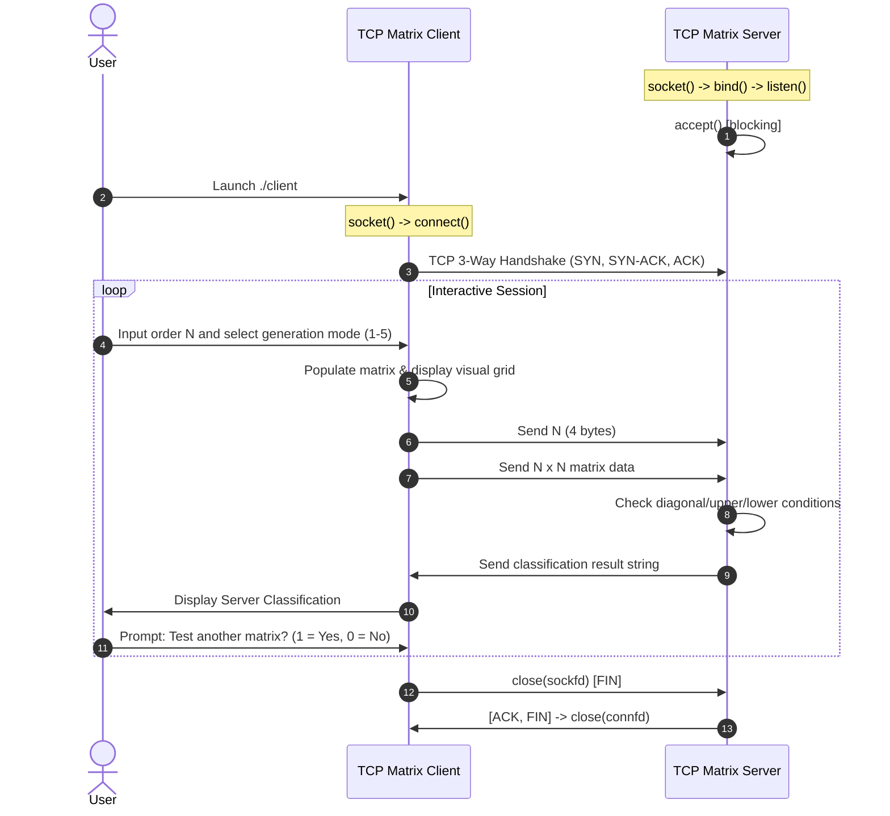

# EXPERIMENT 5: Client-Server Communication Using TCP (Matrix Classification)

**Course Code:** PCCSL507 — Networks Lab  
**Course Type:** Practical / Lab  
**Semester:** S5 (Computer Science & Engineering)  

---

## 1. AIM
To implement client-server communication using the Transmission Control Protocol (TCP) in C on Linux, wherein:
1. The client inputs an integer $N$ representing the order of a square matrix.
2. The client provides an interactive menu allowing the user to generate:
   - General Random Matrix with numbers in $[1, 50]$ (as specified by syllabus)
   - Preset Upper Triangular Matrix
   - Preset Lower Triangular Matrix
   - Preset Diagonal Matrix
   - Custom Manual Input Matrix
3. The client transmits the matrix to the server over a TCP connection.
4. The server receives the matrix, evaluates its mathematical properties, and classifies it as:
   - **Diagonal Matrix**
   - **Upper Triangular Matrix**
   - **Lower Triangular Matrix**
   - **General Matrix (Neither)**
5. The server returns the classification as a string to the client.
6. The client maintains an interactive session, allowing multiple matrices to be evaluated without reconnecting.

---

## 2. THEORETICAL BACKGROUND

### 2.1 The Transmission Control Protocol (TCP)
TCP is a connection-oriented, reliable, stream-based transport layer protocol defined in RFC 793. Key features:
- **Connection establishment** via 3-way handshake (`SYN` $\rightarrow$ `SYN-ACK` $\rightarrow$ `ACK`).
- **Reliable in-order data transfer** using sequence numbers, acknowledgments, and retransmission timeouts (RTO).
- **Flow control** via sliding windows.
- **Congestion control** via slow start, congestion avoidance, fast retransmit, and fast recovery.
- **Graceful termination** via 4-way handshake (`FIN` $\rightarrow$ `ACK` $\rightarrow$ `FIN` $\rightarrow$ `ACK`).

### 2.2 Sockets API in POSIX C

| System Call | Purpose |
| :--- | :--- |
| `socket(int domain, int type, int protocol)` | Creates an endpoint for communication (`AF_INET`, `SOCK_STREAM`, `0`). |
| `bind(int sockfd, const struct sockaddr *addr, socklen_t addrlen)` | Binds socket to a local IP address and port number. |
| `listen(int sockfd, int backlog)` | Marks socket as passive to accept incoming connection requests. |
| `accept(int sockfd, struct sockaddr *addr, socklen_t *addrlen)` | Extracts connection request on the queue and returns dedicated socket (`connfd`). |
| `connect(int sockfd, const struct sockaddr *addr, socklen_t addrlen)` | Initiates TCP 3-way handshake with remote listening server. |
| `send(int sockfd, const void *buf, size_t len, int flags)` | Transmits data through the connected stream socket. |
| `recv(int sockfd, void *buf, size_t len, int flags)` | Reads incoming data from the socket stream into a buffer. |
| `close(int fd)` | Releases socket file descriptor and terminates connection. |

### 2.3 Mathematical Definitions of Matrix Types
For a square matrix $A$ of order $N \times N$, indexed $0 \le i, j < N$:
- **Upper Triangular Matrix:** All elements strictly below the main diagonal are zero:
  $$\forall i > j, \quad A[i][j] = 0$$
- **Lower Triangular Matrix:** All elements strictly above the main diagonal are zero:
  $$\forall i < j, \quad A[i][j] = 0$$
- **Diagonal Matrix:** All non-diagonal elements are zero:
  $$\forall i \ne j, \quad A[i][j] = 0$$
- **General Matrix:** Non-zero elements exist both above and below the diagonal.

---

## 3. SEQUENCE DIAGRAM



---

## 4. ALGORITHMS

### 4.1 Server Algorithm
1. **Start**.
2. Create TCP stream socket using `socket(AF_INET, SOCK_STREAM, 0)`.
3. Set `SO_REUSEADDR` and bind socket to `PORT 8080`.
4. Enter listening state with `listen(server_fd, 5)`.
5. Enter loop:
   - Call `accept()` to obtain connected client socket `connfd`.
   - **Client Session Loop:**
     - Read matrix order $N$ using `recv()`. If client disconnected or sent $0$, break session loop.
     - Read $N \times N$ matrix data into buffer.
     - Evaluate matrix:
       - Set `is_upper = 1` and `is_lower = 1`.
       - If $i > j$ and $A[i][j] \ne 0 \implies$ `is_upper = 0`.
       - If $i < j$ and $A[i][j] \ne 0 \implies$ `is_lower = 0`.
       - If both $\implies$ `"Diagonal Matrix"`.
       - Else if `is_upper` $\implies$ `"Upper Triangular Matrix"`.
       - Else if `is_lower` $\implies$ `"Lower Triangular Matrix"`.
       - Else $\implies$ `"General Matrix"`.
     - Transmit classification string back via `send()`.
   - Close `connfd`.
6. Stop.

### 4.2 Client Algorithm
1. **Start**.
2. Create TCP socket and establish connection to server using `connect()`.
3. **Interactive Session Loop:**
   - Prompt user for order $N$ (or 0 to exit).
   - Display menu: 1. Random [1..50], 2. Upper Triangular, 3. Lower Triangular, 4. Diagonal, 5. Manual.
   - Populate matrix and display on console.
   - Transmit $N$ and matrix buffer over socket via `send()`.
   - Receive classification result from server using `recv()` and display.
   - Prompt user whether to test another matrix.
4. Close socket and exit.

---

## 5. COMPILATION AND EXECUTION

```bash
cd exp05_tcp_matrix_classification
gcc -Wall -Wextra -O2 server.c -o server
gcc -Wall -Wextra -O2 client.c -o client
```

**Terminal 1 (Server):**
```bash
./server
```

**Terminal 2 (Client):**
```bash
./client
```

---

## 6. SAMPLE INPUT AND OUTPUT

### Client Console:
```text
Enter order of matrix N: 3

Generated Matrix (3x3):
  14  22   9
  45  31  12
   8  50  37

Server Result: General Matrix
```

### Server Console:
```text
Matrix Server listening on port 8080...
Client connected.
Received matrix order N = 3
Identified: General Matrix
```


---

## 7. VIVA VOCE QUESTIONS & ANSWERS

1. **Why is TCP chosen over UDP for matrix data transmission?**  
   *Answer:* A matrix represents structured, exact numeric data where dropped or reordered bytes would corrupt dimensions and values. TCP guarantees reliable, in-order byte stream delivery.

2. **Why must the server read the matrix in a loop rather than a single `recv()`?**  
   *Answer:* TCP is a stream protocol without record boundaries. A single `recv()` is not guaranteed to return all $N \times N \times \text{sizeof(int)}$ bytes at once due to network packet fragmentation. Reading in a loop until all expected bytes arrive guarantees complete reception.

3. **What is `SO_REUSEADDR`?**  
   *Answer:* It allows the socket to bind to a local port even if the port is in the `TIME_WAIT` state from a previously closed connection, preventing "Address already in use" errors upon immediate server restart.

---

## 8. RESULT
A TCP client-server application for matrix classification was successfully implemented and evaluated. The server evaluated matrix properties and accurately identified diagonal, upper triangular, lower triangular, and general matrices over a persistent interactive TCP session.
