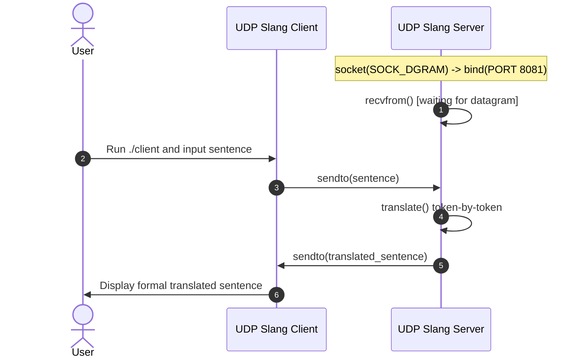

# EXPERIMENT 6: Client-Server Communication Using UDP (Slang Translator)

**Course Code:** PCCSL507 — Networks Lab  
**Course Type:** Practical / Lab  
**Semester:** S5 (Computer Science & Engineering)  

---

## 1. AIM
To implement client-server communication using the User Datagram Protocol (UDP) in C on Linux to build an interactive "New Generation English Slang Translator" application wherein:
1. The client connects to the server and provides an interactive command shell (`slang-client> `).
2. The user inputs informal English sentences containing modern text abbreviations (slang), or issues commands like `sample` (to run the official KTU syllabus test string) or `dict` (to display the server's slang abbreviation dictionary).
3. The client transmits the sentence or command to the server as a UDP datagram.
4. The server translates recognized abbreviations into formal English while preserving non-abbreviated words, casing, whitespace, and punctuation.
5. The server returns the translated formal English sentence to the client via a UDP datagram.
6. The client prints the received translated sentence and remains active for further translations until exit.

---

## 2. THEORETICAL BACKGROUND

### 2.1 The User Datagram Protocol (UDP)
UDP is a minimal, connectionless transport layer protocol defined in RFC 768. Key characteristics include:
- **Connectionless:** No three-way handshake is performed before data transfer. Datagrams are transmitted directly to the destination address.
- **Unreliable / Best-Effort:** UDP does not provide acknowledgments, retransmissions, or ordering guarantees. Packets may arrive out of order, be duplicated, or be dropped.
- **Message-Oriented (Preserves Datagram Boundaries):** Unlike TCP which operates as an unstructured continuous stream of bytes, UDP preserves message boundaries; each `sendto()` generates exactly one IP datagram, received by one `recvfrom()`.
- **Low Overhead:** UDP headers are only 8 bytes (Source Port, Destination Port, Total Length, and Checksum), compared to TCP's 20-60 byte header.

### 2.2 Comparison Between TCP and UDP

| Parameter | TCP (`SOCK_STREAM`) | UDP (`SOCK_DGRAM`) |
| :--- | :--- | :--- |
| **Connection Paradigm** | Connection-oriented (Handshake required) | Connectionless (No handshake) |
| **Reliability** | Guaranteed delivery (Retransmissions, ACKs) | Best effort (No ACKs, packet loss possible) |
| **Ordering** | Guaranteed in-order byte stream | Packets may arrive out-of-order |
| **Data Transmission Model** | Continuous byte stream (No packet boundaries) | Discrete datagrams (Boundaries preserved) |
| **Header Overhead** | 20 to 60 bytes | 8 bytes fixed |
| **Speed & Latency** | Higher overhead, moderate speed | Minimal latency, high throughput |
| **Primary System Calls** | `listen()`, `connect()`, `accept()`, `send()`, `recv()` | `bind()`, `sendto()`, `recvfrom()` |

### 2.3 Slang Translation Dictionary
The server implements a translation lookup table for modern abbreviations:

| Abbreviation | Formal English Expansion |
| :--- | :--- |
| `tbh` | to be honest |
| `ig` | I guess |
| `tbf` | to be fair |
| `atm` | at the moment |
| `irl` | in real life |
| `lol` | laughing out loud |
| `asap` | as soon as possible |
| `omg` | oh my god |
| `ttyl` | talk to you later |
| `idk` | I don't know |
| `nvm` | never mind |
| `idc` | I don't care |

---

## 3. SEQUENCE DIAGRAM



---

## 4. ALGORITHMS

### 4.1 Server Algorithm
1. **Start**.
2. Create a UDP socket using `socket(AF_INET, SOCK_DGRAM, 0)`.
3. Set up `sockaddr_in` structure with `AF_INET`, `INADDR_ANY`, and `htons(PORT)`.
4. Bind socket to port using `bind()`.
5. Call `recvfrom()` to receive the sentence string from client.
6. Call `translate()`:
   - Traverse the input string character-by-character.
   - Retain punctuation and spaces.
   - Extract alphabetical word tokens, compare against slang dictionary (`tbh`, `idc`, `irl`, `atm`, `tbf`, etc.).
   - Replace matching tokens with expanded formal text; keep unmatched words unchanged.
7. Send translated string back to client using `sendto()`.
8. Close socket and exit.

### 4.2 Client Algorithm
1. **Start**.
2. Create a UDP socket using `socket(AF_INET, SOCK_DGRAM, 0)`.
3. Set up destination server address structure (`127.0.0.1:8081`).
4. Read English sentence with slang from standard input using `fgets()`.
5. Transmit sentence to server using `sendto()`.
6. Receive translated sentence from server using `recvfrom()`.
7. Display translated formal sentence on console.
8. Close socket and exit.

---

## 5. COMPILATION AND EXECUTION

```bash
cd exp06_udp_slang_translator
gcc server.c -o server
gcc client.c -o client
```

**Terminal 1 (Server):**
```bash
./server
```

**Terminal 2 (Client):**
```bash
./client
```

---

## 6. SAMPLE INPUT AND OUTPUT

### Client Terminal:
```text
Enter new-gen English sentence: Really idc about this irl but atm I will study, tbf.

Translated Formal Sentence:
Really I don't care about this in real life but at the moment I will study, to be fair.
```

### Server Terminal:
```text
UDP Slang Server listening on port 8081...
Received: Really idc about this irl but atm I will study, tbf.
Translated: Really I don't care about this in real life but at the moment I will study, to be fair.
```

---

## 7. VIVA VOCE QUESTIONS & ANSWERS

1. **Why does UDP not require `listen()` or `accept()`?**  
   *Answer:* UDP is connectionless. It has no concept of establishing a stateful session or connection queue. Packets are processed individually as discrete datagrams using `recvfrom()` and `sendto()`.

2. **How does `recvfrom()` identify the sender?**  
   *Answer:* The `recvfrom()` system call accepts pointers to a `struct sockaddr` and its length. When a datagram is received from the network, the kernel populates this structure with the sender's IP address and ephemeral source port.

3. **What is meant by "message boundaries are preserved in UDP"?**  
   *Answer:* If a sender issues three separate `sendto()` calls of 100 bytes each, the receiver must perform three separate `recvfrom()` calls to retrieve them. In TCP, the three chunks could be coalesced into one 300-byte read or split arbitrarily.

4. **When should UDP be chosen over TCP?**  
   *Answer:* UDP is preferred in applications where low latency and timeliness are more critical than perfect reliability, such as live streaming (VoIP, RTP), DNS queries, and online gaming.

---

## 8. RESULT
The client-server application for translating modern English abbreviations into formal English using UDP sockets was successfully implemented and evaluated. The server received datagrams, extracted word tokens, substituted abbreviations from the dictionary, and transmitted translated sentences back to the client.
