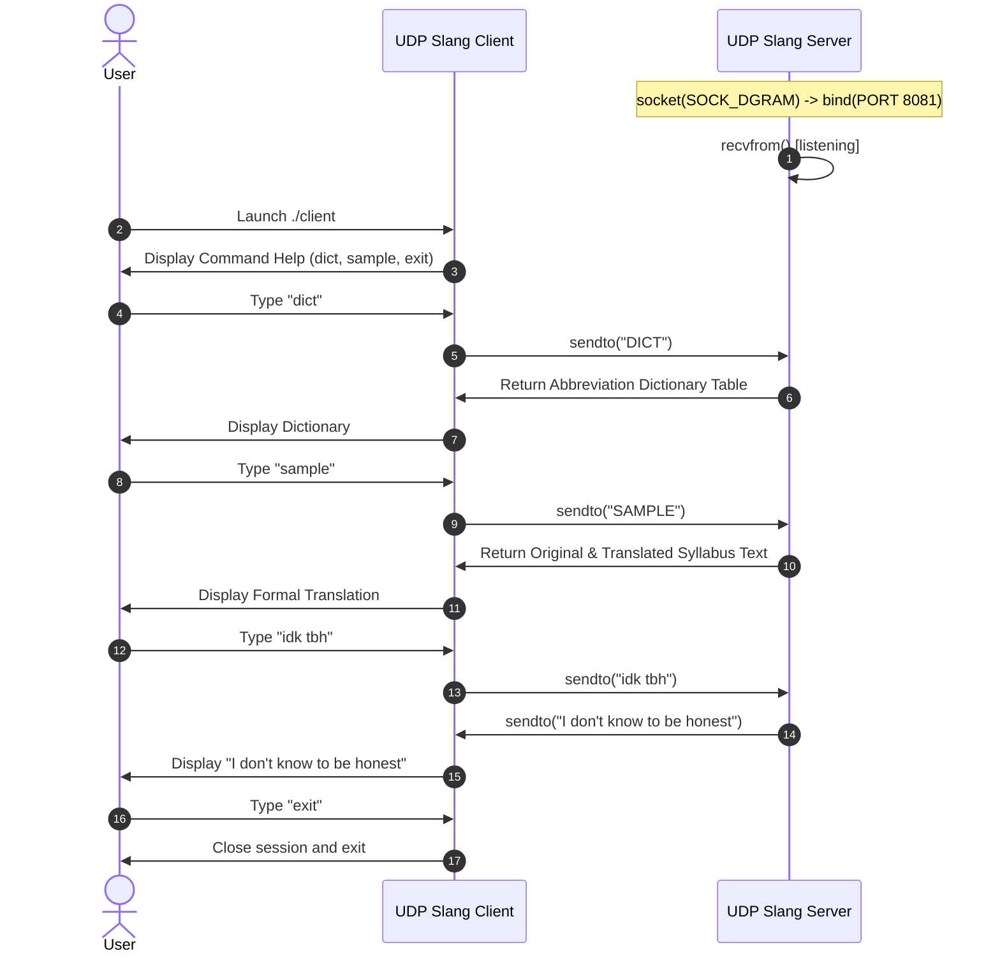

# EXPERIMENT 6: Client-Server Communication Using UDP (Slang Translator)

**Course Code:** PCCSL507 — Networks Lab  
**Course Type:** Practical / Lab  
**Semester:** S5 (Computer Science & Engineering)  

---

## 1. AIM
To implement client-server communication using the User Datagram Protocol (UDP) in C on Linux to build an interactive "New Generation English Slang Translator" application wherein:
1. The client connects to the server and provides an interactive command shell (`slang-client> `).
2. The user inputs informal English sentences containing modern text abbreviations (slang), or issues commands like `sample` (to run the official KTU syllabus test string) or `dict` (to display the server's slang abbreviation dictionary).
3. The client transmits the sentence or command to the server as a UDP datagram.
4. The server translates recognized abbreviations into formal English while preserving non-abbreviated words, casing, whitespace, and punctuation.
5. The server returns the translated formal English sentence to the client via a UDP datagram.
6. The client prints the received translated sentence and remains active for further translations until exit.

---

## 2. THEORETICAL BACKGROUND

### 2.1 The User Datagram Protocol (UDP)
UDP is a minimal, connectionless transport layer protocol defined in RFC 768. Key characteristics include:
- **Connectionless:** No three-way handshake is performed before data transfer. Datagrams are transmitted directly to the destination address.
- **Unreliable / Best-Effort:** UDP does not provide acknowledgments, retransmissions, or ordering guarantees. Packets may arrive out of order, be duplicated, or be dropped.
- **Message-Oriented (Preserves Datagram Boundaries):** Unlike TCP which operates as an unstructured continuous stream of bytes, UDP preserves message boundaries; each `sendto()` generates exactly one IP datagram, received by one `recvfrom()`.
- **Low Overhead:** UDP headers are only 8 bytes (Source Port, Destination Port, Total Length, and Checksum), compared to TCP's 20-60 byte header.

### 2.2 Comparison Between TCP and UDP

| Parameter | TCP (`SOCK_STREAM`) | UDP (`SOCK_DGRAM`) |
| :--- | :--- | :--- |
| **Connection Paradigm** | Connection-oriented (Handshake required) | Connectionless (No handshake) |
| **Reliability** | Guaranteed delivery (Retransmissions, ACKs) | Best effort (No ACKs, packet loss possible) |
| **Ordering** | Guaranteed in-order byte stream | Packets may arrive out-of-order |
| **Data Transmission Model** | Continuous byte stream (No packet boundaries) | Discrete datagrams (Boundaries preserved) |
| **Header Overhead** | 20 to 60 bytes | 8 bytes fixed |
| **Speed & Latency** | Higher overhead, moderate speed | Minimal latency, high throughput |
| **Primary System Calls** | `listen()`, `connect()`, `accept()`, `send()`, `recv()` | `bind()`, `sendto()`, `recvfrom()` |

### 2.3 Slang Translation Dictionary
The server implements a translation lookup table for modern abbreviations:

| Abbreviation | Formal English Expansion |
| :--- | :--- |
| `tbh` | to be honest |
| `ig` | I guess |
| `tbf` | to be fair |
| `atm` | at the moment |
| `irl` | in real life |
| `lol` | laughing out loud |
| `asap` | as soon as possible |
| `omg` | oh my god |
| `ttyl` | talk to you later |
| `idk` | I don't know |
| `nvm` | never mind |
| `idc` | I don't care |

---

## 3. SEQUENCE DIAGRAM



---

## 4. ALGORITHMS

### 4.1 Server Algorithm
1. **Start**.
2. Create a UDP socket using `socket(AF_INET, SOCK_DGRAM, 0)`.
3. Set up the `sockaddr_in` structure with `AF_INET`, `INADDR_ANY`, and `htons(PORT)`.
4. Bind the socket using `bind()`.
5. Enter an infinite listening loop:
   - Call `recvfrom()` to wait for incoming UDP datagrams.
   - Extract client's IP and port from `client_addr`.
   - **If command is `DICT` / `LIST`:** Assemble formatted table of supported abbreviations and transmit back via `sendto()`.
   - **If command is `SAMPLE`:** Translate official KTU syllabus sentence and return both original and translated text.
   - **If custom text:**
     - Scan input string character-by-character.
     - Copy punctuation and whitespace directly.
     - Extract word tokens, perform case-insensitive lookup in `SLANG_DICT`.
     - Replace matching acronyms with expanded phrases; leave unmatched words unchanged.
     - Transmit translated formal sentence back to client via `sendto()`.
6. Stop.

### 4.2 Client Algorithm
1. **Start**.
2. Create a UDP socket using `socket(AF_INET, SOCK_DGRAM, 0)`.
3. Set receive timeout (`SO_RCVTIMEO`) to 3 seconds.
4. Configure destination server address structure (`127.0.0.1:8081`).
5. **If command-line argument passed (`./client "<sentence>"`):**
   - Transmit sentence, receive and print translation, and exit (Batch Mode).
6. **If no arguments passed (Interactive REPL Mode):**
   - Display menu: `<sentence>`, `sample`, `dict`, `help`, `exit`.
   - Loop prompt `slang-client> `:
     - If `exit`: exit loop.
     - If `help`: display commands.
     - Otherwise: transmit line to server via `sendto()`, receive and print translated response.
7. Close socket and stop.

---

## 5. COMPILATION AND EXECUTION

```bash
cd exp06_udp_slang_translator
gcc -Wall -Wextra -O2 server.c -o server
gcc -Wall -Wextra -O2 client.c -o client
```

**Terminal 1 (Server):**
```bash
./server
```

**Terminal 2 (Client - Interactive Console):**
```bash
./client
slang-client> dict
slang-client> sample
slang-client> idk tbh
slang-client> exit
```

**Terminal 3 (Client - Batch Mode):**
```bash
./client "Really idc about this irl"
```

---

## 6. SAMPLE INPUT AND OUTPUT

### Client Console (Interactive REPL Shell):
```text
=====================================================
     UDP NEW-GEN SLANG TRANSLATOR - EXPERIMENT 6     
=====================================================
Connected to Slang Translation Server at 127.0.0.1:8081

Available Commands:
  <any sentence>  - Translate informal abbreviations into formal English
  sample          - Run official KTU syllabus test sentence
  dict / list     - View dictionary of supported slang acronyms
  help            - Display this help message
  exit / quit     - Exit translator client

slang-client> dict
Supported Slang Abbreviations Dictionary (12 entries):
-------------------------------------------------------------
  tbh      -> to be honest
  ig       -> I guess
  tbf      -> to be fair
  atm      -> at the moment
  irl      -> in real life
  lol      -> laughing out loud
  asap     -> as soon as possible
  omg      -> oh my god
  ttyl     -> talk to you later
  idk      -> I don't know
  nvm      -> never mind
  idc      -> I don't care
-------------------------------------------------------------

slang-client> sample
[ORIGINAL]  : Really idc about this stupid server as it is of no use irl but atm, I will design one, tbf to the professor.
[TRANSLATED]: Really I don't care about this stupid server as it is of no use in real life but at the moment, I will design one, to be fair to the professor.

slang-client> idk tbh
I don't know to be honest

slang-client> exit
[INFO] Exiting Slang Translator Client. Goodbye!
```

### Server Console:
```text
=====================================================
   UDP NEW-GEN SLANG TRANSLATOR SERVER (Port: 8081)    
=====================================================
[INFO] Server is listening for incoming UDP datagrams...

[DATAGRAM RECEIVED] From 127.0.0.1:49215: "dict"
[DATAGRAM RECEIVED] From 127.0.0.1:49215: "sample"
[DATAGRAM RECEIVED] From 127.0.0.1:49215: "idk tbh"
[TRANSLATION]: "I don't know to be honest"
[INFO] Translated datagram sent back to 127.0.0.1:49215
```

---

## 7. VIVA VOCE QUESTIONS & ANSWERS

1. **Why does UDP not require `listen()` or `accept()`?**  
   *Answer:* UDP is connectionless. It has no concept of establishing a stateful session or connection queue. Packets are processed individually as discrete datagrams using `recvfrom()` and `sendto()`.

2. **How does `recvfrom()` identify the sender?**  
   *Answer:* The `recvfrom()` system call accepts pointers to a `struct sockaddr` and its length. When a datagram is received from the network, the kernel populates this structure with the sender's IP address and ephemeral source port.

3. **What is meant by "message boundaries are preserved in UDP"?**  
   *Answer:* If a sender issues three separate `sendto()` calls of 100 bytes each, the receiver must perform three separate `recvfrom()` calls to retrieve them. In TCP, the three chunks could be coalesced into one 300-byte read or split arbitrarily.

4. **When should UDP be chosen over TCP?**  
   *Answer:* UDP is preferred in applications where low latency and timeliness are more critical than perfect reliability, such as live streaming (VoIP, RTP), DNS queries, and online gaming.

---

## 8. RESULT
The client-server application for translating modern English abbreviations into formal English using UDP sockets was successfully implemented and evaluated. The server received datagrams, extracted word tokens, substituted abbreviations from the dictionary, and transmitted translated sentences back to the client.
