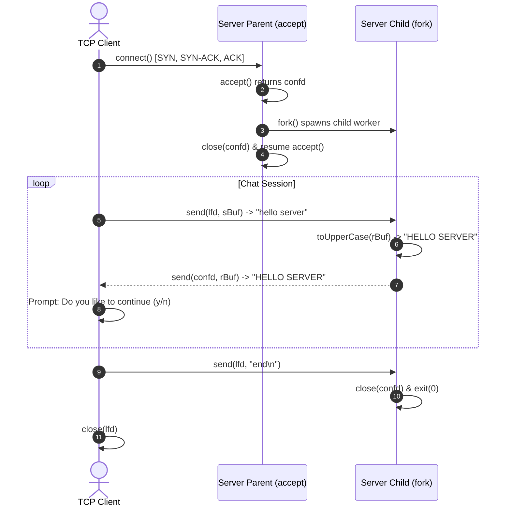

# EXPERIMENT 7: Multi-User Chat Server Using TCP

**Course Code:** PCCSL507 — Networks Lab  
**Course Type:** Practical / Lab  
**Semester:** S5 (Computer Science & Engineering)  

---

## 1. AIM
To design and implement a concurrent multi-client chat server using the Transmission Control Protocol (TCP) and process concurrency (`fork()`) in C on Linux, wherein:
1. Multiple clients connect concurrently to the central chat server.
2. The server accepts each connection and spawns a dedicated child process via `fork()` to handle the client session.
3. The client sends text messages, and the server converts them to uppercase and echoes them back.
4. The client provides an interactive continuation prompt `(y/n)` to send multiple messages in a persistent session.
5. Entering `'n'` signals termination via `"end\n"`, gracefully closing both client and server session sockets.

---

## 2. THEORETICAL BACKGROUND

### 2.1 Multi-Process Concurrency Model (`fork()`)
In a multi-client server, each connected client must be served simultaneously without blocking new incoming connections:
- The **Parent Server Process** creates the listening socket (`lfd`), binds to port `2011`, and calls `listen(lfd, 5)`.
- It executes an infinite loop waiting on `accept(lfd, ...)`.
- Upon accepting a connection, `accept()` returns a new connected descriptor (`confd`).
- The parent immediately calls `fork()`:
  - **In Child Process (`childpid == 0`):** Closes the listening socket `close(lfd)` because the child only needs `confd`. It enters a message handling loop reading from the client, performing transformations (`toUpperCase()`), and echoing back the processed string. When the client terminates, the child closes `confd` and exits.
  - **In Parent Process (`childpid > 0`):** Closes its copy of `confd` immediately using `close(confd)` to release resources, and returns to `accept()` to wait for the next client.

### 2.2 Sockets API in POSIX C

| System Call | Purpose |
| :--- | :--- |
| `socket(AF_INET, SOCK_STREAM, 0)` | Creates stream socket endpoint for TCP communication. |
| `bind(lfd, &server, sizeof server)` | Associates socket with IP address `127.0.0.1` and port `2011`. |
| `listen(lfd, 5)` | Places socket in passive listening state with a backlog queue of 5. |
| `accept(lfd, &client, &n)` | Accepts incoming client connection and returns dedicated `confd`. |
| `fork()` | Creates child process duplicating caller's memory and descriptors. |
| `send(confd, buf, sizeof buf, 0)` | Transmits data buffer over connected TCP socket stream. |
| `recv(confd, buf, sizeof buf, 0)` | Receives incoming byte stream from socket. |
| `close(fd)` | Closes file descriptor and releases system resources. |

---

## 3. SEQUENCE DIAGRAM



---

## 4. ALGORITHMS

### 4.1 Server Algorithm
1. **Start**.
2. Create TCP socket using `socket(AF_INET, SOCK_STREAM, 0)`.
3. Set address structure: `AF_INET`, port `htons(2011)`, address `inet_addr("127.0.0.1")`.
4. Bind socket to server address using `bind()`.
5. Call `listen(lfd, 5)` to listen for connections.
6. Enter infinite accept loop:
   - Call `confd = accept(lfd, (struct sockaddr *)&client, &n)`.
   - Call `fork()`:
     - If child process (`childpid == 0`):
       - `close(lfd)` (child does not listen).
       - While true:
         - Clear buffer `memset(rBuf, 0, sizeof rBuf)`.
         - Receive data using `recv(confd, rBuf, sizeof rBuf, 0)`.
         - If `rBuf` is `"end\n"`, break loop.
         - Call `toUpperCase(rBuf)`.
         - Print client message and send uppercase string using `send()`.
       - `close(confd)` and `exit(0)`.
     - In parent process:
       - `close(confd)`.
7. Stop.

### 4.2 Client Algorithm
1. **Start**.
2. Create TCP socket using `socket(AF_INET, SOCK_STREAM, 0)`.
3. Set server address structure: port `htons(2011)`, IP `127.0.0.1`.
4. Connect to server using `connect(lfd, (struct sockaddr *)&server, sizeof server)`.
5. Enter chat loop:
   - Clear buffers using `memset()`.
   - Prompt user: `printf("\nClient :")` and read using `fgets(sBuf, sizeof sBuf, stdin)`.
   - Send message to server using `send(lfd, sBuf, sizeof sBuf, 0)`.
   - Receive echoed response using `recv(lfd, rBuf, sizeof rBuf, 0)` and print.
   - Prompt user: `printf("\nDo you like to continue (y/n) :")`.
   - Read `choice` using `fgets()`.
   - If choice is `'n'`, copy `"end\n"` into `sBuf`, send to server, and break loop.
6. Close socket using `close(lfd)`.
7. Stop.

---

## 5. COMPILATION AND EXECUTION

```bash
cd exp07_tcp_multiuser_chat
gcc server.c -o server
gcc client.c -o client
```

**Terminal 1 (Server):**
```bash
./server
```

**Terminal 2 (Client 1):**
```bash
./client
```

**Terminal 3 (Client 2):**
```bash
./client
```

---

## 6. SAMPLE RUN OUTPUT

### Terminal 1 (Server Console):
```text
Server ready,waiting for client....
Client:hello server
Server:HELLO SERVER

Client:end

Server ready,waiting for client....
Client:testing client 2
Server:TESTING CLIENT 2

Client:end
```

### Terminal 2 (Client 1 Console):
```text
Client ready....

Client :hello server
Server:HELLO SERVER

Do you like to continue (y/n) :y

Client :how are you
Server:HOW ARE YOU

Do you like to continue (y/n) :n
```

### Terminal 3 (Client 2 Console):
```text
Client ready....

Client :testing client 2
Server:TESTING CLIENT 2

Do you like to continue (y/n) :n
```

---

## 7. VIVA VOCE QUESTIONS & ANSWERS

1. **Why does the child process close `lfd` while the parent closes `confd`?**  
   *Answer:* File descriptors are reference-counted in the operating system kernel. The listening socket `lfd` is needed only by the parent to accept future connections, so the child closes its copy. Conversely, the connected client socket `confd` is handled solely by the child, so the parent closes its descriptor so that when the child terminates, the TCP connection closes cleanly with a `FIN`.

2. **What is the difference between multi-process (`fork`) and multi-threaded (`pthread`) concurrency?**  
   *Answer:* `fork()` creates an entirely separate address space with isolated memory, preventing one client crash from corrupting others, but has higher process creation and context-switch overhead. Threads share the same virtual memory space within a single process, making them lightweight and fast to switch, but require mutex locks to avoid race conditions.

3. **What is a Zombie process and how does it occur in `fork()` servers?**  
   *Answer:* A zombie process is a child process that has completed execution via `exit()` but still has an entry in the OS process table because its parent has not yet read its exit status using `wait()` or `waitpid()`. In production servers, setting `signal(SIGCHLD, SIG_IGN)` or handling `SIGCHLD` automatically reaps terminated children.

---

## 8. RESULT
A concurrent multi-client TCP chat server using process-based concurrency (`fork()`) in C was successfully designed, implemented, and verified. The server handled multiple concurrent client connections, transformed incoming text messages to uppercase, and cleanly terminated active sessions.
