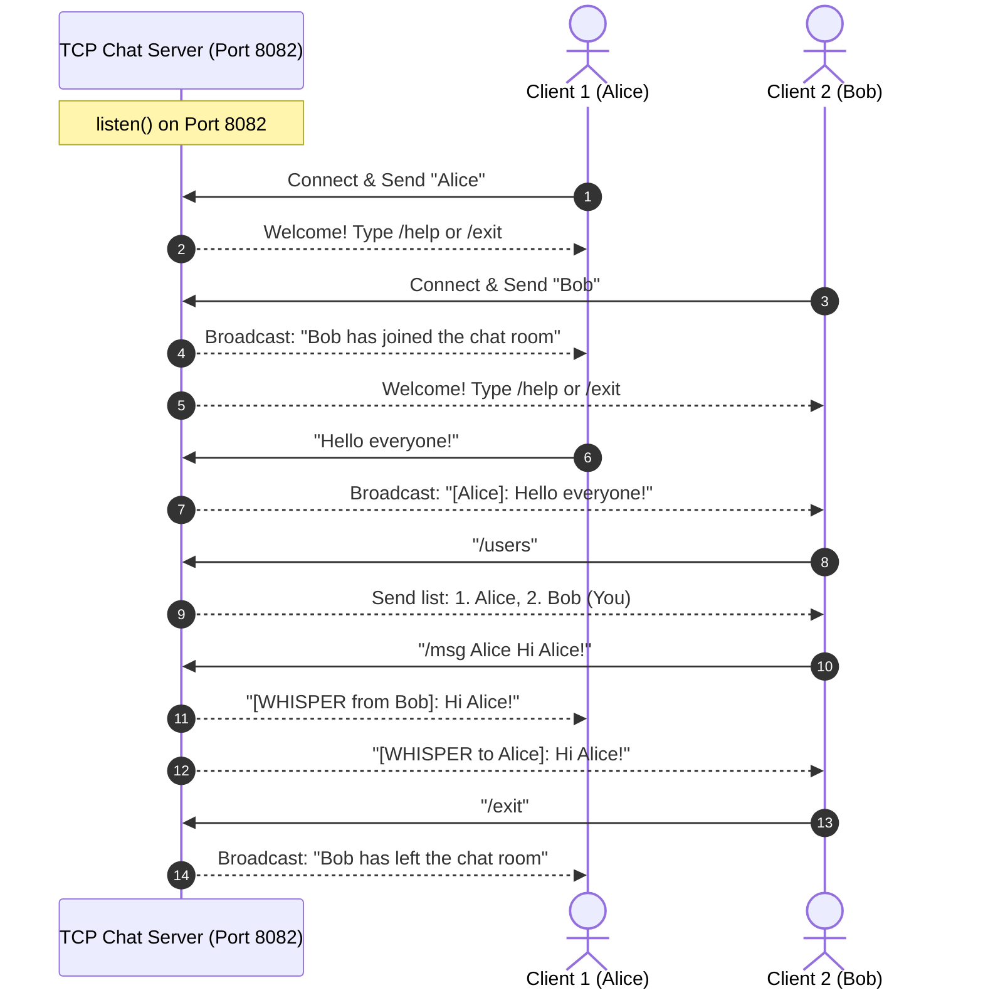

# EXPERIMENT 7: Multi-User Chat Server Using TCP

**Course Code:** PCCSL507 — Networks Lab  
**Course Type:** Practical / Lab  
**Semester:** S5 (Computer Science & Engineering)  

---

## 1. AIM
To design and implement a multi-user broadcast chat application using the Transmission Control Protocol (TCP) and POSIX threads (`pthreads`) in C on Linux, wherein:
1. Multiple clients connect concurrently to a central chat server.
2. Each client registers with a custom username.
3. The server broadcasts chat messages to all connected participants.
4. The server supports interactive commands:
   - `/users` — Lists currently active online users.
   - `/msg <user> <message>` — Sends a private direct message (whisper).
   - `/help` — Displays chat commands.
   - `/exit` — Disconnects cleanly with departure notifications.
5. Mutex synchronization is employed to prevent race conditions during global client list management.

---

## 2. THEORETICAL BACKGROUND

### 2.1 Multi-Threaded Concurrency Model
In a multi-user chat server, multiple clients remain connected for extended periods. A single-threaded iterative server cannot handle multiple active clients simultaneously.
Using POSIX Threads (`pthreads`):
- The **Master Server Thread** calls `accept()` in a loop.
- Upon each connection, it spawns a dedicated worker thread via `pthread_create()`.
- Thread synchronization via `pthread_mutex_t` protects shared state (e.g. `clients[]` array).

### 2.2 Client-Side Concurrency
A chat client must perform full-duplex communication:
1. **Sender Thread:** Blocks on `fgets(stdin)` waiting for the user to type messages.
2. **Receiver Thread:** Blocks on `recv(socket)` waiting for incoming broadcast messages from the server.

---

## 3. SEQUENCE DIAGRAM



---

## 4. ALGORITHMS

### 4.1 Server Algorithm
1. **Start**.
2. Initialize `clients[]` array and `clients_mutex`.
3. Create TCP socket, bind to `PORT 8082`, and call `listen()`.
4. Accept incoming connections:
   - For each client, allocate `client_t`, store socket and unique UID.
   - Lock `clients_mutex`, add to registry, unlock mutex.
   - Spawn worker thread `handle_client`.
5. **In `handle_client` Thread:**
   - Receive username, broadcast join message, send welcome text.
   - While connected:
     - If `/exit`: broadcast departure and break.
     - If `/help`: send command guide to requester.
     - If `/users`: compile online participant list under mutex and send to requester.
     - If `/msg <target> <text>`: route private whisper only to target user and sender.
     - Otherwise: broadcast `[User]: text` to all other participants.
   - On disconnect: remove from client registry under mutex, close socket, free context, and detach thread.
6. Stop.

### 4.2 Client Algorithm
1. **Start**.
2. Prompt user for chat username.
3. Connect to server (`127.0.0.1:8082`).
4. Send username over socket.
5. Spawn two threads:
   - **Sender Thread:** Reads from `stdin`. If `/exit`, sends and terminates client. Otherwise transmits message.
   - **Receiver Thread:** Calls `recv()` in loop, printing server and broadcast messages to terminal.
6. Wait for exit signal, close socket, and stop.

---

## 5. COMPILATION AND EXECUTION

```bash
cd exp07_tcp_multiuser_chat
gcc -Wall -Wextra -O2 -pthread server.c -o server
gcc -Wall -Wextra -O2 -pthread client.c -o client
```

**Terminal 1 (Server):**
```bash
./server
```

**Terminal 2 (Client 1 - Alice):**
```bash
./client
# Username: Alice
```

**Terminal 3 (Client 2 - Bob):**
```bash
./client
# Username: Bob
```

---

## 6. SAMPLE RUN OUTPUT

### Terminal 2 (Alice):
```text
=====================================================
        TCP MULTI-USER CHAT CLIENT - EXPERIMENT 7    
=====================================================
Enter your username (max 31 chars): Alice
[INFO] Connecting to Chat Server at 127.0.0.1:8082...

=== Connected to Chat Room as "Alice" ===
Commands: /help (show help) | /users (list users) | /msg <user> <text> | /exit (leave)
-----------------------------------------------------

Welcome to the chat room! Type /help for commands or /exit to quit.
>>> [SERVER]: "Bob" has joined the chat room <<<
[Bob]: Hello everyone!
[WHISPER from Bob]: Private test message!
>>> [SERVER]: "Bob" has left the chat room <<<
```

### Terminal 3 (Bob):
```text
=====================================================
        TCP MULTI-USER CHAT CLIENT - EXPERIMENT 7    
=====================================================
Enter your username (max 31 chars): Bob
[INFO] Connecting to Chat Server at 127.0.0.1:8082...

=== Connected to Chat Room as "Bob" ===
Commands: /help (show help) | /users (list users) | /msg <user> <text> | /exit (leave)
-----------------------------------------------------

Welcome to the chat room! Type /help for commands or /exit to quit.
/users
--- Active Online Users ---
  1. Alice
  2. Bob (You)
---------------------------

/msg Alice Private test message!
[WHISPER to Alice]: Private test message!

/exit
[INFO] Exiting chat room. Goodbye!
```

---

## 7. VIVA VOCE QUESTIONS & ANSWERS

1. **Why is a mutex necessary in the multi-user chat server?**  
   *Answer:* The global client list `clients[]` is shared across all concurrent worker threads. If two users connect or disconnect simultaneously, modifying the array without a mutex causes race conditions and memory corruption.

2. **Why does the client require two separate threads?**  
   *Answer:* Full-duplex communication. Reading keyboard input (`fgets()`) and receiving incoming network data (`recv()`) are both blocking system calls. Two threads allow reading and receiving concurrently without either blocking the other.

3. **What is the difference between `pthread_join()` and `pthread_detach()`?**  
   *Answer:* `pthread_join()` blocks until the target thread terminates and reaps its resources. `pthread_detach()` marks the thread so its resources are automatically reclaimed by the OS immediately upon termination, ideal for independent server worker threads.

---

## 8. RESULT
A multi-user broadcast chat application using TCP sockets and POSIX threads was successfully implemented and evaluated. The server managed concurrent client connections, broadcast group messages, supported private whispers (`/msg`) and user listings (`/users`), and synchronized shared resources using mutexes.
