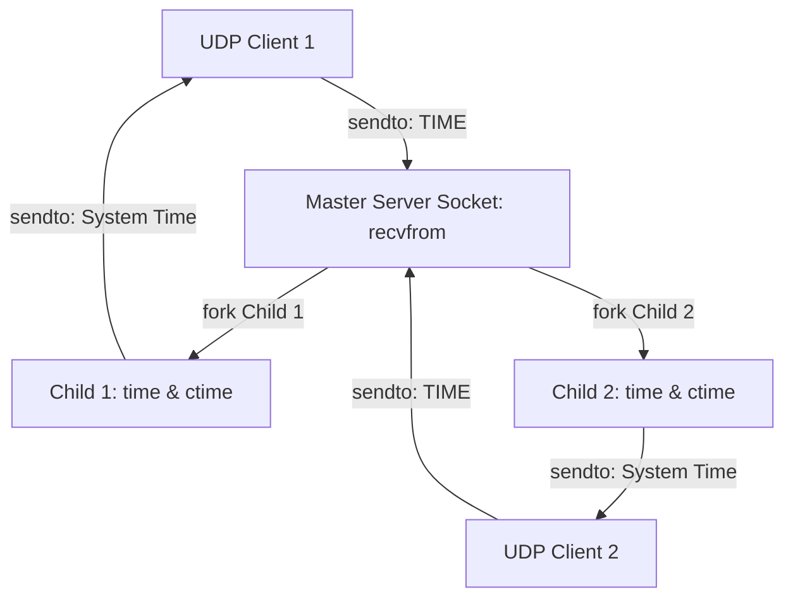
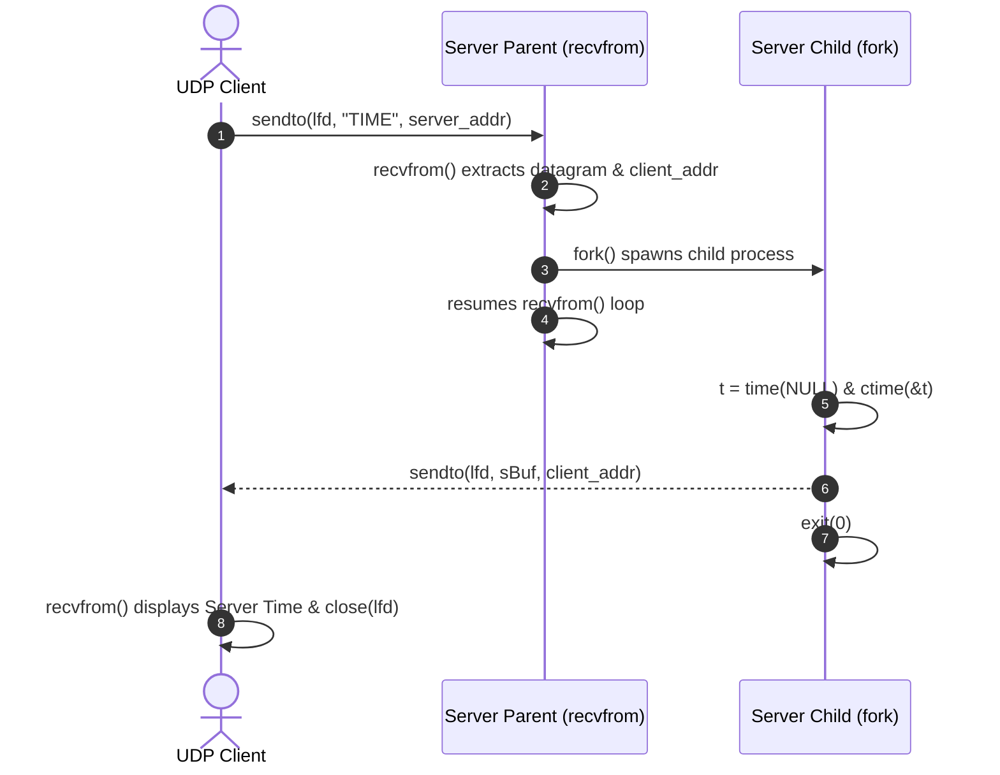

# EXPERIMENT 8: Concurrent Time Server Application Using UDP

**Course Code:** PCCSL507 — Networks Lab  
**Course Type:** Practical / Lab  
**Semester:** S5 (Computer Science & Engineering)  

---

## 1. AIM
To implement a concurrent Time Server application using the User Datagram Protocol (UDP) and process concurrency (`fork()`) in C on Linux to execute on a remote server, wherein:
1. The remote client transmits a time request (`"TIME"`) to the server as a UDP datagram.
2. The server concurrently handles incoming requests using `fork()` without blocking subsequent datagrams.
3. The child process queries the local system clock using `time(NULL)`, formats the date and time using `ctime()`, and sends it back to the client using `sendto()`.
4. The client receives the timestamp via `recvfrom()` and displays the current system time of the remote server.

---

## 2. THEORETICAL BACKGROUND

### 2.1 Iterative vs. Concurrent Servers
- **Iterative Server:** The server processes a single client request completely before reading the next request. If processing takes significant time (e.g. disk I/O, database queries, computation), all other clients are forced to wait in the socket buffer.
- **Concurrent Server:** The server delegates the processing of each incoming request to a distinct concurrent execution unit (either a child process via `fork()` or a lightweight worker thread), returning immediately to listen for further incoming traffic.

### 2.2 Concurrency in UDP
Unlike TCP where `accept()` yields a dedicated connection socket for each client, in UDP all datagrams arrive on a single bound socket (`SOCK_DGRAM`).
To handle requests concurrently:
1. The main server process executes an event loop calling `recvfrom()`.
2. When a datagram arrives, the kernel populates the client's `sockaddr_in` structure.
3. The parent immediately calls `fork()`:
   - **Child Process (`childpid == 0`):** Retrieves the current time using `time(NULL)`, formats it with `ctime()`, and transmits the timestamp string to the client's address using `sendto()`. Once sent, the child exits via `exit(0)`.
   - **Parent Process (`childpid > 0`):** Immediately loops back to `recvfrom()` to accept the next client datagram without waiting.



### 2.3 System Time Functions in C
- `time(time_t *tloc)`: Retrieves current calendar time as seconds elapsed since the Unix Epoch (January 1, 1970 UTC).
- `ctime(const time_t *timep)`: Converts a `time_t` timestamp into a 26-character human-readable string in format `Www Mmm dd hh:mm:ss yyyy\n`.

---

## 3. SEQUENCE DIAGRAM



---

## 4. ALGORITHMS

### 4.1 Server Algorithm
1. **Start**.
2. Create UDP datagram socket using `socket(AF_INET, SOCK_DGRAM, 0)`.
3. Configure `sockaddr_in` server address: `AF_INET`, port `htons(2008)`, address `inet_addr("127.0.0.1")`.
4. Bind socket to designated port using `bind()`.
5. Enter infinite request loop:
   - Clear buffer `memset(rBuf, 0, sizeof rBuf)`.
   - Set `n = sizeof client`.
   - Call `recvfrom(lfd, rBuf, sizeof rBuf, 0, (struct sockaddr *)&client, &n)`.
   - Call `fork()`:
     - In child process (`childpid == 0`):
       - Retrieve calendar time: `t = time(NULL)`.
       - Format time string: `snprintf(sBuf, sizeof sBuf, "%s", ctime(&t))`.
       - Transmit time string using `sendto(lfd, sBuf, sizeof sBuf, 0, (struct sockaddr *)&client, n)`.
       - Call `exit(0)`.
     - In parent process:
       - Loop back immediately to `recvfrom()`.
6. Stop.

### 4.2 Client Algorithm
1. **Start**.
2. Create UDP datagram socket using `socket(AF_INET, SOCK_DGRAM, 0)`.
3. Configure `sockaddr_in` destination server address: port `htons(2008)`, IP `inet_addr("127.0.0.1")`.
4. Set buffer `sBuf = "TIME"` and calculate `n = sizeof server`.
5. Transmit time request string using `sendto(lfd, sBuf, sizeof sBuf, 0, (struct sockaddr *)&server, n)`.
6. Wait for response using `recvfrom(lfd, rBuf, sizeof rBuf, 0, (struct sockaddr *)&server, &n)`.
7. Print received timestamp to standard output.
8. Close socket using `close(lfd)`.
9. Stop.

---

## 5. COMPILATION AND EXECUTION

```bash
cd exp08_udp_concurrent_time_server
gcc server.c -o server
gcc client.c -o client
```

**Terminal 1 (Server):**
```bash
./server
```

**Terminal 2 (Client):**
```bash
./client
```

---

## 6. SAMPLE RUN OUTPUT

### Terminal 1 (Server Console):
```text
Server ready,waiting for client....

Client request: TIME
Sending Time: Sun Oct 18 10:30:15 2026
```

### Terminal 2 (Client Console):
```text
Client ready....

Requesting time from server...
Server Time: Sun Oct 18 10:30:15 2026
```

---

## 7. VIVA VOCE QUESTIONS & ANSWERS

1. **How is concurrency achieved in UDP when there is no `accept()` call?**  
   *Answer:* In UDP, all incoming datagrams arrive on a single bound socket. Concurrency is achieved by having the master receiver immediately hand off the datagram payload and client address to a separate child process via `fork()`, allowing the parent to immediately call `recvfrom()` for subsequent incoming packets.

2. **Why does UDP not require a connection establishment handshake?**  
   *Answer:* UDP is connectionless and stateless. Each datagram is an independent unit containing both source and destination addresses in its header, allowing immediate transmission without prior coordination or state maintenance.

3. **What is the standard port for the Network Time Protocol (NTP)?**  
   *Answer:* NTP runs on UDP port 123. The simpler Daytime Protocol uses TCP or UDP port 13.

4. **What is the function of `ctime()`?**  
   *Answer:* `ctime()` converts a `time_t` timestamp into a 26-character human-readable string in the standard format `Www Mmm dd hh:mm:ss yyyy\n`.

---

## 8. RESULT
A concurrent UDP Time Server application was successfully designed, implemented, and verified in C. The server responded concurrently to remote client datagram requests using process concurrency (`fork()`) and transmitted current system timestamps.
