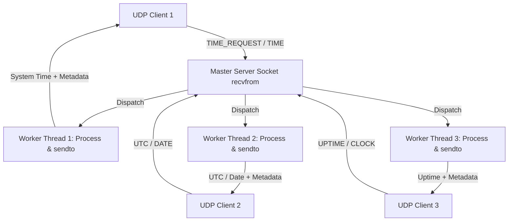
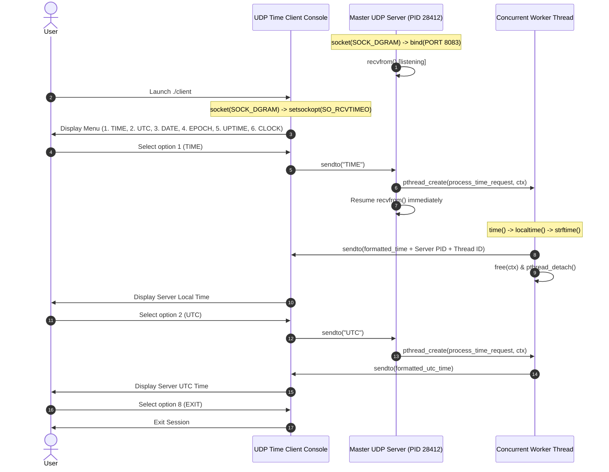

# EXPERIMENT 8: Concurrent Time Server Application Using UDP

**Course Code:** PCCSL507 — Networks Lab  
**Course Type:** Practical / Lab  
**Semester:** S5 (Computer Science & Engineering)  

---

## 1. AIM
To implement a concurrent Time Server application using the User Datagram Protocol (UDP) in C on Linux to execute on a remote server, wherein:
1. The remote client transmits interactive time and telemetry requests (`TIME`, `UTC`, `DATE`, `EPOCH`, `UPTIME`, `CLOCK`, `PING`) to the server.
2. The server concurrently handles incoming requests using multi-threaded workers without blocking subsequent requests.
3. The server queries its system clock, formats the time string, and appends execution metadata (Process ID, Thread ID, Request ID).
4. The server transmits the formatted system time back to the client as a UDP datagram.
5. The client provides an interactive menu and a live synchronized digital clock mode, displaying received remote time values.

---

## 2. THEORETICAL BACKGROUND

### 2.1 Iterative vs. Concurrent Servers
- **Iterative Server:** The server processes a single client request completely before reading the next request. If processing takes significant time (e.g. disk I/O, database queries, computation), all other clients are forced to wait in the socket buffer.
- **Concurrent Server:** The server delegates the processing of each incoming request to a distinct concurrent execution unit (either a child process via `fork()` or a lightweight thread via `pthread_create()`), returning immediately to listen for further incoming traffic.

### 2.2 Concurrency in UDP vs. TCP
In TCP, concurrency is straightforward: `accept()` yields a new, dedicated connected socket descriptor (`connfd`) for each incoming connection.
In UDP, sockets are connectionless and share a single bound port (`SOCK_DGRAM`). All incoming datagrams arrive on the identical socket descriptor.
To build a **Concurrent UDP Server**:
1. The main server thread executes an event loop calling `recvfrom()`.
2. As soon as a datagram arrives, the master thread packages the request data and the client's `sockaddr_in` into a dynamically allocated context structure.
3. The master thread creates a detached worker thread via `pthread_create()` and immediately resumes listening on `recvfrom()`.
4. The worker thread formats the response and calls `sendto()` on the shared socket, passing the client's specific address.



### 2.3 System Time in POSIX C
- `time(time_t *tloc)`: Retrieves the current calendar time as seconds elapsed since the Unix Epoch (January 1, 1970 UTC).
- `localtime(const time_t *timep)`: Breaks down `time_t` into local components within `struct tm`.
- `gmtime(const time_t *timep)`: Breaks down `time_t` into Coordinated Universal Time (UTC/GMT).
- `strftime()`: Formats date and time components into a custom human-readable string buffer.

### 2.4 Client Timeout Handling (`SO_RCVTIMEO`)
Because UDP is connectionless and does not guarantee delivery, a lost request or downed server could cause `recvfrom()` on the client to hang indefinitely.
To avoid hanging, the client configures a socket timeout option using `setsockopt()`:
```c
struct timeval tv;
tv.tv_sec = 3;  // 3 seconds timeout
tv.tv_usec = 0;
setsockopt(sock_fd, SOL_SOCKET, SO_RCVTIMEO, &tv, sizeof(tv));
```

---

## 3. SEQUENCE DIAGRAM



---

## 4. ALGORITHMS

### 4.1 Server Algorithm
1. **Start**.
2. Create a UDP socket using `socket(AF_INET, SOCK_DGRAM, 0)`.
3. Configure `sockaddr_in` with `AF_INET`, `INADDR_ANY`, and `htons(PORT)`.
4. Bind socket to designated port using `bind()`.
5. Display Server PID and status.
6. Enter an infinite request processing loop:
   - Allocate memory for a `request_context_t` structure.
   - Call `recvfrom()` to wait for an incoming datagram from any remote client.
   - Record the client's IP, port, and increment request counter using mutex synchronization.
   - Spawn a detached worker thread via `pthread_create()` passing the context structure.
   - Immediately loop back to `recvfrom()` without waiting.
7. **Worker Thread Routine (`process_time_request`):**
   - Query system clock using `time()`.
   - If query is `UTC` / `GMT`: format UTC time string via `gmtime()`.
   - If query is `DATE`: format full calendar date via `strftime("%A, %B %d, %Y")`.
   - If query is `EPOCH`: return Unix epoch timestamp.
   - If query is `UPTIME`: calculate elapsed time since server start and format uptime.
   - If query is `TIME` or default: format localized time via `localtime()`.
   - Append Server PID, Worker Thread ID, and Request ID.
   - Send response back to the client using `sendto()`.
   - Free context structure and exit thread via `pthread_detach()`.
8. Stop.

### 4.2 Client Algorithm
1. **Start**.
2. Create a UDP socket using `socket(AF_INET, SOCK_DGRAM, 0)`.
3. Set receive timeout (`SO_RCVTIMEO`) to 3 seconds via `setsockopt()`.
4. Configure server address structure (`127.0.0.1:8083`).
5. **If command-line argument passed (`./client <QUERY>`):**
   - Transmit query via `sendto()`, receive response via `recvfrom()`, display, and exit (Batch Mode).
6. **If no arguments passed (Interactive Mode):**
   - Display menu: `TIME`, `UTC`, `DATE`, `EPOCH`, `UPTIME`, `CLOCK`, `EXIT`.
   - Prompt `time-client> `:
     - If `1` or `TIME`: send query, receive and display local time.
     - If `2` or `UTC`: send query, receive and display UTC time.
     - If `3` or `DATE`: send query, receive and display calendar date.
     - If `5` or `UPTIME`: send query, display uptime telemetry.
     - If `6` or `CLOCK`: execute live clock loop querying server once per second for 5 updates.
     - If `8` or `EXIT`: close socket and exit.
7. Stop.

---

## 5. COMPILATION AND EXECUTION

```bash
cd exp08_udp_concurrent_time_server
gcc -Wall -Wextra -O2 -pthread server.c -o server
gcc -Wall -Wextra -O2 client.c -o client
```

**Terminal 1 (Server):**
```bash
./server
```

**Terminal 2 (Client - Interactive Console):**
```bash
./client
time-client> 1
time-client> 2
time-client> DATE
time-client> UPTIME
time-client> CLOCK
time-client> 8
```

**Terminal 3 (Client - Batch Query):**
```bash
./client TIME
./client UTC
```

---

## 6. SAMPLE RUN OUTPUT

### Client Console (Interactive Mode):
```text
=====================================================
     UDP CONCURRENT TIME CLIENT - EXPERIMENT 8       
=====================================================
Connected to Remote Time Server at 127.0.0.1:8083

Available Commands:
  1. TIME   - Query Current Local Server Time
  2. UTC    - Query Universal Coordinated Time (UTC / GMT)
  3. DATE   - Query Server Calendar Date & Day of Week
  4. EPOCH  - Query Unix Epoch Seconds
  5. UPTIME - Query Server Process Uptime & Request Count
  6. CLOCK  - Live Ticking Digital Clock (5 synchronized updates)
  7. HELP   - Display this menu
  8. EXIT   - Exit Client

time-client> 1
=====================================================
SERVER SYSTEM TIME: Thu Oct 08 17:34:26 UTC 2026
[Server PID: 28412 | Worker Thread: 139824102917888 | Request ID: 1]
=====================================================

time-client> 2
=====================================================
SERVER UTC TIME: Thu Oct 08 17:34:26 UTC 2026
[Server PID: 28412 | Worker Thread: 139824094525184 | Request ID: 2]
=====================================================

time-client> DATE
=====================================================
SERVER CALENDAR DATE: Thursday, October 08, 2026 (Day 281 of year 2026)
[Server PID: 28412 | Worker Thread: 139824086132480 | Request ID: 3]
=====================================================

time-client> UPTIME
=====================================================
SERVER UPTIME: 0h 1m 24s (Total requests processed: 4)
[Server PID: 28412 | Worker Thread: 139824077739776 | Request ID: 4]
=====================================================

time-client> CLOCK
[INFO] Live Ticking Clock (Synchronizing with server every 1s for 5 ticks):
  [1/5] SERVER SYSTEM TIME: Thu Oct 08 17:34:30 UTC 2026
  [2/5] SERVER SYSTEM TIME: Thu Oct 08 17:34:31 UTC 2026
  [3/5] SERVER SYSTEM TIME: Thu Oct 08 17:34:32 UTC 2026
  [4/5] SERVER SYSTEM TIME: Thu Oct 08 17:34:33 UTC 2026
  [5/5] SERVER SYSTEM TIME: Thu Oct 08 17:34:34 UTC 2026
[INFO] Clock sync complete.

time-client> 8
[INFO] Exiting Time Client. Goodbye!
```

### Server Console:
```text
=====================================================
     CONCURRENT UDP TIME SERVER (Port: 8083)           
=====================================================
[INFO] Server is running on PID 28412
[INFO] Multi-threaded worker model initialized.
[INFO] Ready to accept concurrent client UDP queries...

[WORKER THREAD 139824102917888] Servicing Request #1 ("1") from 127.0.0.1:52119
[WORKER THREAD 139824102917888] Response sent to 127.0.0.1:52119
[WORKER THREAD 139824094525184] Servicing Request #2 ("2") from 127.0.0.1:52119
[WORKER THREAD 139824094525184] Response sent to 127.0.0.1:52119
[WORKER THREAD 139824086132480] Servicing Request #3 ("DATE") from 127.0.0.1:52119
[WORKER THREAD 139824086132480] Response sent to 127.0.0.1:52119
```

---

## 7. VIVA VOCE QUESTIONS & ANSWERS

1. **How is concurrency achieved in UDP when there is no `accept()` call?**  
   *Answer:* In UDP, the single listening socket receives all datagrams. Concurrency is achieved by having the master receiver thread immediately hand off the datagram payload and client address to a separate worker thread or process, freeing the master thread to immediately call `recvfrom()` for subsequent incoming packets.

2. **Why should a UDP client implement socket timeout?**  
   *Answer:* UDP is an unreliable protocol. If the request datagram is lost in transit, or if the server process is down, the client's `recvfrom()` call would block indefinitely. Setting `SO_RCVTIMEO` allows the client to abort or retransmit gracefully.

3. **What is the standard port for the Network Time Protocol (NTP)?**  
   *Answer:* NTP runs on UDP port 123. The simpler Daytime Protocol uses TCP or UDP port 13.

4. **What is the function of `strftime()`?**  
   *Answer:* `strftime()` formats the broken-down time components stored in a `struct tm` into a human-readable, localized string according to format specifiers (e.g. `%Y` for year, `%H` for hour, `%Z` for timezone).

---

## 8. RESULT
A concurrent UDP Time Server application was successfully implemented and evaluated on Linux. The server responded concurrently to remote time requests using worker threads, reporting localized system time, UTC time, date, uptime telemetry, and process identifiers.
