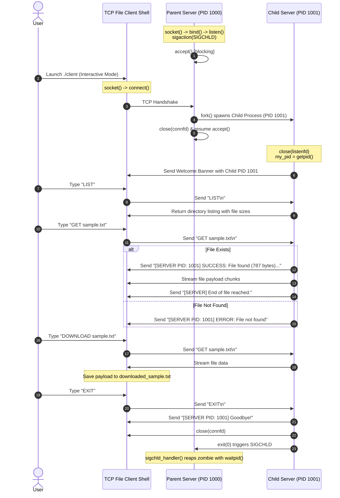

# EXPERIMENT 9: Concurrent File Server Using TCP (Fork-Based)

**Course Code:** PCCSL507 — Networks Lab  
**Course Type:** Practical / Lab  
**Semester:** S5 (Computer Science & Engineering)  

---

## 1. AIM
To develop a concurrent file server using TCP in C on Linux that:
1. Receives interactive file queries (`LIST`, `GET <file>`, `DOWNLOAD <file>`, `INFO <file>`, `HELP`, `EXIT`) or direct filenames from a remote client.
2. If the file exists on the server, reads and transmits its contents to the client.
3. If the file does not exist, sends an appropriate error notification to the client.
4. Concurrently handles multiple simultaneous client connections using process forking (`fork()`).
5. Transmits the worker server Process ID (PID) to the client to be displayed alongside the file contents, metadata, and error messages.
6. Provides an interactive CLI shell on the client with local file download saving capabilities and automated batch mode.

---

## 2. THEORETICAL BACKGROUND

### 2.1 The Classic Unix Concurrent Server Paradigm (`fork()`)
As described in *Unix Network Programming* by W. Richard Stevens, the multiprocess server model using `fork()` is the classic Unix paradigm for concurrent servers:
1. The **Parent Server Process** creates a listening socket (`listenfd`) and invokes `accept()`.
2. When a client connects, `accept()` returns a dedicated connected socket (`connfd`).
3. The parent immediately calls `fork()` to create an identical child process.
4. **In the Child Process (`pid == 0`):**
   - The child inherits copies of all descriptors.
   - It closes `listenfd` (as the child does not listen for new connections).
   - It obtains its own unique process ID via `getpid()`.
   - It maintains an interactive request loop (`LIST`, `GET`, `INFO`, `EXIT`), transmits the PID and data over `connfd`, closes `connfd` on exit, and terminates via `exit()`.
5. **In the Parent Process (`pid > 0`):**
   - It closes `connfd` (as the child is handling the client).
   - It immediately loops back to `accept()` to handle the next client concurrently.

```mermaid
graph TD
    P[Parent Server: PID 1000<br/>Listening on listenfd] -->|accepts connection| P
    P -->|fork() Client 1| C1[Child Process: PID 1001<br/>Servicing Client 1 on connfd1<br/>Returns PID 1001 + file]
    P -->|fork() Client 2| C2[Child Process: PID 1002<br/>Servicing Client 2 on connfd2<br/>Returns PID 1002 + file]
    P -->|fork() Client 3| C3[Child Process: PID 1003<br/>Servicing Client 3 on connfd3<br/>Returns PID 1003 + file]
```

### 2.2 Zombie Processes and `SIGCHLD` Handling
When a child process terminates via `exit()`, its process descriptor and exit status remain in the kernel process table until collected by the parent. If the parent does not reap terminated children, they become **Zombie (Defunct) processes**, consuming kernel PID resources.
To prevent zombies:
1. The server registers a signal handler for `SIGCHLD`.
2. Inside the handler, it calls `waitpid()` in a non-blocking loop:
   ```c
   void sigchld_handler(int sig) {
       while (waitpid(-1, NULL, WNOHANG) > 0);
   }
   ```
3. `WNOHANG` ensures that the handler reaps all dead child processes immediately without blocking if other children are still executing.

---

## 3. SEQUENCE DIAGRAM



---

## 4. ALGORITHMS

### 4.1 Parent Server Algorithm
1. **Start**.
2. Install `sigchld_handler` using `sigaction` with `SA_RESTART` and `SA_NOCLDSTOP`.
3. Create TCP stream socket using `socket(AF_INET, SOCK_STREAM, 0)`.
4. Configure server address with `AF_INET`, `INADDR_ANY`, and `PORT 8084`.
5. Bind socket using `bind()` and enter listening state with `listen()`.
6. Print Parent Server PID using `getpid()`.
7. Loop indefinitely:
   - Call `accept()` to obtain `connfd`.
   - Call `fork()`:
     - **If `fork() < 0`:** Log error.
     - **If `fork() == 0` (Child):** Close `server_fd`, execute interactive client handler, and exit.
     - **If `fork() > 0` (Parent):** Close `client_fd` and return to `accept()`.
8. Stop.

### 4.2 Child Worker Algorithm
1. Obtain child process ID using `getpid()`.
2. Transmit welcome banner with child PID.
3. Enter interactive command loop:
   - Read command line from `connfd` using `recv()`.
   - If client disconnects or sends `EXIT` / `QUIT`: send goodbye and break loop.
   - If command is `LIST` / `DIR`: read directory using `opendir()`, stream file names and sizes, and send delimiter.
   - If command is `INFO <file>`: inspect file using `stat()`, format size/permissions/timestamp with child PID, and return.
   - If command is `GET <file>` or direct filename:
     - Try opening `fopen(file, "rb")`.
     - If exists: send header with child PID and size, stream file blocks, and send EOF delimiter.
     - If not: send error message with child PID.
4. Close `connfd`.
5. Call `exit(0)` to terminate child process.

### 4.3 Client Algorithm
1. **Start**.
2. Create TCP stream socket and connect to `127.0.0.1:8084`.
3. Read server welcome banner and child PID.
4. **If arguments supplied on command line (`./client <filename>`):**
   - Transmit `GET <filename>`, receive and display contents, close socket, and exit (Batch Mode).
5. **If no arguments supplied (Interactive Mode):**
   - Display menu: `LIST`, `GET`, `DOWNLOAD`, `INFO`, `HELP`, `EXIT`.
   - Loop prompt `file-client> `:
     - If `LIST`: send `LIST`, receive and display server file catalog.
     - If `INFO <file>`: send `INFO <file>`, display file metadata.
     - If `GET <file>`: send `GET <file>`, print contents on terminal with server PID.
     - If `DOWNLOAD <file>`: send `GET <file>`, extract content, and save to `downloaded_<file>`.
     - If `EXIT`: send `EXIT`, close connection, and exit.
6. Stop.

---

## 5. COMPILATION & EXECUTION STEPS

```bash
cd exp09_tcp_concurrent_file_server
gcc -Wall -Wextra -O2 server.c -o server
gcc -Wall -Wextra -O2 client.c -o client
```

**Terminal 1 (Server):**
```bash
./server
```

**Terminal 2 (Client 1 - Interactive Shell):**
```bash
./client
file-client> LIST
file-client> INFO sample.txt
file-client> GET sample.txt
file-client> DOWNLOAD sample.txt
file-client> EXIT
```

**Terminal 3 (Client 2 - Batch Mode):**
```bash
./client sample.txt
```

---

## 6. SAMPLE RUN OUTPUT

### Client 1 Console (Interactive CLI Shell):
```text
=====================================================
        CONCURRENT TCP FILE CLIENT - EXPERIMENT 9    
=====================================================
[SERVER PID: 31205] Connected to Concurrent File Server. Type HELP for commands.
Type 'HELP' for available commands or 'EXIT' to quit.

file-client> LIST
[SERVER PID: 31205] Files hosted on server:
-------------------------------------------------------------
   1. client.c                 (6446 bytes)
   2. RECORD.md                (11868 bytes)
   3. sample.txt               (787 bytes)
   4. server.c                 (11957 bytes)
-------------------------------------------------------------
[SERVER] End of command output.

file-client> INFO sample.txt
[SERVER PID: 31205] File Metadata for 'sample.txt':
  Size:          787 bytes
  Last Modified: 2026-10-01 09:17:38
  Permissions:   0777
[SERVER] End of command output.

file-client> GET sample.txt
[SERVER PID: 31205] SUCCESS: File 'sample.txt' found (787 bytes). Transmitting contents below:
-------------------------------------------------------------
=============================================================
             KTU PCCSL507 NETWORKS LAB EXPERIMENT 9
                 CONCURRENT FILE SERVER TEST FILE
=============================================================
This is a sample text file hosted on the concurrent TCP server.
When requested by a client, the server:
1. Spawns a child process using fork().
2. Obtains its unique Child Process ID (PID) via getpid().
3. Sends its PID to the client.
4. Streams the contents of this file over the TCP socket.
=============================================================

-------------------------------------------------------------
[SERVER] End of file reached.

file-client> DOWNLOAD sample.txt
[SUCCESS] File saved locally as 'downloaded_sample.txt' (787 bytes).

file-client> EXIT
[SERVER PID: 31205] Goodbye! Closing session.
[INFO] Session closed. Exiting.
```

### Client 2 Console (File Not Found):
```text
file-client> GET missing_file.txt
[SERVER PID: 31210] ERROR: File 'missing_file.txt' not found on server.
[SERVER] End of file reached.
```

### Server Console:
```text
=====================================================
   CONCURRENT TCP FILE SERVER (Port: 8084)             
=====================================================
[INFO] Parent Server listening with PID: 31200

[PARENT PID 31200] Forked child process with PID 31205 to handle client.
[CHILD PID 31205] Handling connection from 127.0.0.1:54112
[CHILD PID 31205] Request from 127.0.0.1:54112: "LIST"
[CHILD PID 31205] Request from 127.0.0.1:54112: "INFO sample.txt"
[CHILD PID 31205] Request from 127.0.0.1:54112: "GET sample.txt"
[CHILD PID 31205] File 'sample.txt' transmitted successfully.
[CHILD PID 31205] Request from 127.0.0.1:54112: "EXIT"
[CHILD PID 31205] Finished servicing client 127.0.0.1:54112. Exiting child process.

[PARENT PID 31200] Forked child process with PID 31210 to handle client.
[CHILD PID 31210] Handling connection from 127.0.0.1:54118
[CHILD PID 31210] Request from 127.0.0.1:54118: "GET missing_file.txt"
[CHILD PID 31210] File 'missing_file.txt' not found. Sent error response.
```

---

## 7. VIVA VOCE QUESTIONS & ANSWERS

1. **Why does the parent process close `connfd` while the child process closes `listenfd`?**  
   *Answer:* `fork()` creates an exact duplicate of the parent's file descriptor table, incrementing reference counts in the kernel file table. The parent does not handle client communication, so it closes `connfd` to prevent descriptor leaks and allow connection termination when the child closes its descriptor. The child does not listen for incoming connections, so it closes `listenfd` to release the listening socket resource.

2. **What is a Zombie process, and how does the server prevent it?**  
   *Answer:* A zombie process is a child that has terminated (`exit()`) whose entry remains in the process table so its parent can read its exit status. If the parent does not call `wait()`/`waitpid()`, zombies accumulate. The server prevents zombies by registering a `SIGCHLD` handler that calls `waitpid(-1, NULL, WNOHANG)` in a loop to reap dead children asynchronously.

3. **What is the purpose of the `WNOHANG` flag in `waitpid()`?**  
   *Answer:* It instructs `waitpid()` not to block if no child process has exited. This ensures that the `SIGCHLD` handler finishes immediately without freezing the parent process.

4. **Why is transmitting the server PID significant in this experiment?**  
   *Answer:* It provides direct empirical proof that multiple clients connecting concurrently are handled by distinct, isolated operating system processes spawned by `fork()`, verifying concurrent execution.

---

## 8. RESULT
A concurrent TCP file server using process forking (`fork()`) and an interactive client shell were successfully implemented in C on Linux. The server serviced concurrent client requests, returned directory listings, metadata, and file contents alongside worker Process IDs, and gracefully prevented zombie processes using `SIGCHLD` and `waitpid()`.
