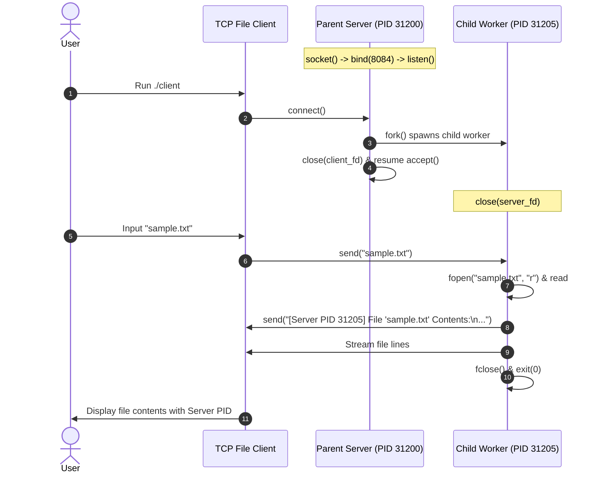

# EXPERIMENT 9: Concurrent File Server Using TCP (Fork-Based)

**Course Code:** PCCSL507 — Networks Lab  
**Course Type:** Practical / Lab  
**Semester:** S5 (Computer Science & Engineering)  

---

## 1. AIM
To develop a concurrent file server using TCP in C on Linux that:
1. Receives interactive file queries (`LIST`, `GET <file>`, `DOWNLOAD <file>`, `INFO <file>`, `HELP`, `EXIT`) or direct filenames from a remote client.
2. If the file exists on the server, reads and transmits its contents to the client.
3. If the file does not exist, sends an appropriate error notification to the client.
4. Concurrently handles multiple simultaneous client connections using process forking (`fork()`).
5. Transmits the worker server Process ID (PID) to the client to be displayed alongside the file contents, metadata, and error messages.
6. Provides an interactive CLI shell on the client with local file download saving capabilities and automated batch mode.

---

## 2. THEORETICAL BACKGROUND

### 2.1 The Classic Unix Concurrent Server Paradigm (`fork()`)
As described in *Unix Network Programming* by W. Richard Stevens, the multiprocess server model using `fork()` is the classic Unix paradigm for concurrent servers:
1. The **Parent Server Process** creates a listening socket (`listenfd`) and invokes `accept()`.
2. When a client connects, `accept()` returns a dedicated connected socket (`connfd`).
3. The parent immediately calls `fork()` to create an identical child process.
4. **In the Child Process (`pid == 0`):**
   - The child inherits copies of all descriptors.
   - It closes `listenfd` (as the child does not listen for new connections).
   - It obtains its own unique process ID via `getpid()`.
   - It maintains an interactive request loop (`LIST`, `GET`, `INFO`, `EXIT`), transmits the PID and data over `connfd`, closes `connfd` on exit, and terminates via `exit()`.
5. **In the Parent Process (`pid > 0`):**
   - It closes `connfd` (as the child is handling the client).
   - It immediately loops back to `accept()` to handle the next client concurrently.

```mermaid
graph TD
    P[Parent Server: PID 1000<br/>Listening on listenfd] -->|accepts connection| P
    P -->|fork() Client 1| C1[Child Process: PID 1001<br/>Servicing Client 1 on connfd1<br/>Returns PID 1001 + file]
    P -->|fork() Client 2| C2[Child Process: PID 1002<br/>Servicing Client 2 on connfd2<br/>Returns PID 1002 + file]
    P -->|fork() Client 3| C3[Child Process: PID 1003<br/>Servicing Client 3 on connfd3<br/>Returns PID 1003 + file]
```

### 2.2 Zombie Processes and `SIGCHLD` Handling
When a child process terminates via `exit()`, its process descriptor and exit status remain in the kernel process table until collected by the parent. If the parent does not reap terminated children, they become **Zombie (Defunct) processes**, consuming kernel PID resources.
To prevent zombies:
1. The server registers a signal handler for `SIGCHLD`.
2. Inside the handler, it calls `waitpid()` in a non-blocking loop:
   ```c
   void sigchld_handler(int sig) {
       while (waitpid(-1, NULL, WNOHANG) > 0);
   }
   ```
3. `WNOHANG` ensures that the handler reaps all dead child processes immediately without blocking if other children are still executing.

---

## 3. SEQUENCE DIAGRAM



---

## 4. ALGORITHMS

### 4.1 Parent Server Algorithm
1. **Start**.
2. Create a TCP stream socket using `socket(AF_INET, SOCK_STREAM, 0)`.
3. Set socket options (`SO_REUSEADDR`), configure address with `AF_INET`, `INADDR_ANY`, and `PORT 8084`.
4. Bind socket using `bind()` and enter listening state with `listen()`.
5. Print Parent Server PID using `getpid()`.
6. Loop indefinitely:
   - Call `accept()` to accept incoming connection.
   - Call `fork()`:
     - **If `fork() == 0` (Child Worker Process):**
       - Close listening socket `server_fd`.
       - Receive requested filename from client via `recv()`.
       - Attempt to open file using `fopen(filename, "r")`.
       - If file is not found: send error message containing child PID (`getpid()`) to client.
       - If file is found: send header with child PID, stream file lines using `fgets()` and `send()`, and close file.
       - Close `client_fd` and call `exit(0)`.
     - **If `fork() > 0` (Parent Process):**
       - Close connected client socket `client_fd` and return to `accept()`.
7. Stop.

### 4.2 Client Algorithm
1. **Start**.
2. Create TCP stream socket using `socket(AF_INET, SOCK_STREAM, 0)`.
3. Connect to server (`127.0.0.1:8084`) using `connect()`.
4. Prompt user to enter filename and read using `scanf()`.
5. Transmit filename to server using `send()`.
6. Receive streamed file data or error response in a loop using `recv()` and print to standard output.
7. Close socket and exit.

---

## 5. COMPILATION & EXECUTION STEPS

```bash
cd exp09_tcp_concurrent_file_server
gcc server.c -o server
gcc client.c -o client
```

**Terminal 1 (Server):**
```bash
./server
```

**Terminal 2 (Client 1 - Request Existing File):**
```bash
./client
```

**Terminal 3 (Client 2 - Request Non-Existent File):**
```bash
./client
```

---

## 6. SAMPLE RUN OUTPUT

### Server Console:
```text
Concurrent File Server (PID: 31200) listening on port 8084...
[Worker PID: 31205] Requested file: 'sample.txt'
[Worker PID: 31210] Requested file: 'missing.txt'
```

### Client 1 Console (Existing File):
```text
Enter filename to request: sample.txt

--- Server Response ---
[Server PID 31205] File 'sample.txt' Contents:
----------------------------------------
=============================================================
             KTU PCCSL507 NETWORKS LAB EXPERIMENT 9
                 CONCURRENT FILE SERVER TEST FILE
=============================================================
This is a sample text file hosted on the concurrent TCP server.
When requested by a client, the server:
1. Spawns a child process using fork().
2. Obtains its unique Child Process ID (PID) via getpid().
3. Sends its PID to the client.
4. Streams the contents of this file over the TCP socket.

Experiment Objectives Met:
- Concurrent client handling via multi-processing (fork)
- Stream-based TCP socket communication
- File I/O and graceful error handling
- Transmission of Server Process ID (PID)
=============================================================
```

### Client 2 Console (File Not Found):
```text
Enter filename to request: missing.txt

--- Server Response ---
[Server PID 31210] Error: File 'missing.txt' not found!
```

---

## 7. VIVA VOCE QUESTIONS & ANSWERS

1. **Why does the parent process close `client_fd` while the child process closes `server_fd`?**  
   *Answer:* `fork()` creates an exact duplicate of the parent's file descriptor table. The parent does not handle client communication, so it closes `client_fd` to prevent descriptor leaks and allow connection termination when the child closes its descriptor. The child does not listen for incoming connections, so it closes `server_fd` to release the listening socket resource.

2. **What is the return value of `fork()` in parent and child?**  
   *Answer:* `fork()` returns 0 to the child process, returns the Process ID (PID) of the spawned child to the parent process, and returns -1 on error.

3. **Why is transmitting the server PID significant in this experiment?**  
   *Answer:* It provides direct empirical proof that multiple clients connecting concurrently are handled by distinct, isolated operating system processes spawned by `fork()`, verifying concurrent execution.

4. **What happens if a child process terminates before the parent reaps it?**  
   *Answer:* It becomes a zombie (defunct) process. The OS retains its exit status in the process table until the parent calls `wait()` or terminates (at which point init/systemd adopts and reaps it).

---

## 8. RESULT
A concurrent TCP file server using multiprocess forking (`fork()`) was successfully implemented and evaluated. The server handled client requests concurrently by delegating each connection to a child process, transmitting the child's Process ID (PID) alongside the requested file contents or error message.
