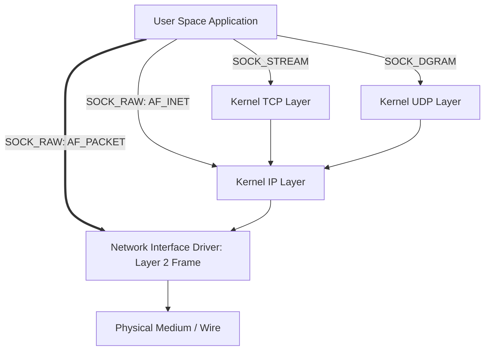
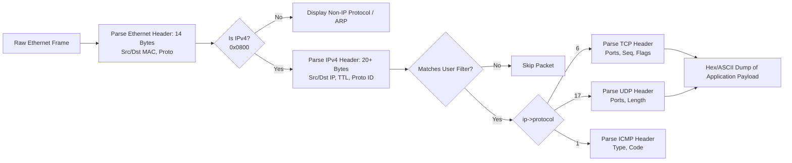

# EXPERIMENT 10: Packet-Capturing Application Using Raw Sockets

**Course Code:** PCCSL507 — Networks Lab  
**Course Type:** Practical / Lab  
**Semester:** S5 (Computer Science & Engineering)  

---

## 1. AIM
To develop a packet-capturing application (packet sniffer) using raw sockets in C on Linux that:
1. Intercepts incoming and outgoing network packets at the data link layer.
2. Provides an interactive console allowing the user to select capture packet limits and protocol filters (All, TCP only, UDP only, ICMP only).
3. Dissects Ethernet frames and decodes MAC addresses and protocol identifiers.
4. Decodes the IPv4 network layer header (Source IP, Destination IP, TTL, IHL, Total Length, Protocol).
5. Dissects transport layer headers (TCP ports and flags, UDP ports and lengths, ICMP types and codes).
6. Provides a hex and ASCII payload preview of the captured packet data.
7. Aggregates and prints packet capture statistics.

---

## 2. THEORETICAL BACKGROUND

### 2.1 Understanding Raw Sockets (`SOCK_RAW`)
In standard network programming:
- **Stream Sockets (`SOCK_STREAM`):** Interface at Layer 4 (Transport layer - TCP). The operating system kernel automatically builds the TCP and IP headers and parses them. Applications only see the raw byte stream payload.
- **Datagram Sockets (`SOCK_DGRAM`):** Interface at Layer 4 (Transport layer - UDP). The kernel handles IP and UDP headers.
- **Raw Sockets (`SOCK_RAW`):** Bypass the transport and network layer protocol stacks, granting the user application direct access to lower-level packet headers and frames.



### 2.2 Domain Types for Raw Sockets in Linux
1. `AF_INET, SOCK_RAW`: Operates at Layer 3 (Network Layer). The application can inspect or construct IP headers or receive specific IP protocols (such as ICMP, IGMP, or raw TCP/UDP). Link-layer headers (Ethernet) are stripped by the kernel.
2. `AF_PACKET, SOCK_RAW, htons(ETH_P_ALL)`: Operates at Layer 2 (Data Link Layer). Intercepts all raw Ethernet frames (including Ethernet header, ARP packets, IP packets, 802.1Q VLAN tags) directly from the device driver queue before any kernel processing.

### 2.3 Protocol Header Structures in Linux C

#### A. Ethernet Header (`struct ethhdr` in `<linux/if_ether.h>`)
- Total size: 14 bytes.
- Destination MAC: 6 bytes (`h_dest`)
- Source MAC: 6 bytes (`h_source`)
- Protocol Type: 2 bytes (`h_proto` — e.g., `0x0800` for IPv4, `0x0806` for ARP)

#### B. IPv4 Header (`struct iphdr` in `<netinet/ip.h>`)
- Total size: Minimum 20 bytes.
- Version (4 bits) & Internet Header Length (IHL, 4 bits $\times 4 = \text{bytes}$).
- Total Length (16 bits), TTL (8 bits), Protocol (8 bits: 6 = TCP, 17 = UDP, 1 = ICMP).
- Source IP (`saddr`, 32 bits) and Destination IP (`daddr`, 32 bits).

#### C. TCP Header (`struct tcphdr` in `<netinet/tcp.h>`)
- Source Port (16 bits), Destination Port (16 bits).
- Sequence Number (32 bits), Acknowledgment Number (32 bits).
- Data Offset / Header Length (4 bits $\times 4$).
- Control Flags: `syn`, `ack`, `fin`, `rst`, `psh`, `urg`.

#### D. UDP Header (`struct udphdr` in `<netinet/udp.h>`)
- 8 bytes total: Source Port (16 bits), Destination Port (16 bits), Length (16 bits), Checksum (16 bits).

#### E. ICMP Header (`struct icmphdr` in `<netinet/ip_icmp.h>`)
- Type (8 bits: 8 = Echo Request, 0 = Echo Reply), Code (8 bits), Checksum (16 bits).

### 2.4 Security and Privileges
Raw sockets enable packet eavesdropping, sniffing unencrypted credentials, and packet spoofing. Consequently, the Linux kernel strictly restricts `SOCK_RAW` creation to processes running with `CAP_NET_RAW` capability or superuser (`root` / `sudo`) privileges.

---

## 3. PACKET DECAPSULATION PIPELINE



---

## 4. ALGORITHM

1. **Start**.
2. Create a raw link-layer packet socket:
   ```c
   sock = socket(AF_PACKET, SOCK_RAW, htons(ETH_P_ALL));
   ```
3. Check socket creation return value; if `< 0`, report error requiring root privileges (`sudo`) and exit.
4. Execute capture loop for 5 frames:
   - Call `recvfrom()` to read raw link-layer Ethernet frame into buffer.
   - Cast start of buffer to `struct ethhdr *`.
   - Display frame size and Source / Destination MAC addresses in hexadecimal format (`%02X`).
   - Check if EtherType is IPv4 (`ntohs(eth->h_proto) == ETH_P_IP`).
   - If IPv4:
     - Cast payload offset (`buffer + sizeof(struct ethhdr)`) to `struct iphdr *`.
     - Extract and print Source and Destination IP addresses using `inet_ntoa()`.
     - Inspect `ip->protocol` field: print whether TCP (`6`), UDP (`17`), or ICMP (`1`).
5. Close raw socket and exit.

---

## 5. COMPILATION AND EXECUTION

```bash
cd exp10_raw_socket_packet_sniffer
gcc sniffer.c -o sniffer
sudo ./sniffer
```

*(Tip: In another terminal, generate network traffic such as `ping -c 3 8.8.8.8` or `curl http://example.com` to see live frames captured immediately).*

---

## 6. SAMPLE RUN OUTPUT

```text
Raw Socket Sniffer started. Capturing 5 packets...

--- Packet #1 (98 bytes) ---
MAC: 00:15:5D:89:12:01 -> 00:15:5D:89:12:02
IP:  192.168.1.15 -> 8.8.8.8 | Protocol: ICMP (1)

--- Packet #2 (74 bytes) ---
MAC: 00:15:5D:89:12:01 -> 52:54:00:12:35:02
IP:  192.168.1.15 -> 142.250.190.46 | Protocol: TCP (6)

--- Packet #3 (60 bytes) ---
MAC: 52:54:00:12:35:02 -> 00:15:5D:89:12:01
IP:  142.250.190.46 -> 192.168.1.15 | Protocol: TCP (6)

--- Packet #4 (128 bytes) ---
MAC: 00:15:5D:89:12:01 -> 52:54:00:12:35:02
IP:  192.168.1.15 -> 1.1.1.1 | Protocol: UDP (17)

--- Packet #5 (85 bytes) ---
MAC: 52:54:00:12:35:02 -> 00:15:5D:89:12:01
IP:  1.1.1.1 -> 192.168.1.15 | Protocol: UDP (17)
```

---

## 7. VIVA VOCE QUESTIONS & ANSWERS

1. **What is a raw socket, and how does it differ from standard sockets?**  
   *Answer:* Standard sockets (`SOCK_STREAM`, `SOCK_DGRAM`) interface at the transport layer, where the kernel generates and parses protocol headers automatically. A raw socket (`SOCK_RAW`) bypasses transport/network layer processing, giving applications direct access to lower-layer protocol headers and raw wire frames.

2. **Why does creating a raw socket require root or `sudo` privileges?**  
   *Answer:* Raw sockets can intercept all traffic passing through network interfaces (including plain-text passwords, session cookies, and private communications) and can forge/spoof arbitrary IP and MAC headers. Hence, the kernel restricts raw socket creation to users with the `CAP_NET_RAW` capability.

3. **What is the difference between `AF_INET` and `AF_PACKET` for raw sockets?**  
   *Answer:* `AF_INET, SOCK_RAW` captures at the network layer (Layer 3); the kernel strips the link-layer header. `AF_PACKET, SOCK_RAW` captures at the data link layer (Layer 2), providing access to the raw Ethernet frame, including source/destination MAC addresses and EtherType.

4. **What is Promiscuous Mode?**  
   *Answer:* By default, a Network Interface Card (NIC) discards frames whose destination MAC does not match its own MAC address or broadcast/multicast addresses. In promiscuous mode, the NIC passes *all* incoming frames to the operating system regardless of the destination MAC address.

5. **How does the sniffer determine whether the payload is TCP, UDP, or ICMP?**  
   *Answer:* The sniffer examines the 8-bit `protocol` field inside the IPv4 header:
   - Protocol `6` indicates TCP.
   - Protocol `17` indicates UDP.
   - Protocol `1` indicates ICMP.

---

## 8. RESULT
A link-layer packet-capturing program was successfully developed and evaluated using Linux raw sockets (`AF_PACKET`). The program captured live network frames, decapsulated Ethernet headers to extract MAC addresses, and dissected IPv4 headers to resolve Source/Destination IP addresses and transport protocol types (TCP, UDP, ICMP).
