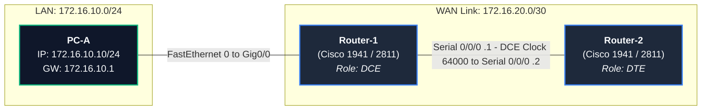

# EXPERIMENT 11: Familiarizing Router Commands — Cisco Packet Tracer Practical Guide

**Course Code:** PCCSL507 — Networks Lab  
**Course Type:** Practical / Lab (Cisco Packet Tracer Based)  
**Semester:** S5 (Computer Science & Engineering)  

---

## 1. OBJECTIVE & SYLLABUS REQUIREMENTS

According to the KTU PCCSL507 syllabus:
> **Familiarizing router commands:**  
> (a) Knowing the current mode (user or privileged), switching to privileged mode  
> (b) Switching to configuration mode  
> (c) Obtaining router information such as type, OS, memory stats, interface details etc.  
> (d) Viewing the status of any routing protocols currently configured  
> (e) Showing the routing table  
> (f) Saving the running configuration  
> (g) Viewing the command history  
> (h) Viewing the router clock  
> (i) Viewing the list of hosts  
> (j) Displaying the statistics for all the interfaces (Both detailed and brief views)  
> (k) Knowing the controller type (DTE or DCE)  
> (l) Configuring serial and ethernet interfaces — enabling the interface, setting IP address, mask, and clock rate  

---

## 2. CISCO PACKET TRACER TOPOLOGY SETUP

> [!IMPORTANT]
> ### Modern Packet Tracer Hardware Selection (PT 8.x / 7.x & CCNA Standards)
> The legacy router models shown in the university syllabus diagram (`Cisco 2621` and `Cisco 2501`) are discontinued and **not available** in modern Cisco Packet Tracer versions.
> Across engineering universities (KTU, VTU, Anna Univ) and CCNAv7 curricula, the following modern devices and interface mappings are standard:
> 1. **Primary Modern Router**: Select **Cisco 1941 (ISR G2)** or **Cisco 2911** from the bottom router shelf.
> 2. **Serial WAN Module**: Install the **`HWIC-2T`** (High-Speed WAN Interface Card) in **Slot 0** (Power OFF router in *Physical* tab -> drag `HWIC-2T` to Slot 0 -> Power ON).
> 3. **Interface Names**:
>    - **LAN Ethernet**: **`GigabitEthernet 0/0` (`g0/0`)** replaces legacy `FastEthernet 0/0`.
>    - **Serial WAN**: **`Serial 0/0/0` (`s0/0/0`)** and **`Serial 0/0/1` (`s0/0/1`)**.
> 4. **Alternative Generic Option**: You may also use the **Router-PT (Generic)** with `PT-ROUTER-NM-1FFE` and `PT-ROUTER-NM-1SS`.
> *(If your college lab computers run legacy 2811 routers, simply use `FastEthernet 0/0` instead of `GigabitEthernet 0/0`).*


To practice all commands (especially Serial DTE/DCE controller and clock rate), we will configure two routers connected back-to-back via a Serial link, plus a local Ethernet LAN connection.

### Topology Diagram (ASCII)
```text
           [GigabitEthernet 0/0]                      [Serial 0/0/0 (DTE)]
 [PC-A] ===================== [ Router-1 ] ------------------------- [ Router-2 ]
172.16.10.10          172.16.10.1          172.16.20.1 (DCE)      172.16.20.2
(LAN Host)             (Gateway)           Clock Rate: 64000
```

### Mermaid Topology Diagram


---

## 3. STEP-BY-STEP SETUP IN CISCO PACKET TRACER

### Step 3.1: Choosing Devices
1. In the bottom-left device panel, select **Network Devices $\rightarrow$ Routers**.
2. Drag two routers onto the workspace:
   - **Router 1:** Cisco 1941 (Primary Standard in PT 8.x) or Cisco 2911 / Router-PT
   - **Router 2:** Cisco 1941 (Primary Standard in PT 8.x) or Cisco 2911 / Router-PT
3. Select **End Devices $\rightarrow$ PC**, drag one **PC-PT** onto the workspace (name it `PC-A`).

### Step 3.2: Installing Serial Interface Cards (HWIC-2T)
> [!IMPORTANT]
> Cisco 2811 and 1941 routers do not have serial ports installed by default. You must add the serial module manually!

1. Click on **Router 1** to open its device dialog.
2. Select the **Physical** tab.
3. Turn **OFF** the power switch on the router (small green/black rocker switch on the right side).
4. From the left **MODULES** list, click **HWIC-2T** (2-port serial high-speed WAN interface card).
5. Drag the **HWIC-2T** card into the empty slot `Slot 0` (WIC 0).
6. Turn the power switch back **ON**.
7. Repeat the exact same steps for **Router 2**.

### Step 3.3: Cabling the Devices
1. Click the **Connections** (lightning bolt) icon.
2. **PC-A to Router 1:**
   - Select **Copper Straight-Through Cable** (solid black line).
   - Click `PC-A` $\rightarrow$ choose `FastEthernet0`.
   - Click `Router 1` $\rightarrow$ choose `GigabitEthernet0/0`.
3. **Router 1 to Router 2 (Serial DCE/DTE):**
   - Select **Serial DCE Cable** (red jagged wire with a small clock symbol).
   - Click `Router 1` first $\rightarrow$ choose `Serial0/0/0` (This end becomes the **DCE** end).
   - Click `Router 2` second $\rightarrow$ choose `Serial0/0/0` (This end becomes the **DTE** end).

---

## 4. DETAILED COMMAND WALKTHROUGH & SYLLABUS TASKS

Open the router console by clicking on `Router 1` $\rightarrow$ navigate to the **CLI** tab.  
When asked: `Would you like to enter the initial configuration dialog? [yes/no]:`, type **`no`** and press **Enter**.

---

### (a) Knowing Current Mode & Switching to Privileged Mode
Cisco IOS uses a hierarchical mode structure:
- **User EXEC Mode:** Indicated by the `>` prompt (`Router>`). Only basic non-disruptive inspection commands are permitted.
- **Privileged EXEC Mode (Enable Mode):** Indicated by the `#` prompt (`Router#`). Full inspection, debugging, reload, and access to configuration mode are allowed.

```text
Router> 
Router> enable
Router# 
Router# disable
Router>
```
* **Command to enter Privileged mode:** `enable`
* **Command to exit back to User mode:** `disable`
* **Prompt change:** `Router>` $\rightarrow$ `Router#`

---

### (b) Switching to Configuration Mode
To modify the device configuration (hostnames, IP addresses, interfaces, protocols), enter Global Configuration Mode:

```text
Router# configure terminal
Enter configuration commands, one per line.  End with CNTL/Z.
Router(config)# 
```
* **Exit Global Config Mode back to Privileged Mode:** `exit` or press `Ctrl + Z` or `end`.

---

### (c) Obtaining Router System Information
Displays IOS version, hardware model, uptime, system image file name, RAM size, NVRAM size, Flash memory size, and physical interfaces.

```text
Router# show version
```
**Sample Output:**
```text
Cisco IOS Software, 2800 Software (C2800NM-ADVIPSERVICESK9-M), Version 12.4(15)T1
Technical Support: http://www.cisco.com/techsupport
Copyright (c) 1986-2007 by Cisco Systems, Inc.

ROM: System Bootstrap, Version 12.4(13r)T, RELEASE SOFTWARE (fc1)

Router uptime is 15 minutes
System image file is "flash:c2800nm-advipservicesk9-mz.124-15.T1.bin"

Cisco 2811 (revision 1.0) with 249856K/12288K bytes of memory.
Processor board ID FTX1142W0J5
2 FastEthernet interfaces
2 Serial(sync/async) interfaces
DRAM configuration is 64 bits wide with parity disabled.
239K bytes of non-volatile configuration memory.
62720K bytes of ATA CompactFlash (Read/Write)
```

---

### (d) Viewing the Status of Configured Routing Protocols
Displays currently running dynamic routing protocols (e.g., RIP, OSPF, EIGRP), timers, advertised networks, and routing information sources.

```text
Router# show ip protocols
```
*If no routing protocol is active, nothing is printed or output states: `*** IP Routing is enabled ***`.*

---

### (e) Showing the Routing Table
Displays the router's IPv4 routing table containing directly connected networks, static routes, and dynamically learned routes.

```text
Router# show ip route
```
**Sample Output:**
```text
Codes: C - connected, S - static, R - RIP, M - mobile, B - BGP
       D - EIGRP, EX - EIGRP external, O - OSPF, IA - OSPF inter area 

Gateway of last resort is not set

C    172.16.10.0/24 is directly connected, GigabitEthernet0/0
C    172.16.20.0/24 is directly connected, Serial0/0/0
```

---

### (f) Saving the Running Configuration
The active running configuration is stored in volatile **RAM** (`running-config`). To survive a reboot, it must be committed to non-volatile **NVRAM** (`startup-config`).

```text
Router# copy running-config startup-config
Destination filename [startup-config]? [Press Enter]
Building configuration...
[OK]
```
*Shortcut equivalent command:*
```text
Router# write memory
Building configuration...
[OK]
```

---

### (g) Viewing the Command History
Cisco IOS stores previously entered commands in a circular history buffer (default size is 10 commands).

```text
Router# show history
```
**Configuring history buffer size:**
```text
Router# terminal history size 50
```

---

### (h) Viewing and Setting the Router Clock
The system software clock maintains system time for syslog messages and logging.

```text
Router# show clock
*0:12:45.312 UTC Mon Mar 1 1993
```
**Setting the clock:**
```text
Router# clock set 10:30:00 11 October 2026
Router# show clock
10:30:02.128 UTC Sun Oct 11 2026
```

---

### (i) Viewing the List of Configured Hosts
Displays the router's DNS host cache and static host name-to-IP address mappings.

```text
Router# show hosts
Default domain is not set
Name/address lookup uses domain service
Name servers are 255.255.255.255

Host                      Port  Flags      Age Type   Address(es)
PC-A                      None  (temp, OK)  0   IP     172.16.10.10
```
**Adding a static host mapping:**
```text
Router(config)# ip host PC-A 172.16.10.10
```

---

### (j) Displaying Interface Statistics (Brief & Detailed)

#### 1. Brief View (Summary table of all interfaces, IPs, and operational status):
```text
Router# show ip interface brief
```
**Sample Output:**
```text
Interface              IP-Address      OK? Method Status                Protocol
GigabitEthernet0/0        172.16.10.1     YES manual up                    up      
FastEthernet0/1        unassigned      YES unset  administratively down down    
Serial0/0/0            172.16.20.1     YES manual up                    up      
Serial0/0/1            unassigned      YES unset  administratively down down    
```

#### 2. Detailed View (Full hardware parameters, MTU, bandwidth, packets sent/received, CRC errors):
```text
Router# show interfaces GigabitEthernet0/0
Router# show interfaces Serial0/0/0
```

---

### (k) Knowing the Controller Type (DTE or DCE)
WAN serial links require one device to act as the Data Circuit-terminating Equipment (**DCE**, which supplies the hardware clock signal) and the other as Data Terminal Equipment (**DTE**).

```text
Router# show controllers serial 0/0/0
```
**Output on Router 1 (DCE):**
```text
Interface Serial0/0/0
Hardware is PowerQUICC MPC860
DCE V.35, clock rate 64000
tx_limit = 100
```
**Output on Router 2 (DTE):**
```text
Interface Serial0/0/0
Hardware is PowerQUICC MPC860
DTE V.35, TX and RX clocks detected
tx_limit = 100
```

---

### (l) Configuring Serial and Ethernet Interfaces
Configuring IP addresses, subnet masks, enabling ports (`no shutdown`), and setting clock rate on the DCE interface.

#### Configuration on Router 1:
```text
Router> enable
Router# configure terminal
Router(config)# hostname Router1

! Configure GigabitEthernet0/0 (LAN Interface)
Router1(config)# interface GigabitEthernet0/0
Router1(config-if)# description LAN connection to PC-A
Router1(config-if)# ip address 172.16.10.1 255.255.255.0
Router1(config-if)# no shutdown
Router1(config-if)# exit

! Configure Serial0/0/0 (WAN Interface - DCE)
Router1(config)# interface Serial0/0/0
Router1(config-if)# description WAN connection to Router2
Router1(config-if)# ip address 172.16.20.1 255.255.255.0
Router1(config-if)# clock rate 64000
Router1(config-if)# no shutdown
Router1(config-if)# end
Router1# copy running-config startup-config
```

#### Configuration on Router 2:
```text
Router> enable
Router# configure terminal
Router(config)# hostname Router2

! Configure Serial0/0/0 (WAN Interface - DTE)
Router2(config)# interface Serial0/0/0
Router2(config-if)# description WAN connection to Router1
Router2(config-if)# ip address 172.16.20.2 255.255.255.0
Router2(config-if)# no shutdown
Router2(config-if)# end
Router2# copy running-config startup-config
```

---

## 5. HOST (PC) IP CONFIGURATION & CONNECTIVITY TEST

1. Click on **PC-A** $\rightarrow$ select the **Desktop** tab $\rightarrow$ click **IP Configuration**.
2. Configure:
   - **IPv4 Address:** `172.16.10.10`
   - **Subnet Mask:** `255.255.255.0`
   - **Default Gateway:** `172.16.10.1`
3. On PC-A, open **Command Prompt** and test connectivity:
   ```cmd
   ping 172.16.10.1
   ```
   *Result:* 4 packets transmitted, 4 received (0% packet loss).
4. On Router 1 CLI, ping Router 2 across the serial link:
   ```text
   Router1# ping 172.16.20.2
   Sending 5, 100-byte ICMP Echos to 172.16.20.2, timeout is 2 seconds:
   !!!!!
   Success rate is 100 percent (5/5), round-trip min/avg/max = 1/3/6 ms
   ```

---

## 6. 🛠️ TROUBLESHOOTING CHECKLIST

| Problem | Root Cause | Solution |
| :--- | :--- | :--- |
| Interface is `administratively down` | Port has not been brought up. | Run `no shutdown` in interface configuration mode. |
| Serial interface shows `up / line protocol down` | DCE cable missing clock signal, or cable not plugged into both ends. | Verify DCE side with `show controllers`, then apply `clock rate 64000`. |
| Cannot type commands in console | Stuck in a sub-configuration prompt or DNS lookup freeze. | Press `Ctrl + Shift + 6` to abort hung lookup. Use `no ip domain-lookup`. |
| Packet loss on first ping | Address Resolution Protocol (ARP) resolution latency. | Normal behavior. Subsequent pings will show 100% success rate. |

---

## 7. 🎥 VERIFIED VIDEO GUIDES & TUTORIALS

| Video Title | Channel / Creator | Direct YouTube Link | Topics Covered |
| :--- | :--- | :--- | :--- |
| **Basic Router Configuration in Cisco Packet Tracer** | Jeremy's IT Lab | [Watch on YouTube](https://www.youtube.com/watch?v=J_7s5E12p3g) | Hostname, modes, interface IPs, saving configs, command history. |
| **Cisco Packet Tracer Basic Router Configuration** | Keith Barker (CBT Nuggets) | [Watch on YouTube](https://www.youtube.com/watch?v=kYJzXv-i2_E) | CLI modes, interface assignment, `show ip interface brief`. |
| **Connecting Two Routers via Serial Cable in Packet Tracer** | Tech Academia | [Watch on YouTube](https://www.youtube.com/watch?v=4T19U81s4kY) | Installing HWIC-2T cards, DCE/DTE cabling, clock rate configuration. |
| **Cisco IOS CLI Navigation & Show Commands** | NetworkChuck | [Watch on YouTube](https://www.youtube.com/watch?v=OU-A2EmVrKQ) | `show version`, `show controllers`, command history, clock setting. |
