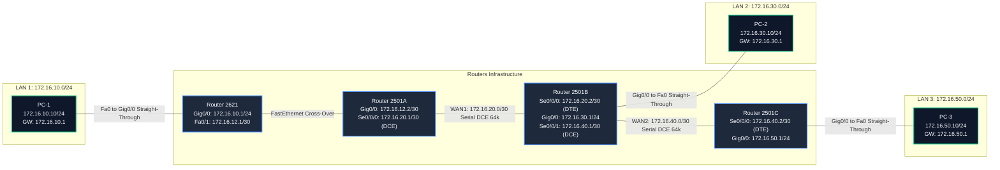

# EXPERIMENT 12: Static Routing Configuration — Cisco Packet Tracer Practical Guide

**Course Code:** PCCSL507 — Networks Lab  
**Course Type:** Practical / Lab (Cisco Packet Tracer Based)  
**Semester:** S5 (Computer Science & Engineering)  

---

## 1. OBJECTIVE & SYLLABUS REQUIREMENTS

According to the KTU PCCSL507 syllabus:
> **Experiment 12:**  
> *Set up static routing for the network shown in Figure 1. Once the routes are set up, display the routing table and verify the connectivity using ping.*

---

## 2. NETWORK TOPOLOGY (FIGURE 1 FROM SYLLABUS)

> [!IMPORTANT]
> ### Modern Packet Tracer Hardware Selection (PT 8.x / 7.x & CCNA Standards)
> The legacy router models shown in the university syllabus diagram (`Cisco 2621` and `Cisco 2501`) are discontinued and **not available** in modern Cisco Packet Tracer versions.
> Across engineering universities (KTU, VTU, Anna Univ) and CCNAv7 curricula, the following modern devices and interface mappings are standard:
> 1. **Primary Modern Router**: Select **Cisco 1941 (ISR G2)** or **Cisco 2911** from the bottom router shelf.
> 2. **Serial WAN Module**: Install the **`HWIC-2T`** (High-Speed WAN Interface Card) in **Slot 0** (Power OFF router in *Physical* tab -> drag `HWIC-2T` to Slot 0 -> Power ON).
> 3. **Interface Names**:
>    - **LAN Ethernet**: **`GigabitEthernet 0/0` (`g0/0`)** replaces legacy `FastEthernet 0/0`.
>    - **Serial WAN**: **`Serial 0/0/0` (`s0/0/0`)** and **`Serial 0/0/1` (`s0/0/1`)**.
> 4. **Alternative Generic Option**: You may also use the **Router-PT (Generic)** with `PT-ROUTER-NM-1FFE` and `PT-ROUTER-NM-1SS`.
> *(If your college lab computers run legacy 2811 routers, simply use `FastEthernet 0/0` instead of `GigabitEthernet 0/0`).*


Figure 1 depicts an enterprise multi-router backbone consisting of 4 routers interconnected across serial links and Ethernet segments. All interfaces use a `/24` subnet mask (`255.255.255.0`).

### Topology Diagram (ASCII)
```text
  [172.16.10.0/24]                [172.16.20.0/24]                 [172.16.40.0/24]              [172.16.50.0/24]
       Ethernet                     Serial WAN                       Serial WAN                      Ethernet
 [Router 2621] ============ [Router 2501A] ----------------- [Router 2501B] ----------------- [Router 2501C] === [PC-3]
   Gig0/0: .1                 Gig0/0: .2  Se0/0/0: .1      Se0/0/0: .2  Se0/0/1: .1     Se0/0/0: .2  Gig0/0: .1    .10
       |                                                    |                                           
     [PC-1]                                               Gig0/0: .1                                     
      .10                                                   |                                           
                                                          [PC-2] .10                                    
                                                     [172.16.30.0/24] LAN                               
```

### Mermaid Diagram


---

## 3. COMPLETE IP ADDRESSING & PORT ALLOCATION TABLE

| Device Name | Interface | IP Address | Subnet Mask | Default Gateway | Connection / Description |
| :--- | :--- | :--- | :--- | :--- | :--- |
| **Router 2621** | `Gig0/0` | `172.16.10.1` | `255.255.255.0` | N/A | Connects to 2501A & LAN 10 |
| **Router 2501A**| `Gig0/0` | `172.16.10.2` | `255.255.255.0` | N/A | Connects to 2621 |
| | `Se0/0/0` | `172.16.20.1` | `255.255.255.0` | N/A | Serial DCE to 2501B (Clock 64000) |
| **Router 2501B**| `Se0/0/0` | `172.16.20.2` | `255.255.255.0` | N/A | Serial DTE from 2501A |
| | `Gig0/0` | `172.16.30.1` | `255.255.255.0` | N/A | Local LAN (172.16.30.0/24) |
| | `Se0/0/1` | `172.16.40.1` | `255.255.255.0` | N/A | Serial DCE to 2501C (Clock 64000) |
| **Router 2501C**| `Se0/0/0` | `172.16.40.2` | `255.255.255.0` | N/A | Serial DTE from 2501B |
| | `Gig0/0` | `172.16.50.1` | `255.255.255.0` | N/A | Local LAN (172.16.50.0/24) |
| **PC-1** | `Fa0` | `172.16.10.10`| `255.255.255.0` | `172.16.10.1` | Workstation on Subnet 10 |
| **PC-2** | `Fa0` | `172.16.30.10`| `255.255.255.0` | `172.16.30.1` | Workstation on Subnet 30 |
| **PC-3** | `Fa0` | `172.16.50.10`| `255.255.255.0` | `172.16.50.1` | Workstation on Subnet 50 |

---

## 4. STEP-BY-STEP CISCO PACKET TRACER SETUP

### Step 4.1: Placing Devices
1. Select **Network Devices $\rightarrow$ Routers**:
   - Drag 4 × **Cisco 2811** (or Cisco 2621XM / 1941) routers onto the canvas.
   - Name them: `2621`, `2501A`, `2501B`, `2501C`.
2. Select **End Devices $\rightarrow$ PC**:
   - Drag 3 × **PC-PT** (`PC-1`, `PC-2`, `PC-3`).
3. (Optional) Drag a **Switch 2960** between Router 2621, 2501A, and PC-1 to connect them to the shared `172.16.10.0/24` collision domain.

### Step 4.2: Installing Serial HWIC-2T Modules
1. On **2501A**, **2501B**, and **2501C**:
   - Click the router $\rightarrow$ **Physical** tab $\rightarrow$ toggle Power switch to **OFF**.
   - Drag the **HWIC-2T** module into `Slot 0`.
   - Toggle Power switch to **ON**.

### Step 4.3: Wiring the Network
- **Switch to Routers/PCs:** Copper Straight-Through cable.
- **2501A to 2501B:** Red **Serial DCE cable** (Click 2501A `Se0/0/0` first, then 2501B `Se0/0/0`).
- **2501B to 2501C:** Red **Serial DCE cable** (Click 2501B `Se0/0/1` first, then 2501C `Se0/0/0`).

---

## 5. COMPLETE ROUTER CONFIGURATION COMMANDS

### 5.1 Router 2621 Configuration
```text
Router> enable
Router# configure terminal
Router(config)# hostname R_2621
R_2621(config)# interface GigabitEthernet0/0
R_2621(config-if)# ip address 172.16.10.1 255.255.255.0
R_2621(config-if)# no shutdown
R_2621(config-if)# exit

! Static Route: Forward all remote traffic towards next-hop 2501A (172.16.10.2)
R_2621(config)# ip route 172.16.20.0 255.255.255.0 172.16.10.2
R_2621(config)# ip route 172.16.30.0 255.255.255.0 172.16.10.2
R_2621(config)# ip route 172.16.40.0 255.255.255.0 172.16.10.2
R_2621(config)# ip route 172.16.50.0 255.255.255.0 172.16.10.2
! (Alternatively: ip route 0.0.0.0 0.0.0.0 172.16.10.2)
R_2621(config)# end
R_2621# copy running-config startup-config
```

### 5.2 Router 2501A Configuration
```text
Router> enable
Router# configure terminal
Router(config)# hostname R_2501A

! Ethernet interface to 2621
R_2501A(config)# interface GigabitEthernet0/0
R_2501A(config-if)# ip address 172.16.10.2 255.255.255.0
R_2501A(config-if)# no shutdown
R_2501A(config-if)# exit

! Serial interface to 2501B (DCE)
R_2501A(config)# interface Serial0/0/0
R_2501A(config-if)# ip address 172.16.20.1 255.255.255.0
R_2501A(config-if)# clock rate 64000
R_2501A(config-if)# no shutdown
R_2501A(config-if)# exit

! Static Routes: Traffic to right side goes to 2501B (172.16.20.2)
R_2501A(config)# ip route 172.16.30.0 255.255.255.0 172.16.20.2
R_2501A(config)# ip route 172.16.40.0 255.255.255.0 172.16.20.2
R_2501A(config)# ip route 172.16.50.0 255.255.255.0 172.16.20.2
R_2501A(config)# end
R_2501A# copy running-config startup-config
```

### 5.3 Router 2501B Configuration
```text
Router> enable
Router# configure terminal
Router(config)# hostname R_2501B

! Serial interface towards 2501A (DTE)
R_2501B(config)# interface Serial0/0/0
R_2501B(config-if)# ip address 172.16.20.2 255.255.255.0
R_2501B(config-if)# no shutdown
R_2501B(config-if)# exit

! Ethernet interface (Local LAN 172.16.30.0)
R_2501B(config)# interface GigabitEthernet0/0
R_2501B(config-if)# ip address 172.16.30.1 255.255.255.0
R_2501B(config-if)# no shutdown
R_2501B(config-if)# exit

! Serial interface towards 2501C (DCE)
R_2501B(config)# interface Serial0/0/1
R_2501B(config-if)# ip address 172.16.40.1 255.255.255.0
R_2501B(config-if)# clock rate 64000
R_2501B(config-if)# no shutdown
R_2501B(config-if)# exit

! Static Routes:
! 1) Leftward traffic goes to 2501A (172.16.20.1)
R_2501B(config)# ip route 172.16.10.0 255.255.255.0 172.16.20.1

! 2) Rightward traffic goes to 2501C (172.16.40.2)
R_2501B(config)# ip route 172.16.50.0 255.255.255.0 172.16.40.2
R_2501B(config)# end
R_2501B# copy running-config startup-config
```

### 5.4 Router 2501C Configuration
```text
Router> enable
Router# configure terminal
Router(config)# hostname R_2501C

! Serial interface towards 2501B (DTE)
R_2501C(config)# interface Serial0/0/0
R_2501C(config-if)# ip address 172.16.40.2 255.255.255.0
R_2501C(config-if)# no shutdown
R_2501C(config-if)# exit

! Ethernet interface (Local LAN 172.16.50.0)
R_2501C(config)# interface GigabitEthernet0/0
R_2501C(config-if)# ip address 172.16.50.1 255.255.255.0
R_2501C(config-if)# no shutdown
R_2501C(config-if)# exit

! Static Routes: All leftward traffic goes to 2501B (172.16.40.1)
R_2501C(config)# ip route 172.16.10.0 255.255.255.0 172.16.40.1
R_2501C(config)# ip route 172.16.20.0 255.255.255.0 172.16.40.1
R_2501C(config)# ip route 172.16.30.0 255.255.255.0 172.16.40.1
! (Alternatively: ip route 0.0.0.0 0.0.0.0 172.16.40.1)
R_2501C(config)# end
R_2501C# copy running-config startup-config
```

---

## 6. ROUTING TABLE VERIFICATION & CONNECTIVITY TESTS

### 6.1 Inspecting Routing Tables (`show ip route`)

#### On Router 2501B:
```text
R_2501B# show ip route
Codes: C - connected, S - static, R - RIP, M - mobile, B - BGP
       D - EIGRP, EX - EIGRP external, O - OSPF

Gateway of last resort is not set

S    172.16.10.0/24 [1/0] via 172.16.20.1
C    172.16.20.0/24 is directly connected, Serial0/0/0
C    172.16.30.0/24 is directly connected, GigabitEthernet0/0
C    172.16.40.0/24 is directly connected, Serial0/0/1
S    172.16.50.0/24 [1/0] via 172.16.40.2
```
> Notice the code **`S`** designating manually configured static routes, and **`[1/0]`** indicating an **Administrative Distance of 1** and Metric of 0.

### 6.2 Verifying End-to-End Connectivity with `ping` and `tracert`

#### Test 1: From PC-1 (`172.16.10.10`) pinging PC-3 (`172.16.50.10`):
Open PC-1 Desktop $\rightarrow$ Command Prompt:
```cmd
C:\> ping 172.16.50.10

Pinging 172.16.50.10 with 32 bytes of data:
Reply from 172.16.50.10: bytes=32 time=9ms TTL=125
Reply from 172.16.50.10: bytes=32 time=8ms TTL=125
Reply from 172.16.50.10: bytes=32 time=7ms TTL=125
Reply from 172.16.50.10: bytes=32 time=8ms TTL=125

Ping statistics for 172.16.50.10:
    Packets: Sent = 4, Received = 4, Lost = 0 (0% loss)
```

#### Test 2: Hop-by-Hop Trace Route from PC-1:
```cmd
C:\> tracert 172.16.50.10

Tracing route to 172.16.50.10 over a maximum of 30 hops:

  1   <1 ms    172.16.10.1   (Router 2621 Gateway)
  2    2 ms    172.16.10.2   (Router 2501A)
  3    5 ms    172.16.20.2   (Router 2501B)
  4    7 ms    172.16.40.2   (Router 2501C)
  5    8 ms    172.16.50.10  (Target PC-3)

Trace complete.
```

---

## 7. 🎥 VERIFIED VIDEO GUIDES & TUTORIALS

| Video Title | Channel / Creator | Direct YouTube Link | Key Takeaways |
| :--- | :--- | :--- | :--- |
| **Free CCNA Lab 024: Static Routing (Part 1)** | Jeremy's IT Lab | [Watch on YouTube](https://www.youtube.com/watch?v=4T19U81s4kY) | Next-hop IP vs exit interface, administrative distance, bidirectional return path. |
| **Static Routing Configuration in Cisco Packet Tracer** | Keith Barker (CBT Nuggets) | [Watch on YouTube](https://www.youtube.com/watch?v=J_7s5E12p3g) | Step-by-step 3-router topology, configuring `ip route`, troubleshooting pings. |
| **How to Configure Static Routes in Cisco Packet Tracer** | NetworkChuck | [Watch on YouTube](https://www.youtube.com/watch?v=OU-A2EmVrKQ) | Intuitive explanation of why routers need forward and reverse routing entries. |
