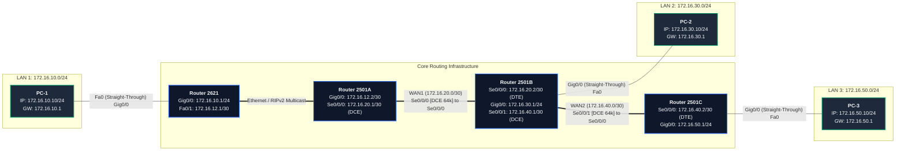

# EXPERIMENT 13: RIPv2 Routing Protocol — Cisco Packet Tracer Practical Guide

**Course Code:** PCCSL507 — Networks Lab  
**Course Type:** Practical / Lab (Cisco Packet Tracer Based)  
**Semester:** S5 (Computer Science & Engineering)  

---

## 1. OBJECTIVE & SYLLABUS REQUIREMENTS

According to the KTU PCCSL507 syllabus:
> **Experiment 13:**  
> *Implement RIPv2 routing for the network shown in Figure 1. Once the routes are set up, display the routing table and verify the connectivity using ping.*

---

## 2. NETWORK TOPOLOGY (FIGURE 1 FROM SYLLABUS)

> [!IMPORTANT]
> ### Modern Packet Tracer Hardware Selection (PT 8.x / 7.x & CCNA Standards)
> The legacy router models shown in the university syllabus diagram (`Cisco 2621` and `Cisco 2501`) are discontinued and **not available** in modern Cisco Packet Tracer versions.
> Across engineering universities (KTU, VTU, Anna Univ) and CCNAv7 curricula, the following modern devices and interface mappings are standard:
> 1. **Primary Modern Router**: Select **Cisco 1941 (ISR G2)** or **Cisco 2911** from the bottom router shelf.
> 2. **Serial WAN Module**: Install the **`HWIC-2T`** (High-Speed WAN Interface Card) in **Slot 0** (Power OFF router in *Physical* tab -> drag `HWIC-2T` to Slot 0 -> Power ON).
> 3. **Interface Names**:
>    - **LAN Ethernet**: **`GigabitEthernet 0/0` (`g0/0`)** replaces legacy `FastEthernet 0/0`.
>    - **Serial WAN**: **`Serial 0/0/0` (`s0/0/0`)** and **`Serial 0/0/1` (`s0/0/1`)**.
> 4. **Alternative Generic Option**: You may also use the **Router-PT (Generic)** with `PT-ROUTER-NM-1FFE` and `PT-ROUTER-NM-1SS`.
> *(If your college lab computers run legacy 2811 routers, simply use `FastEthernet 0/0` instead of `GigabitEthernet 0/0`).*


### Topology Diagram (ASCII)
```text
  [172.16.10.0/24]                [172.16.20.0/24]                 [172.16.40.0/24]              [172.16.50.0/24]
       Ethernet                      Serial WAN                       Serial WAN                      Ethernet
 [Router 2621] ============ [Router 2501A] ----------------- [Router 2501B] ----------------- [Router 2501C] === [PC-3]
   Gig0/0: .1                 Gig0/0: .2  Se0/0/0: .1      Se0/0/0: .2  Se0/0/1: .1     Se0/0/0: .2  Gig0/0: .1    .10
       |                                                    |                                           
     [PC-1]                                               Gig0/0: .1                                     
      .10                                                   |                                           
                                                          [PC-2] .10                                    
                                                     [172.16.30.0/24] LAN                               
```

### Mermaid Topology Diagram


---

## 3. KEY DIFFERENCES: RIPv1 VS RIPv2

| Parameter | RIP Version 1 (RIPv1) | RIP Version 2 (RIPv2) |
| :--- | :--- | :--- |
| **Routing Type** | Classful (does NOT send subnet mask) | **Classless** (sends subnet mask with route) |
| **VLSM / CIDR Support** | No | **Yes (Full support)** |
| **Transmission Mode** | Broadcast (`255.255.255.255`) | **Multicast (`224.0.0.9`)** |
| **Authentication** | None | **Plain text & MD5 authentication** |
| **Auto-Summarization** | Mandatory (cannot disable) | **Configurable (`no auto-summary`)** |
| **Administrative Distance** | 120 | 120 |
| **Metric** | Hop Count (Max 15, 16 is Unreachable) | Hop Count (Max 15, 16 is Unreachable) |

> [!IMPORTANT]
> Always execute **`version 2`** and **`no auto-summary`** when enabling RIP. Without `no auto-summary`, RIPv2 defaults to summarizing contiguous subnets into their major classful boundary (`172.16.0.0/16`), breaking subnet-level routing!

---

## 4. STEP-BY-STEP CISCO PACKET TRACER CONFIGURATION

### 4.1 Router 2621 CLI Commands
```text
Router> enable
Router# configure terminal
Router(config)# hostname R_2621

! 1. Interface IP Configuration
R_2621(config)# interface GigabitEthernet0/0
R_2621(config-if)# ip address 172.16.10.1 255.255.255.0
R_2621(config-if)# no shutdown
R_2621(config-if)# exit

! 2. RIPv2 Routing Configuration
R_2621(config)# router rip
R_2621(config-router)# version 2
R_2621(config-router)# no auto-summary
R_2621(config-router)# network 172.16.0.0
R_2621(config-router)# end
R_2621# copy running-config startup-config
```

### 4.2 Router 2501A CLI Commands
```text
Router> enable
Router# configure terminal
Router(config)# hostname R_2501A

! 1. Interface Configuration
R_2501A(config)# interface GigabitEthernet0/0
R_2501A(config-if)# ip address 172.16.10.2 255.255.255.0
R_2501A(config-if)# no shutdown
R_2501A(config-if)# exit

R_2501A(config)# interface Serial0/0/0
R_2501A(config-if)# ip address 172.16.20.1 255.255.255.0
R_2501A(config-if)# clock rate 64000
R_2501A(config-if)# no shutdown
R_2501A(config-if)# exit

! 2. RIPv2 Routing Configuration
R_2501A(config)# router rip
R_2501A(config-router)# version 2
R_2501A(config-router)# no auto-summary
R_2501A(config-router)# network 172.16.0.0
R_2501A(config-router)# end
R_2501A# copy running-config startup-config
```

### 4.3 Router 2501B CLI Commands
```text
Router> enable
Router# configure terminal
Router(config)# hostname R_2501B

! 1. Interface Configuration
R_2501B(config)# interface Serial0/0/0
R_2501B(config-if)# ip address 172.16.20.2 255.255.255.0
R_2501B(config-if)# no shutdown
R_2501B(config-if)# exit

R_2501B(config)# interface GigabitEthernet0/0
R_2501B(config-if)# ip address 172.16.30.1 255.255.255.0
R_2501B(config-if)# no shutdown
R_2501B(config-if)# exit

R_2501B(config)# interface Serial0/0/1
R_2501B(config-if)# ip address 172.16.40.1 255.255.255.0
R_2501B(config-if)# clock rate 64000
R_2501B(config-if)# no shutdown
R_2501B(config-if)# exit

! 2. RIPv2 Routing Configuration
R_2501B(config)# router rip
R_2501B(config-router)# version 2
R_2501B(config-router)# no auto-summary
R_2501B(config-router)# network 172.16.0.0
! LAN interface does not need to send RIP packets to end hosts:
R_2501B(config-router)# passive-interface GigabitEthernet0/0
R_2501B(config-router)# end
R_2501B# copy running-config startup-config
```

### 4.4 Router 2501C CLI Commands
```text
Router> enable
Router# configure terminal
Router(config)# hostname R_2501C

! 1. Interface Configuration
R_2501C(config)# interface Serial0/0/0
R_2501C(config-if)# ip address 172.16.40.2 255.255.255.0
R_2501C(config-if)# no shutdown
R_2501C(config-if)# exit

R_2501C(config)# interface GigabitEthernet0/0
R_2501C(config-if)# ip address 172.16.50.1 255.255.255.0
R_2501C(config-if)# no shutdown
R_2501C(config-if)# exit

! 2. RIPv2 Routing Configuration
R_2501C(config)# router rip
R_2501C(config-router)# version 2
R_2501C(config-router)# no auto-summary
R_2501C(config-router)# network 172.16.0.0
R_2501C(config-router)# passive-interface GigabitEthernet0/0
R_2501C(config-router)# end
R_2501C# copy running-config startup-config
```

---

## 5. VERIFICATION & PROTOCOL INSPECTION

### 5.1 Checking Active Routing Protocols (`show ip protocols`)
Execute on `Router 2501B`:
```text
R_2501B# show ip protocols

Routing Protocol is "rip"
  Sending updates every 30 seconds, next due in 14 seconds
  Invalid after 180 seconds, hold down 180, flushed after 240
  Outgoing update filter list for all interfaces is not set
  Incoming update filter list for all interfaces is not set
  Redistributing: rip
  Default version control: send version 2, receive version 2
    Interface             Send  Recv  Triggered RIP  Key-chain
    Serial0/0/0           2     2                                    
    Serial0/0/1           2     2                                    
  Automatic network summarization is not in effect
  Maximum path: 4
  Routing for Networks:
    172.16.0.0
  Passive Interface(s):
    GigabitEthernet0/0
  Routing Information Sources:
    Gateway         Distance      Last Update
    172.16.20.1          120      00:00:18
    172.16.40.2          120      00:00:09
  Distance: (default is 120)
```

### 5.2 Checking the Routing Table (`show ip route`)
Execute on `Router 2501B`:
```text
R_2501B# show ip route

Codes: C - connected, S - static, R - RIP, M - mobile, B - BGP
       D - EIGRP, EX - EIGRP external, O - OSPF

Gateway of last resort is not set

     172.16.0.0/24 is subnetted, 5 subnets
R       172.16.10.0 [120/1] via 172.16.20.1, 00:00:12, Serial0/0/0
C       172.16.20.0 is directly connected, Serial0/0/0
C       172.16.30.0 is directly connected, GigabitEthernet0/0
C       172.16.40.0 is directly connected, Serial0/0/1
R       172.16.50.0 [120/1] via 172.16.40.2, 00:00:15, Serial0/0/1
```
> Notice **`R`** indicates RIP, **`120`** is the Administrative Distance, and **`1`** is the hop count distance.

### 5.3 Live Debugging (`debug ip rip`)
To watch periodic 30-second RIP update multicasts arriving on Serial interfaces:
```text
R_2501B# debug ip rip
RIP protocol debugging is on
RIP: received v2 update from 172.16.20.1 on Serial0/0/0
     172.16.10.0/24 via 0.0.0.0 in 1 hops
RIP: sending v2 update to 224.0.0.9 via Serial0/0/1 (172.16.40.1)
     172.16.10.0/24 via 0.0.0.0 in 2 hops
     172.16.20.0/24 via 0.0.0.0 in 1 hops
     172.16.30.0/24 via 0.0.0.0 in 1 hops
R_2501B# undebug all
```

### 5.4 End-to-End Ping Test
From **PC-1** (`172.16.10.10`) ping **PC-3** (`172.16.50.10`):
```cmd
C:\> ping 172.16.50.10

Pinging 172.16.50.10 with 32 bytes of data:
Reply from 172.16.50.10: bytes=32 time=9ms TTL=125
Reply from 172.16.50.10: bytes=32 time=8ms TTL=125
Reply from 172.16.50.10: bytes=32 time=8ms TTL=125
Reply from 172.16.50.10: bytes=32 time=7ms TTL=125

Ping statistics for 172.16.50.10:
    Packets: Sent = 4, Received = 4, Lost = 0 (0% loss)
```

---

## 6. 🎥 VERIFIED VIDEO GUIDES & TUTORIALS

| Video Title | Channel / Creator | Direct YouTube Link | Key Takeaways |
| :--- | :--- | :--- | :--- |
| **Day 25: RIP & EIGRP (CCNA 200-301)** | Jeremy's IT Lab | [Watch on YouTube](https://www.youtube.com/watch?v=J_7s5E12p3g) | Distance vector theory, hop counts, `network` statement classful syntax. |
| **Configuring RIPv2 in Cisco Packet Tracer** | Tech Academia | [Watch on YouTube](https://www.youtube.com/watch?v=kYJzXv-i2_E) | Complete lab walk-through, `version 2`, `no auto-summary`, ping test. |
| **RIPv2 Routing Protocol Deep Dive** | NetworkChuck | [Watch on YouTube](https://www.youtube.com/watch?v=OU-A2EmVrKQ) | Split horizon, poison reverse, why multicast `224.0.0.9` is superior to broadcast. |
