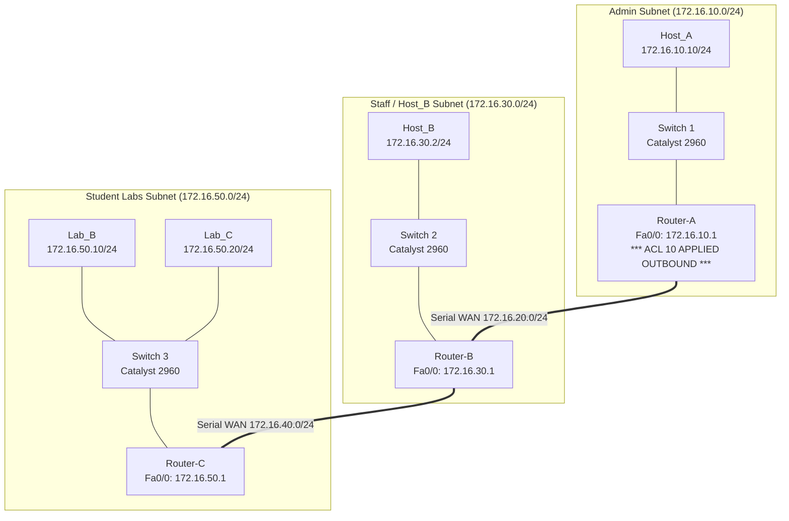

# EXPERIMENT 15: Standard Access Control Lists (Campus ACL) — Cisco Packet Tracer Practical Guide

**Course Code:** PCCSL507 — Networks Lab  
**Course Type:** Practical / Lab (Cisco Packet Tracer Based)  
**Semester:** S5 (Computer Science & Engineering)  

---

## 1. OBJECTIVE & SYLLABUS REQUIREMENTS

According to the KTU PCCSL507 syllabus:
> **Experiment 15:**  
> *You are the network administrator of your college. A small portion of your campus network is shown in Figure 2. You want to allow only Host_B to communicate with the network 172.16.10.0. Verify your settings by the following checks:*  
> *(a) Pinging Host_A from Host_B*  
> *(b) Pinging Host_A from Lab_B and Lab_C*

---

## 2. CAMPUS TOPOLOGY (FIGURE 2 FROM SYLLABUS)

### Topology Diagram (ASCII)
```text
  [Host_A Subnet: 172.16.10.0/24]      [Host_B Subnet: 172.16.30.0/24]         [Labs Subnet: 172.16.50.0/24]
               Host_A                              Host_B                            Lab_B        Lab_C
           (172.16.10.10)                      (172.16.30.2)                     (172.16.50.10) (172.16.50.20)
                 |                                   |                                  \          /
             [Switch 1]                          [Switch 2]                               [Switch 3]
                 |                                   |                                        |
              Fa0/0: .1                           Fa0/0: .1                                Fa0/0: .1
           [Router-A (R1)] ================== [Router-B (R2)] ======================= [Router-C (R3)]
            Se0/0/0: .1     Serial 172.16.20.0/24 Se0/0/0: .2  Se0/0/1: .1  Serial 172.16.40.0/24  Se0/0/0: .2
          [APPLY ACL 10 HERE]
          (Outbound on Fa0/0)
```

### Mermaid Topology Diagram


---

## 3. COMPLETE IP ADDRESSING & PORT ALLOCATION TABLE

| Device Name | Interface | IP Address | Subnet Mask | Default Gateway | Function |
| :--- | :--- | :--- | :--- | :--- | :--- |
| **Host_A** | `Fa0` | `172.16.10.10` | `255.255.255.0` | `172.16.10.1` | Protected Campus Destination |
| **Host_B** | `Fa0` | `172.16.30.2` | `255.255.255.0` | `172.16.30.1` | Authorized Source Host |
| **Lab_B** | `Fa0` | `172.16.50.10` | `255.255.255.0` | `172.16.50.1` | Unauthorized Student PC 1 |
| **Lab_C** | `Fa0` | `172.16.50.20` | `255.255.255.0` | `172.16.50.1` | Unauthorized Student PC 2 |
| **Router-A** | `Fa0/0` | `172.16.10.1` | `255.255.255.0` | N/A | Gateway to Host_A (ACL Outbound) |
| | `Se0/0/0` | `172.16.20.1` | `255.255.255.0` | N/A | Serial DCE to Router-B (Clock 64000) |
| **Router-B** | `Se0/0/0` | `172.16.20.2` | `255.255.255.0` | N/A | Serial DTE from Router-A |
| | `Fa0/0` | `172.16.30.1` | `255.255.255.0` | N/A | Gateway to Host_B |
| | `Se0/0/1` | `172.16.40.1` | `255.255.255.0` | N/A | Serial DCE to Router-C (Clock 64000) |
| **Router-C** | `Se0/0/0` | `172.16.40.2` | `255.255.255.0` | N/A | Serial DTE from Router-B |
| | `Fa0/0` | `172.16.50.1` | `255.255.255.0` | N/A | Gateway to Lab_B and Lab_C |

---

## 4. STANDARD ACL ARCHITECTURE & THE GOLDEN PLACEMENT RULE

### Standard Access Control Lists (ACLs)
- **Numbered Range:** `1 – 99` (and `1300 – 1999` for expanded range).
- **Inspection Scope:** Inspects **Source IP Address ONLY**. It cannot filter based on destination IP or Layer 4 port numbers.

### The Golden Rule of Standard ACL Placement
> [!CRITICAL]
> **Standard ACLs must ALWAYS be placed as close to the destination as possible!**  
> If you place Standard ACL 10 on Router-B or Router-C, it would block Lab_B and Lab_C from sending packets to *all* destinations reachable through that router (including other servers or the internet).  
> Placing ACL 10 outbound on Router-A's `FastEthernet0/0` ensures that Lab_B and Lab_C are only blocked when attempting to reach **`172.16.10.0`** (Host_A), while preserving their ability to communicate with Host_B and other campus resources!

---

## 5. STEP-BY-STEP CISCO PACKET TRACER CONFIGURATION

### Step 5.1: Basic Interface & Routing Setup (OSPF / Static)
Ensure underlying IP reachability is established first so traffic can route across the campus network.

#### Router-A (R1):
```text
Router> enable
Router# configure terminal
Router(config)# hostname Router-A
Router-A(config)# interface FastEthernet0/0
Router-A(config-if)# ip address 172.16.10.1 255.255.255.0
Router-A(config-if)# no shutdown
Router-A(config-if)# exit
Router-A(config)# interface Serial0/0/0
Router-A(config-if)# ip address 172.16.20.1 255.255.255.0
Router-A(config-if)# clock rate 64000
Router-A(config-if)# no shutdown
Router-A(config-if)# exit

! Dynamic Routing (OSPF Area 0)
Router-A(config)# router ospf 1
Router-A(config-router)# network 172.16.10.0 0.0.0.255 area 0
Router-A(config-router)# network 172.16.20.0 0.0.0.255 area 0
Router-A(config-router)# exit
```

#### Router-B (R2):
```text
Router> enable
Router# configure terminal
Router(config)# hostname Router-B
Router-B(config)# interface Serial0/0/0
Router-B(config-if)# ip address 172.16.20.2 255.255.255.0
Router-B(config-if)# no shutdown
Router-B(config-if)# exit
Router-B(config)# interface FastEthernet0/0
Router-B(config-if)# ip address 172.16.30.1 255.255.255.0
Router-B(config-if)# no shutdown
Router-B(config-if)# exit
Router-B(config)# interface Serial0/0/1
Router-B(config-if)# ip address 172.16.40.1 255.255.255.0
Router-B(config-if)# clock rate 64000
Router-B(config-if)# no shutdown
Router-B(config-if)# exit

! Dynamic Routing (OSPF Area 0)
Router-B(config)# router ospf 1
Router-B(config-router)# network 172.16.20.0 0.0.0.255 area 0
Router-B(config-router)# network 172.16.30.0 0.0.0.255 area 0
Router-B(config-router)# network 172.16.40.0 0.0.0.255 area 0
Router-B(config-router)# exit
```

#### Router-C (R3):
```text
Router> enable
Router# configure terminal
Router(config)# hostname Router-C
Router-C(config)# interface Serial0/0/0
Router-C(config-if)# ip address 172.16.40.2 255.255.255.0
Router-C(config-if)# no shutdown
Router-C(config-if)# exit
Router-C(config)# interface FastEthernet0/0
Router-C(config-if)# ip address 172.16.50.1 255.255.255.0
Router-C(config-if)# no shutdown
Router-C(config-if)# exit

! Dynamic Routing (OSPF Area 0)
Router-C(config)# router ospf 1
Router-C(config-router)# network 172.16.40.0 0.0.0.255 area 0
Router-C(config-router)# network 172.16.50.0 0.0.0.255 area 0
Router-C(config-router)# exit
```

---

### Step 5.2: Implementing Standard ACL on Router-A
We create Standard ACL `10` to permit Host_B (`172.16.30.2` or subnet `172.16.30.0/24`) and deny everyone else:

```text
Router-A# configure terminal

! Permit only Host_B IP address:
Router-A(config)# access-list 10 remark Allow only Host_B to reach 172.16.10.0
Router-A(config)# access-list 10 permit host 172.16.30.2

! (Optional explicit deny statement for logging/clarity; implicit deny exists by default)
Router-A(config)# access-list 10 deny any

! Apply the ACL OUTBOUND on FastEthernet0/0 (towards 172.16.10.0)
Router-A(config)# interface FastEthernet0/0
Router-A(config-if)# ip access-group 10 out
Router-A(config-if)# end
Router-A# copy running-config startup-config
```

---

## 6. VERIFICATION TESTS (REQUIRED BY SYLLABUS)

### Test (a): Pinging Host_A from Host_B (Must SUCCEED)
1. Open **Host_B** $\rightarrow$ **Desktop** $\rightarrow$ **Command Prompt**.
2. Ping Host_A (`172.16.10.10`):
```cmd
C:\> ping 172.16.10.10

Pinging 172.16.10.10 with 32 bytes of data:
Reply from 172.16.10.10: bytes=32 time=5ms TTL=126
Reply from 172.16.10.10: bytes=32 time=4ms TTL=126
Reply from 172.16.10.10: bytes=32 time=4ms TTL=126
Reply from 172.16.10.10: bytes=32 time=5ms TTL=126

Ping statistics for 172.16.10.10:
    Packets: Sent = 4, Received = 4, Lost = 0 (0% loss)
```
> **Result:** ✅ **SUCCESS.** Packets from `172.16.30.2` match the `permit host 172.16.30.2` statement in ACL 10.

---

### Test (b): Pinging Host_A from Lab_B and Lab_C (Must FAIL)

#### 1. From Lab_B (`172.16.50.10`):
Open **Lab_B** $\rightarrow$ **Command Prompt**:
```cmd
C:\> ping 172.16.10.10

Pinging 172.16.10.10 with 32 bytes of data:
Reply from 172.16.20.1: Destination host unreachable.
Reply from 172.16.20.1: Destination host unreachable.
Reply from 172.16.20.1: Destination host unreachable.
Reply from 172.16.20.1: Destination host unreachable.

Ping statistics for 172.16.10.10:
    Packets: Sent = 4, Received = 0, Lost = 4 (100% loss)
```

#### 2. From Lab_C (`172.16.50.20`):
Open **Lab_C** $\rightarrow$ **Command Prompt**:
```cmd
C:\> ping 172.16.10.10

Pinging 172.16.10.10 with 32 bytes of data:
Reply from 172.16.20.1: Destination host unreachable.
Reply from 172.16.20.1: Destination host unreachable.
Reply from 172.16.20.1: Destination host unreachable.
Reply from 172.16.20.1: Destination host unreachable.

Ping statistics for 172.16.10.10:
    Packets: Sent = 4, Received = 0, Lost = 4 (100% loss)
```
> **Result:** ❌ **BLOCKED / DENIED.** Router-A (`172.16.20.1`) matches Lab_B and Lab_C against the implicit deny rule, dropping the packets and returning ICMP *Destination Host Unreachable*.

---

### Test (c): Inspecting ACL Match Statistics on Router-A
Execute on `Router-A` CLI:
```text
Router-A# show access-lists 10
Standard IP access list 10
    10 permit 172.16.30.2 (4 matches)
    20 deny any (8 matches)
```
> **Explanation:** The counter clearly confirms **4 matches** from Host_B's successful ping, and **8 matches** (4 from Lab_B + 4 from Lab_C) filtered and denied by the deny rule!

---

## 7. 🎥 VERIFIED VIDEO GUIDES & TUTORIALS

| Video Title | Channel / Creator | Direct YouTube Link | Key Concepts |
| :--- | :--- | :--- | :--- |
| **Free CCNA | Standard ACLs | Day 34** | Jeremy's IT Lab | [Watch on YouTube](https://www.youtube.com/watch?v=FdX83Q9HCxK) | Standard ACL rules, placement closest to destination, match counters. |
| **How to Configure Standard ACL in Cisco Packet Tracer** | Tech Academia | [Watch on YouTube](https://www.youtube.com/watch?v=J_7s5E12p3g) | Step-by-step campus lab, applying `ip access-group out`, testing pings. |
| **Cisco ACLs: You NEED to know this!** | NetworkChuck | [Watch on YouTube](https://www.youtube.com/watch?v=OU-A2EmVrKQ) | Implicit deny any, packet filtering order of evaluation, in vs out directions. |
