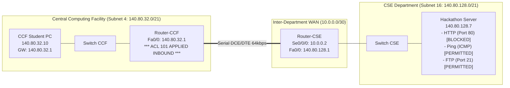

# EXPERIMENT 16: Extended Access Control Lists (Selective Port Filtering) — Cisco Packet Tracer Practical Guide

**Course Code:** PCCSL507 — Networks Lab  
**Course Type:** Practical / Lab (Cisco Packet Tracer Based)  
**Semester:** S5 (Computer Science & Engineering)  

---

## 1. OBJECTIVE & SYLLABUS REQUIREMENTS

According to the KTU PCCSL507 syllabus:
> **Experiment 16:**  
> *You are the network administrator of your college. The college is assigned a network address 140.80.0.0. There are 20 subnets in your college network. The Central Computing Facility (CCF) resides in the 4th subnet. The department of CSE is organizing an inter-department hackathon for which the registration closed yesterday. The registration was through the hackathon website hosted on a server which is assigned the 7th address in the 16th subnet. As the network administrator, your job now is to block students from accessing the hackathon website from CCF.*  
> *[The server provides other services than the website hosting as well. Make sure you block only the website access. Other services should not be denied.]*

---

## 2. SUBNETTING DESIGN & ADDRESS CALCULATIONS

### 2.1 Subnetting Mathematical Calculation
- **Major Network Address:** `140.80.0.0` (Class B Network)
- **Default Mask:** `/16` (`255.255.0.0`)
- **Required Subnets:** 20 subnets
- **Borrowing Bits:**
  $$2^n \ge 20 \implies n = 5 \text{ bits borrowed}$$
- **Custom Subnet Mask:**
  $$16 + 5 = \mathbf{/21} \quad (255.255.248.0)$$
- **Block Size (Step Value in 3rd Octet):**
  $$256 - 248 = \mathbf{8}$$

### 2.2 Subnet Layout & Target Devices
| Subnet # | Network ID | Host Range | Description / Assigned Facility |
| :--- | :--- | :--- | :--- |
| **Subnet 0** | `140.80.0.0/21` | `140.80.0.1` – `140.80.7.254` | Administration |
| **Subnet 1** | `140.80.8.0/21` | `140.80.8.1` – `140.80.15.254` | Campus Wi-Fi |
| **...** | ... | ... | ... |
| **Subnet 4** | `140.80.32.0/21` | `140.80.32.1` – `140.80.39.254` | **Central Computing Facility (CCF)** |
| **...** | ... | ... | ... |
| **Subnet 16** | `140.80.128.0/21` | `140.80.128.1` – `140.80.135.254` | **CSE Server Farm (Hackathon)** |

### 2.3 Identifying the Target Devices
1. **Central Computing Facility (CCF):**
   - **Subnet:** `140.80.32.0/21`
   - **Subnet Mask:** `255.255.248.0`
   - **Wildcard Mask:** $255.255.255.255 - 255.255.248.0 = \mathbf{0.0.7.255}$
   - **Default Gateway (Router Fa0/0):** `140.80.32.1`
   - **CCF Student PC:** `140.80.32.10`
2. **Hackathon Server (7th address in 16th Subnet):**
   - 1st address: `140.80.128.1` (Default Gateway)
   - 7th address: $\mathbf{140.80.128.7}$
   - **Server IP:** `140.80.128.7`
   - **Services Running on Server:**
     - **HTTP (Port 80) & HTTPS (Port 443):** Hackathon Website (MUST BE BLOCKED)
     - **ICMP Ping:** Diagnostic reachability (MUST BE ALLOWED)
     - **FTP (Port 20/21):** File transfer (MUST BE ALLOWED)
     - **DNS (Port 53):** Name resolution (MUST BE ALLOWED)

*(Note: If your college lab uses a simplified `/24` subnet mask with block size 1, CCF is `140.80.4.0/24` with wildcard `0.0.0.255`, and Hackathon Server is `140.80.16.7`. Both wildcard masks are fully provided below).*

---

## 3. TOPOLOGY DIAGRAM

### Topology Diagram (ASCII)
```text
   [CCF Subnet 4: 140.80.32.0/21]                             [CSE Server Farm Subnet 16: 140.80.128.0/21]
         [ CCF Student PC ]                                                [ Hackathon Server ]
           140.80.32.10                                                       140.80.128.7
                |                                                                  |
           [Switch CCF]                                                       [Switch CSE]
                |                                                                  |
            Fa0/0: .1                                                          Fa0/0: .1
       [ Router-CCF (R1) ] ============================================== [ Router-CSE (R2) ]
        Se0/0/0: 10.0.0.1                  WAN Serial Link                 Se0/0/0: 10.0.0.2
       [ APPLY EXTENDED ACL 101 ]           (10.0.0.0/30)
          (Inbound on Fa0/0)
```

### Mermaid Topology Diagram


---

## 4. EXTENDED ACL LOGIC & THE GOLDEN PLACEMENT RULE

### Extended Access Control List (Numbered 100 – 199)
Extended ACLs inspect:
- **Source IP Address & Wildcard Mask**
- **Destination IP Address & Wildcard Mask**
- **IP Protocol Suite (TCP, UDP, ICMP, IP)**
- **Layer 4 Port Numbers (eq 80, eq 443, eq 21, etc.)**

### The Golden Rule of Extended ACL Placement
> [!IMPORTANT]
> **Extended ACLs must ALWAYS be placed as close to the source as possible!**  
> Because extended ACLs specify both source, destination, and exact port number, they can filter unauthorized packets right at the entry interface (`in` on Router-CCF `Fa0/0`). This prevents denied packets from traveling across the serial WAN link, saving precious router CPU cycles and network bandwidth!

---

## 5. STEP-BY-STEP CISCO PACKET TRACER SETUP

### Step 5.1: Device Selection & Wiring
1. Place 2 × **Cisco 2811 Routers** (`Router-CCF` and `Router-CSE`). Add `WIC-2T` serial modules to both.
2. Place 2 × **Cisco 2960 Switches**.
3. Place 1 × **PC** (`CCF Student PC`) and 1 × **Server-PT** (`Hackathon Server`).
4. Wire PC and Server to switches using **Copper Straight-Through Cables**.
5. Wire Routers together using a **Serial DCE Cable** (DCE on Router-CCF).

### Step 5.2: Server Configuration (Services Setup)
1. Click on **Hackathon Server** $\rightarrow$ **Desktop** $\rightarrow$ **IP Configuration**:
   - **IP Address:** `140.80.128.7`
   - **Subnet Mask:** `255.255.248.0`
   - **Default Gateway:** `140.80.128.1`
2. Navigate to the **Services** tab:
   - **HTTP:** Ensure **HTTP** and **HTTPS** are **ON**. Edit `index.html` to say:  
     `<h1>CSE Inter-Department Hackathon Registration Portal</h1>`
   - **FTP:** Ensure FTP service is **ON** (username: `cisco`, password: `cisco`).

### Step 5.3: CCF Student PC IP Configuration
1. Click **CCF Student PC** $\rightarrow$ **Desktop** $\rightarrow$ **IP Configuration**:
   - **IP Address:** `140.80.32.10`
   - **Subnet Mask:** `255.255.248.0`
   - **Default Gateway:** `140.80.32.1`

---

## 6. CISCO ROUTER CLI CONFIGURATIONS

### 6.1 Router-CCF Configuration (With Extended ACL 101)
```text
Router> enable
Router# configure terminal
Router(config)# hostname Router-CCF

! 1. Interface IP Configuration
Router-CCF(config)# interface FastEthernet0/0
Router-CCF(config-if)# ip address 140.80.32.1 255.255.248.0
Router-CCF(config-if)# no shutdown
Router-CCF(config-if)# exit

Router-CCF(config)# interface Serial0/0/0
Router-CCF(config-if)# ip address 10.0.0.1 255.255.255.252
Router-CCF(config-if)# clock rate 64000
Router-CCF(config-if)# no shutdown
Router-CCF(config-if)# exit

! 2. Routing (OSPF Area 0)
Router-CCF(config)# router ospf 1
Router-CCF(config-router)# network 140.80.32.0 0.0.7.255 area 0
Router-CCF(config-router)# network 10.0.0.0 0.0.0.3 area 0
Router-CCF(config-router)# exit

! 3. Extended Access List 101 Definition
! Block HTTP (Port 80) access to Hackathon Server
Router-CCF(config)# access-list 101 remark Block Hackathon website from CCF
Router-CCF(config)# access-list 101 deny tcp 140.80.32.0 0.0.7.255 host 140.80.128.7 eq 80

! Block HTTPS (Port 443) access to Hackathon Server
Router-CCF(config)# access-list 101 deny tcp 140.80.32.0 0.0.7.255 host 140.80.128.7 eq 443

! Permit ALL other services (ICMP ping, FTP, DNS, etc.) to the server and network
Router-CCF(config)# access-list 101 permit ip any any

! 4. Apply ACL Inbound on the CCF Interface (Close to Source)
Router-CCF(config)# interface FastEthernet0/0
Router-CCF(config-if)# ip access-group 101 in
Router-CCF(config-if)# end
Router-CCF# copy running-config startup-config
```

### 6.2 Router-CSE Configuration
```text
Router> enable
Router# configure terminal
Router(config)# hostname Router-CSE

! 1. Interface IP Configuration
Router-CSE(config)# interface Serial0/0/0
Router-CSE(config-if)# ip address 10.0.0.2 255.255.255.252
Router-CSE(config-if)# no shutdown
Router-CSE(config-if)# exit

Router-CSE(config)# interface FastEthernet0/0
Router-CSE(config-if)# ip address 140.80.128.1 255.255.248.0
Router-CSE(config-if)# no shutdown
Router-CSE(config-if)# exit

! 2. Routing (OSPF Area 0)
Router-CSE(config)# router ospf 1
Router-CSE(config-router)# network 140.80.128.0 0.0.7.255 area 0
Router-CSE(config-router)# network 10.0.0.0 0.0.0.3 area 0
Router-CSE(config-router)# end
Router-CSE# copy running-config startup-config
```

---

## 7. VERIFICATION & TESTING (SYLLABUS REQUIREMENTS)

### Test 1: Testing Website Access from CCF Student PC (MUST BE BLOCKED)
1. On **CCF Student PC**, open **Desktop $\rightarrow$ Web Browser**.
2. Type URL: `http://140.80.128.7` and press **Go**.
3. **Observed Output:**  
   `Request Timeout` / `Page Cannot Be Displayed`.
> **Result:** ✅ **BLOCKED.** Port 80 TCP SYN packets are filtered and dropped by ACL 101.

---

### Test 2: Testing ICMP Ping from CCF Student PC (MUST BE ALLOWED)
1. On **CCF Student PC**, open **Command Prompt**.
2. Execute `ping 140.80.128.7`:
```cmd
C:\> ping 140.80.128.7

Pinging 140.80.128.7 with 32 bytes of data:
Reply from 140.80.128.7: bytes=32 time=4ms TTL=126
Reply from 140.80.128.7: bytes=32 time=4ms TTL=126
Reply from 140.80.128.7: bytes=32 time=5ms TTL=126
Reply from 140.80.128.7: bytes=32 time=4ms TTL=126

Ping statistics for 140.80.128.7:
    Packets: Sent = 4, Received = 4, Lost = 0 (0% loss)
```
> **Result:** ✅ **PERMITTED.** ICMP packets match the `permit ip any any` rule and are not blocked.

---

### Test 3: Testing FTP Access from CCF Student PC (MUST BE ALLOWED)
1. On **CCF Student PC**, test FTP connection to the server:
```cmd
C:\> ftp 140.80.128.7
Connected to 140.80.128.7.
220 Service ready for new user.
User (140.80.128.7:(none)): cisco
331 User name okay, need password.
Password: cisco
230 User logged in, proceed.
ftp> quit
221 Goodbye.
```
> **Result:** ✅ **PERMITTED.** Non-web services are completely functional.

---

### Test 4: Inspecting Match Counters on Router-CCF
Execute on `Router-CCF` CLI:
```text
Router-CCF# show access-lists 101

Extended IP access list 101
    10 deny tcp 140.80.32.0 0.0.7.255 host 140.80.128.7 eq www (6 matches)
    20 deny tcp 140.80.32.0 0.0.7.255 host 140.80.128.7 eq 443
    30 permit ip any any (28 matches)
```
> **Confirmation:** The counters clearly confirm **6 matches** for blocked HTTP browser connection attempts, while the permit rule logged **28 matches** for ping, ARP, and FTP packets!

---

## 8. 🎥 VERIFIED VIDEO GUIDES & TUTORIALS

| Video Title | Channel / Creator | Direct YouTube Link | Key Takeaways |
| :--- | :--- | :--- | :--- |
| **Extended ACL Lab: CCNA 200-301 (Port Filtering)** | Jeremy's IT Lab | [Watch on YouTube](https://www.youtube.com/watch?v=ESniaVzFYpv) | Source + Destination + Port filtering syntax, `eq www`, placement closest to source. |
| **Configuring Extended ACL to Block Web Traffic (HTTP/HTTPS)** | Tech Academia | [Watch on YouTube](https://www.youtube.com/watch?v=J_7s5E12p3g) | Setting up web server, testing browser block vs ping success in Packet Tracer. |
| **Cisco Extended Access Lists Demystified** | Keith Barker (CBT Nuggets) | [Watch on YouTube](https://www.youtube.com/watch?v=kYJzXv-i2_E) | Wildcard calculation for VLSM subnets, verification using `show access-lists`. |
