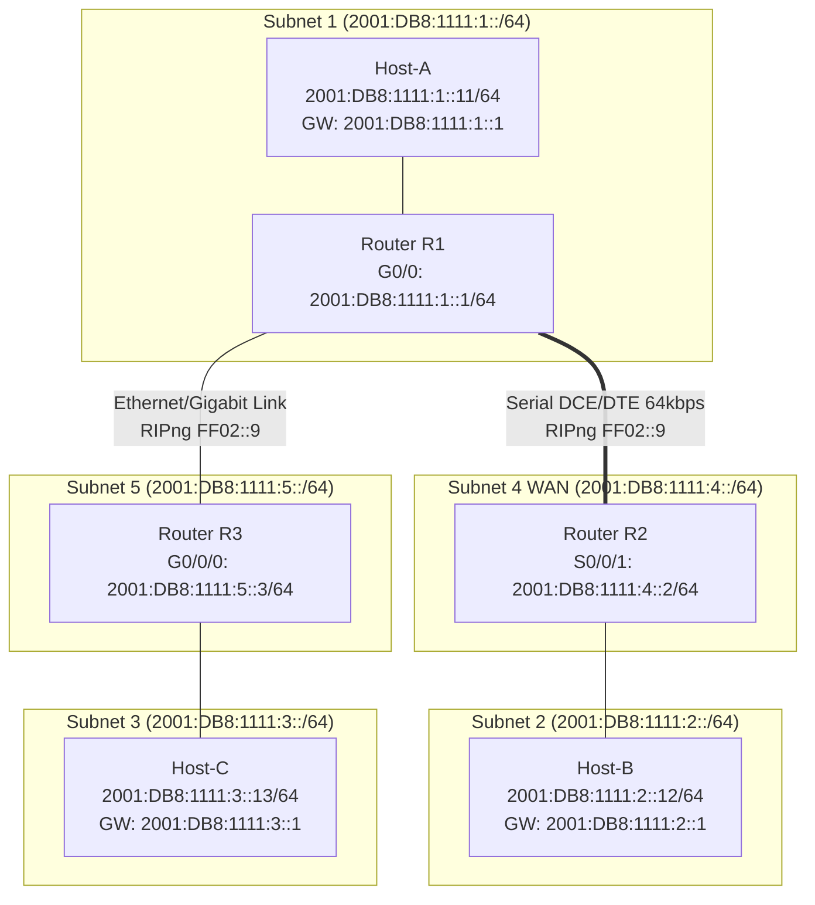

# EXPERIMENT 17: IPv6 Routing using RIPng — Cisco Packet Tracer Practical Guide

**Course Code:** PCCSL507 — Networks Lab  
**Course Type:** Practical / Lab (Cisco Packet Tracer Based)  
**Semester:** S5 (Computer Science & Engineering)  

---

## 1. OBJECTIVE & SYLLABUS REQUIREMENTS

According to the KTU PCCSL507 syllabus:
> **Experiment 17:**  
> *Figure 3 shows an IPv6-based network. Interconnect the different subnets using RIPng.*

---

## 2. IPV6 NETWORK TOPOLOGY (FIGURE 3 FROM SYLLABUS)

### Topology Diagram (ASCII)
```text
  [Subnet 1: 2001:DB8:1111:1::/64]                                        [Subnet 2: 2001:DB8:1111:2::/64]
           [ Host-A ]                                                                  [ Host-B ]
       2001:DB8:1111:1::11                                                         2001:DB8:1111:2::12
               |                                                                           |
             (LAN)                                                                       (LAN)
               |                                                                           |
             G0/0: ::1                     [Subnet 4: 2001:DB8:1111:4::/64]              G0/0: ::1
        +--------------+                      WAN Serial Link (S0/0/0 to S0/0/1)    +--------------+
        |   ROUTER 1   | S0/0/0: ::1 (DCE) ------------------------ S0/0/1: ::2 |   ROUTER 2   |
        |     (R1)     |                                                            |     (R2)     |
        +--------------+                                                            +--------------+
             G0/1/0: ::1
               |
               |  [Subnet 5: 2001:DB8:1111:5::/64]
               |  Gigabit/Ethernet Link (G0/1/0 to G0/0/0)
               |
        +--------------+
        |   ROUTER 3   | G0/0/0: ::3
        |     (R3)     |
        +--------------+
             G0/0: ::1
               |
             (LAN)
               |
           [ Host-C ]
       2001:DB8:1111:3::13
  [Subnet 3: 2001:DB8:1111:3::/64]
```

### Mermaid Topology Diagram


---

## 3. IPV6 ADDRESSING & INTERFACE ALLOCATION TABLE

| Device | Interface | IPv6 Address / Prefix | IPv6 Default Gateway | Description |
| :--- | :--- | :--- | :--- | :--- |
| **Host-A** | `FastEthernet0` | `2001:DB8:1111:1::11/64` | `2001:DB8:1111:1::1` | End-Host on Subnet 1 |
| **Host-B** | `FastEthernet0` | `2001:DB8:1111:2::12/64` | `2001:DB8:1111:2::1` | End-Host on Subnet 2 |
| **Host-C** | `FastEthernet0` | `2001:DB8:1111:3::13/64` | `2001:DB8:1111:3::1` | End-Host on Subnet 3 |
| **Router R1** | `GigabitEthernet0/0` | `2001:DB8:1111:1::1/64` | N/A | LAN Gateway for Subnet 1 |
| | `Serial0/0/0` | `2001:DB8:1111:4::1/64` | N/A | WAN to R2 (DCE, Clock 64000) |
| | `GigabitEthernet0/1` | `2001:DB8:1111:5::1/64` | N/A | Link to R3 |
| **Router R2** | `Serial0/0/1` | `2001:DB8:1111:4::2/64` | N/A | WAN from R1 (DTE) |
| | `GigabitEthernet0/0` | `2001:DB8:1111:2::1/64` | N/A | LAN Gateway for Subnet 2 |
| **Router R3** | `GigabitEthernet0/0` | `2001:DB8:1111:5::3/64` | N/A | Link from R1 |
| | `GigabitEthernet0/1` | `2001:DB8:1111:3::1/64` | N/A | LAN Gateway for Subnet 3 |

---

## 4. RIPng PROTOCOL FUNDAMENTALS

RIPng (Routing Information Protocol next generation, **RFC 2080**) adapts distance-vector routing for IPv6:
1. **Metric:** Hop count (maximum 15 hops; 16 hops = unreachable).
2. **Administrative Distance:** 120.
3. **Transport:** Runs over **UDP port 521** (IPv4 RIP uses UDP port 520).
4. **Multicast Group:** Multicasts routing updates to the link-local scope multicast address **`FF02::9`** (All RIPng Routers).
5. **No `network` command:** Unlike IPv4 RIP, RIPng is enabled directly under interface configuration mode:
   ```text
   Router(config-if)# ipv6 rip <process-name> enable
   ```
6. **IPv6 Routing Activation:** By default, IPv6 packet forwarding is disabled on Cisco routers. It must be enabled globally using:
   ```text
   Router(config)# ipv6 unicast-routing
   ```

---

## 5. STEP-BY-STEP CISCO PACKET TRACER SETUP

### Step 5.1: Device Selection & Physical Cabling
1. Drag 3 × **Cisco 1941** (or 2811 / 2911) routers onto the workspace (`R1`, `R2`, `R3`).
2. Add serial cards:
   - Power off `R1` and `R2`, drag **HWIC-2T** (or WIC-2T) modules into `Slot 0`, power on.
3. Drag 3 × **PC-PT** (`Host-A`, `Host-B`, `Host-C`).
4. Cabling:
   - `Host-A` to `R1`: Copper Straight-Through cable (`Fa0` to `G0/0`).
   - `R1` to `R2`: Red **Serial DCE Cable** (`Se0/0/0` on R1 to `Se0/0/1` on R2).
   - `R1` to `R3`: Copper Crossover Cable (`G0/1` on R1 to `G0/0` on R3).
   - `R2` to `Host-B`: Copper Straight-Through cable (`G0/0` to `Fa0`).
   - `R3` to `Host-C`: Copper Straight-Through cable (`G0/1` to `Fa0`).

---

## 6. CISCO ROUTER CLI CONFIGURATIONS

### 6.1 Router R1 Configuration
```text
Router> enable
Router# configure terminal
Router(config)# hostname R1

! 1. Enable IPv6 Routing Globally
R1(config)# ipv6 unicast-routing

! 2. Initialize RIPng Routing Process (Named 'CISCO_RIP')
R1(config)# ipv6 router rip CISCO_RIP
R1(config-rtr)# exit

! 3. Configure LAN Interface (Subnet 1) & Enable RIPng
R1(config)# interface GigabitEthernet0/0
R1(config-if)# ipv6 address 2001:DB8:1111:1::1/64
R1(config-if)# ipv6 rip CISCO_RIP enable
R1(config-if)# no shutdown
R1(config-if)# exit

! 4. Configure WAN Interface to R2 (Subnet 4) & Enable RIPng
R1(config)# interface Serial0/0/0
R1(config-if)# ipv6 address 2001:DB8:1111:4::1/64
R1(config-if)# clock rate 64000
R1(config-if)# ipv6 rip CISCO_RIP enable
R1(config-if)# no shutdown
R1(config-if)# exit

! 5. Configure Link to R3 (Subnet 5) & Enable RIPng
R1(config)# interface GigabitEthernet0/1
R1(config-if)# ipv6 address 2001:DB8:1111:5::1/64
R1(config-if)# ipv6 rip CISCO_RIP enable
R1(config-if)# no shutdown
R1(config-if)# end
R1# copy running-config startup-config
```

### 6.2 Router R2 Configuration
```text
Router> enable
Router# configure terminal
Router(config)# hostname R2

! 1. Enable IPv6 Routing Globally
R2(config)# ipv6 unicast-routing

! 2. Initialize RIPng Process
R2(config)# ipv6 router rip CISCO_RIP
R2(config-rtr)# exit

! 3. Configure WAN Interface from R1 (Subnet 4) & Enable RIPng
R2(config)# interface Serial0/0/1
R2(config-if)# ipv6 address 2001:DB8:1111:4::2/64
R2(config-if)# ipv6 rip CISCO_RIP enable
R2(config-if)# no shutdown
R2(config-if)# exit

! 4. Configure LAN Interface (Subnet 2) & Enable RIPng
R2(config)# interface GigabitEthernet0/0
R2(config-if)# ipv6 address 2001:DB8:1111:2::1/64
R2(config-if)# ipv6 rip CISCO_RIP enable
R2(config-if)# no shutdown
R2(config-if)# end
R2# copy running-config startup-config
```

### 6.3 Router R3 Configuration
```text
Router> enable
Router# configure terminal
Router(config)# hostname R3

! 1. Enable IPv6 Routing Globally
R3(config)# ipv6 unicast-routing

! 2. Initialize RIPng Process
R3(config)# ipv6 router rip CISCO_RIP
R3(config-rtr)# exit

! 3. Configure Link from R1 (Subnet 5) & Enable RIPng
R3(config)# interface GigabitEthernet0/0
R3(config-if)# ipv6 address 2001:DB8:1111:5::3/64
R3(config-if)# ipv6 rip CISCO_RIP enable
R3(config-if)# no shutdown
R3(config-if)# exit

! 4. Configure LAN Interface (Subnet 3) & Enable RIPng
R3(config)# interface GigabitEthernet0/1
R3(config-if)# ipv6 address 2001:DB8:1111:3::1/64
R3(config-if)# ipv6 rip CISCO_RIP enable
R3(config-if)# no shutdown
R3(config-if)# end
R3# copy running-config startup-config
```

---

## 7. HOST (PC) IPV6 CONFIGURATION

### Host-A:
- Click **Host-A** $\rightarrow$ **Desktop** $\rightarrow$ **IP Configuration**.
- Under **IPv6 Configuration**:
  - **IPv6 Address:** `2001:DB8:1111:1::11/64`
  - **IPv6 Gateway:** `2001:DB8:1111:1::1`

### Host-B:
- **IPv6 Address:** `2001:DB8:1111:2::12/64`
- **IPv6 Gateway:** `2001:DB8:1111:2::1`

### Host-C:
- **IPv6 Address:** `2001:DB8:1111:3::13/64`
- **IPv6 Gateway:** `2001:DB8:1111:3::1`

---

## 8. VERIFICATION & SHOW COMMANDS

### 8.1 Verifying IPv6 Routing Table (`show ipv6 route`)
Execute on Router **R2**:
```text
R2# show ipv6 route

IPv6 Routing Table - 7 entries
Codes: C - Connected, L - Local, S - Static, R - RIP, B - BGP
       U - Per-user Static route, M - MIPv6

R   2001:DB8:1111:1::/64 [120/2]
     via FE80::201:97FF:FE28:1A01, Serial0/0/1
C   2001:DB8:1111:2::/64 [0/0]
     via GigabitEthernet0/0, directly connected
L   2001:DB8:1111:2::1/128 [0/0]
     via GigabitEthernet0/0, receive
R   2001:DB8:1111:3::/64 [120/3]
     via FE80::201:97FF:FE28:1A01, Serial0/0/1
C   2001:DB8:1111:4::/64 [0/0]
     via Serial0/0/1, directly connected
L   2001:DB8:1111:4::2/128 [0/0]
     via Serial0/0/1, receive
R   2001:DB8:1111:5::/64 [120/2]
     via FE80::201:97FF:FE28:1A01, Serial0/0/1
```
> **Key Observations:**
> 1. RIP routes are flagged with **`R`**.
> 2. Administrative Distance is **120**.
> 3. Subnet 1 has a hop metric of **2** (`[120/2]`).
> 4. Subnet 3 has a hop metric of **3** (`[120/3]`).
> 5. The next-hop is the neighbor's link-local IPv6 address starting with `FE80::`.

### 8.2 Verifying RIPng Process Parameters (`show ipv6 rip`)
Execute on Router **R1**:
```text
R1# show ipv6 rip
RIP process "CISCO_RIP", port 521, multicast-group FF02::9, pid 39
     Administrative distance is 120. Maximum paths is 16
     Updates every 30 seconds, expire after 180
     Holddown lasts 0 seconds, garbage collect after 120
     Split horizon is on; poison reverse is on
     Default routes are not generated
     Periodic updates 14, trigger updates 2
  Interfaces:
    GigabitEthernet0/0
    Serial0/0/0
    GigabitEthernet0/1
  Redistribution:
    None
```

### 8.3 End-to-End IPv6 Ping Tests
Open **Host-A** Command Prompt:

#### Ping to Host-B (`2001:DB8:1111:2::12`):
```cmd
C:\> ping 2001:DB8:1111:2::12

Pinging 2001:DB8:1111:2::12 with 32 bytes of data:
Reply from 2001:DB8:1111:2::12: time=7ms
Reply from 2001:DB8:1111:2::12: time=6ms
Reply from 2001:DB8:1111:2::12: time=6ms
Reply from 2001:DB8:1111:2::12: time=7ms

Ping statistics for 2001:DB8:1111:2::12:
    Packets: Sent = 4, Received = 4, Lost = 0 (0% loss)
```

#### Ping to Host-C (`2001:DB8:1111:3::13`):
```cmd
C:\> ping 2001:DB8:1111:3::13

Pinging 2001:DB8:1111:3::13 with 32 bytes of data:
Reply from 2001:DB8:1111:3::13: time=8ms
Reply from 2001:DB8:1111:3::13: time=7ms
Reply from 2001:DB8:1111:3::13: time=7ms
Reply from 2001:DB8:1111:3::13: time=8ms

Ping statistics for 2001:DB8:1111:3::13:
    Packets: Sent = 4, Received = 4, Lost = 0 (0% loss)
```

#### Trace Route from Host-A to Host-C:
```cmd
C:\> tracert 2001:DB8:1111:3::13

Tracing route to 2001:DB8:1111:3::13 over a maximum of 30 hops:

  1   <1 ms    2001:DB8:1111:1::1   (Router R1)
  2    4 ms    2001:DB8:1111:5::3   (Router R3)
  3    6 ms    2001:DB8:1111:3::13  (Host-C)

Trace complete.
```

---

## 9. 🎥 VERIFIED VIDEO GUIDES & TUTORIALS

| Video Title | Channel / Creator | Direct YouTube Link | Key Concepts |
| :--- | :--- | :--- | :--- |
| **Packet Tracer: Configuring RIPng (7.3.2.3)** | CCNA Lab Walkthroughs | [Watch on YouTube](https://www.youtube.com/watch?v=kYJzXv-i2_E) | `ipv6 unicast-routing`, interface-level `ipv6 rip enable`, link-local next-hops. |
| **IPv6 Routing Protocols - RIPng Tutorial** | CBT Nuggets / Keith Barker | [Watch on YouTube](https://www.youtube.com/watch?v=J_7s5E12p3g) | Multicast `FF02::9`, UDP 521, comparing RIPv2 vs RIPng, examining routing tables. |
| **IPv6 RIPng Configuration in Cisco Packet Tracer** | Tech Academia | [Watch on YouTube](https://www.youtube.com/watch?v=OU-A2EmVrKQ) | Step-by-step multi-router IPv6 setup, configuring PCs with IPv6, ping tests. |
